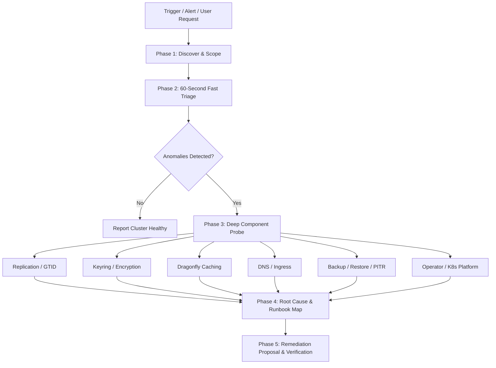

# Bloodraven Doctor (`bloodraven-doctor`)

`bloodraven-doctor` provides systematic, non-destructive diagnosis and actionable remediation for Bloodraven MySQL clusters running in Kubernetes environments.

When an operator or developer encounters issues with a cluster, replication, failover, backup, encryption, or Dragonfly caching, follow this structured runbook.

---

## Safety & Non-Destructive Operation Rules

1. **Read-Only First**: Initial triage and diagnostics MUST ONLY query cluster state, metrics, logs, and sidecar endpoints. Do NOT modify CRDs, trigger promotions, restart pods, or wipe PVCs during investigation without explicit user approval.
2. **First-Party Tools**: Use `kubectl bloodraven <command>` (the official day-2 plugin) wherever applicable (`status`, `promote`, `reclone`, `backup`, `verify-backup`).
3. **Transparent Remediation**: Before executing any state-changing command:
   - State the **Root Cause**.
   - State the **Blast Radius & Downtime Impact**.
   - State the **Data Loss Risk (RPO / RTO)**.
   - Present the exact command and seek user confirmation.
4. **Dynamic Container Resolution**: Never assume fixed container names (e.g. `sidecar` vs `bloodraven-sidecar`). Always discover container names dynamically from `.spec.containers[*].name`. Helper scripts in `scripts/` handle this automatically.

---

## Systematic Diagnostic Workflow



### Phase 1: Discover & Scope

1. Identify the target namespace and `MySQLFailoverGroup` (MFG):
   ```bash
   kubectl get mysqlfailovergroups.shipstream.io -A
   ```
2. If multiple groups exist and the user didn't specify one, ask or list the options.

### Phase 2: The 60-Second Fast Triage

Run the bundled triage script or execute the baseline inspection:

```bash
# Option A: Run the bundled non-destructive triage script
./.agents/skills/bloodraven-doctor/scripts/triage.sh -n <namespace> <group-name>

# Option B: Run native kubectl bloodraven status
kubectl bloodraven status <group-name> -n <namespace>
```

Check the core conditions and status fields:
- `.status.activeSite`: Is there an active primary site?
- `.status.topologyGeneration`: Has authoritative topology changed since the deployment's grant or the start of this investigation? This is durable across restarts, not the CR generation.
- `.status.plannedFailover`: `Deferred/DeploymentHold` normally means a live deployment hold, not a failed promotion. Inspect `retryAfter` and the message's operation ID and instance. If it remains deferred past expiry, check operator logs for Lease persistence errors.
- `.status.conditions`:
  - `Ready == True`?
  - `Bootstrapping == False`?
  - `RecoveryInProgress == False`?
  - `RecoveryBlocked == False`?
- Pod status: `kubectl get pods -n <namespace> -l app.kubernetes.io/instance=<group-name>`
- Recent events: `kubectl get events -n <namespace> --sort-by=.lastTimestamp`

---

## Phase 3: Deep Component Probes & Symptom Trees

Consult [references/troubleshooting_playbooks.md](./references/troubleshooting_playbooks.md) for step-by-step diagnostic trees.

### 1. Topology & Split-Brain Triage
- **Symptom**: `NoPrimary` (both sites read-only) or multiple sites accepting writes (`read_only=OFF`).
- **Probe**:
  ```bash
  # Check read_only state on all sites
  kubectl get mfg <group-name> -n <namespace> -o jsonpath='{range .status.sites[*]}{.name}{": readOnly="}{.readOnly}{", reachable="}{.reachable}{", role="}{.role}{"\n"}{end}'
  ```
- **Action**: Refer to [Split-Brain Recovery Playbook](./references/troubleshooting_playbooks.md#split-brain--dual-writable-recovery).

### 2. Replication & GTID Divergence
- **Symptom**: High replication lag, `SecondsBehindSource > 0`, replication stopped, or `DivergentTransactionsDetected`.
- **Probe**:
  ```bash
  # Run GTID audit script
  ./.agents/skills/bloodraven-doctor/scripts/gtid-audit.sh -n <namespace> <group-name>
  ```
- **Action**:
  - If replica simply stopped or lagged due to network, restart replication or wait for sync.
  - If GTIDs diverged (errant transactions on old primary): execute safe reclone:
    ```bash
    kubectl bloodraven reclone <group-name> -n <namespace> --target=<divergent-site>
    ```

### 3. Keyring & Data-at-Rest Encryption
- **Symptom**: `KeyringNotSealed`, `KeyringEscrowMissing`, or `KeyringEscrowCorrupt`.
- **Probe**:
  ```bash
  # Probe sidecar keyring status
  ./.agents/skills/bloodraven-doctor/scripts/sidecar-probe.sh -n <namespace> <group-name> keyring
  ```
- **CRITICAL SAFETY RULE**: If `KeyringEscrowMissing` or `KeyringEscrowCorrupt` is detected on a sealed pod, **DO NOT delete, restart, or reschedule the pod**. Recover the escrow Secret first.

### 4. Dragonfly Cache & Session Degradation
- **Symptom**: `status.dragonfly.phase=Degraded`, `DragonflyPromotionFailed`, or active cache service has no endpoints.
- **Probe**:
  ```bash
  kubectl get mfg <group-name> -n <namespace> -o jsonpath='{.status.dragonfly}{"\n"}'
  kubectl get endpoints <group-name>-dragonfly -n <namespace>
  ```
- **Emergency promotion**: Dragonfly follows a MySQL emergency failover in the background. The MySQL failover only queues the request; the group's Dragonfly manager runs it between its polls.
  - `dragonfly emergency: ... (sessions lost)` means the cache was promoted empty via `REPLICAOF NO ONE`. That happens when the takeover failed, or was skipped because the old master was unreachable.
  - `REPLICAOF NO ONE failed` or `re-dial for REPLICAOF NO ONE failed` is an unconfirmed attempt, not the outcome. The operator waits for the commands to settle (about 13s after a takeover), reads the target's role, and logs the result: `promotion outcome unconfirmed; target observed as master` (recorded as promoted, sessions may be lost) or `promotion failed; target not observed as master` (old source's traffic label restored). Report from that line, not from the earlier failure.
  - `dragonfly promotion: request coalesced`, `manager stopping; request dropped`, `yielding to another owner; skipping`, `planned failover in flight; skipping` and `target already promoted since the request; skipping` are normal: a newer request, a stopping manager, a waiting planned failover or rollout, or an earlier promotion made this one unnecessary. If MySQL and Dragonfly still disagree, the manager's next poll promotes.
  - A fallback can legitimately take up to about 14s, and an unconfirmed outcome up to about 13s more.
  - `dragonfly gate busy; retrying` on a planned failover, rollout or snapshot upgrade means the Dragonfly manager (or a stopping manager's last step) held the group's Dragonfly gate; it requeues in 1s and is not stuck unless it repeats for minutes. A planned failover waiting this way also emits Warning `DragonflyPromotionWaiting` and sets `status.plannedFailover.dragonfly.message`: MySQL writes stay paused until the in-progress promotion finishes (about 12-13s typically, about 40s worst case).
  - `dragonfly promotion: request superseded by a newer decision; skipping` is normal after a quick failback or planned failover. A snapshot upgrade `Failed` with reason `ActiveSiteChanged` was abandoned because a promotion moved the Dragonfly master; re-run it against the new active site.
- **Action**: Refer to [Dragonfly Degraded Playbook](./references/troubleshooting_playbooks.md#dragonfly-degradation).

### 5. Backups, PITR Archiver & Verification
- **Symptom**: `BloodravenBackupStale`, failed backup Job, or stale backup verification.
- **Encrypted PITR startup failure**: `failed to init archive store` with `permission denied` for the passphrase file means the sidecar cannot start HTTP or fencing. Check previous sidecar logs and the pod's `pitr-passphrase` Secret projection mode. It must be `0444` for a non-root sidecar without fsGroup, matching PITR S3 credentials. See [playbook 25](./references/troubleshooting_playbooks.md#25-encrypted-pitr-sidecar-fails-to-init-archive-store).
- **PITR encryption drift or incompatible archive**: encryption settings and selected passphrase bytes trigger ordered updates in both credential modes. After a change, compare the desired reference/key with the rendered sidecar mount and rollout state; a manifest-read/authentication error can mean the existing archive uses the old encryption settings. Preserve the old passphrase and archive; rollout does not migrate them. See [playbook 26](./references/troubleshooting_playbooks.md#26-pitr-archival-stops-after-an-encryption-change).
- **PITR after reclone or rebuild**: `backlogFiles=0` alone does not prove historical coverage. New manifest rows distinguish reused names with content IDs (keyed for encrypted profiles); legacy rows retain plain keys with persisted verified `contentId`. Surviving rollback-stripped IDs are recovered only from exact confined object keys. History work yields between rotations; no full-file scratch space is required. Inspect divergent/missing-file `lastError`, durable `divergent`/`quarantined`/`acknowledged` records and `epoch.resetReason`; use the reversible `bloodraven pitr-quarantine` procedure with a verified canonical backup. GTID reuse needs verified conflicting issuance, not upload order. Bootstrap/clone observations do not establish divergence; eligible audits clear recovered foreign-source flags, but known loss from the current server UUID requires verified or explicit canonical recovery because replacement bytes may still be active. Legacy issuance verification runs independently of retention. An obsolete guard can be acknowledged after a canonical backup covers every active stream and overlapping issuance is verified; this removes no rows or older recovery windows. Quarantine bounds apply only to windows needing excluded rows. Prefer a new prefix/full backup after RESET. Check retained history and reader/writer compatibility before calling recovery complete. See [playbook 27](./references/troubleshooting_playbooks.md#27-pitr-history-after-a-site-reclone-or-data-rebuild).
- **Retention deferred**: deletion needs content-bound complete binlog GTIDs covered by every retained group backup's pre-dump `status.gtidExecuted`, across profiles. In-flight group backups pause new retirements. `noRetainedBackups` and `backupInFlight` are normal Info waits; missing metadata, unsupported files, or version skew retain objects. Backfill is bounded and persists IDs/proofs together. Normal progress logs at Info; failed coverage identities wait the normal interval while other backfill can progress. Unresolved issuance can pause all new retirements for the site. Its failure stays in lastError during cooldown, and retention deferred logs archiveIssuanceUnverified at Warn with the row/error and repair/quarantine remedy; monitor archive capacity until resolved. Cutoff throttling follows source IP, so check direct Service routing and shared-NAT callers on a Warn lookup failure. The support bundle captures projected backup bounds in `backups.json`. See [playbook 28](./references/troubleshooting_playbooks.md#28-pitr-retention-deferred-because-gtid-coverage-is-unknown).
- **Retention cleanup retry**: `retention: delete object` and `retention: save delete acknowledgements` preserve durable pending records in the manifest's `pruned` list. Approved deletes retry even without a new operator proof; restores select only live `files`. See [playbook 29](./references/troubleshooting_playbooks.md#29-retention-object-deletion-or-acknowledgement-keeps-failing).
- **Retired local binlogs**: matching retired content stays out of upload/backlog after restart; different bytes reusing the filename still archive. Every running site maintains its own archive, including replicas. Acknowledged records remain until the filename leaves a readable local index and the file is absent; pending records are never compacted. See [playbook 30](./references/troubleshooting_playbooks.md#30-retired-local-binlogs-or-growing-retirement-metadata).
- **Probe**:
  ```bash
  kubectl get mysqlbackups.shipstream.io -n <namespace> --sort-by=.metadata.creationTimestamp
  kubectl get mysqlbackupverifications.shipstream.io -n <namespace>
  kubectl get mysqlfailovergroup <group-name> -n <namespace> \
    -o jsonpath='{.status.conditions[?(@.type=="S3CredentialsReady")]}'
  ```
  `S3CredentialsReady=False` means an S3 `credentialsSecret` lacks `AWS_ACCESS_KEY_ID` or `AWS_SECRET_ACCESS_KEY`; Jobs fail instead of using ambient credentials. Fix the Secret before re-running anything.
- **MySQL authentication**: If backup or restore reports `Access denied` while the operator connects successfully, check whether the Job script predates the exact-content credential reader. Older scripts strip password whitespace and normalize CRLF, including newlines intentionally stored by `--from-file`. Fixed scripts preserve mounted MySQL credentials and honor an empty password file over environment fallback. Follow the [credential playbook](./references/troubleshooting_playbooks.md#12-backup-or-restore-reports-access-denied-with-valid-credentials); do not print or collect password contents.
- **Artifact identity**: If a successful backup cannot be found by restore, verification, or cleanup, compare `status.location` with the original Job's main-container output/storage env. Account for one kubelet expansion when comparing env values; consumer Jobs escape literal dollars while status keeps the actual path. Legacy records without a metadata condition retain their producer-reported locations. Older completion encoding corrupted underscores and could not distinguish them from spaces. New dump and sanity sentinels use versioned percent encoding (`v=2`). Never repair old locations by globally substituting spaces or underscores; follow the [location playbook](./references/troubleshooting_playbooks.md#13-succeeded-backup-cannot-be-found-at-its-recorded-location).
- **Completion metadata**: `MetadataComplete=False` with `SentinelUnavailable` or `SentinelMissing` can accompany a usable Succeeded backup: the destination came from the owned Job, but optional size/GTID/binlog observations may be absent. Transient reads retry every 15 seconds for ten minutes after completion, including after restart. The operator also repairs historical missing or underscore-damaged locations from owned Jobs before cleanup. `DestinationUnavailable` means `Ready=False` and needs investigation. Use the [metadata playbook](./references/troubleshooting_playbooks.md#14-backup-completed-with-incomplete-metadata); helpers project public backup/Job fields without collecting Secret contents.
- **Scheduled retries**: Inspect the failed run's own UID, `shipstream.io/backup-retry-of` successors, root UID and `shipstream.io/backup-attempt` annotation. Earlier runs' higher attempt counters do not suppress the current chain. Launch metadata survives a lost status patch; the backup reconciler restores `status.attempt`. New retry names contain a predecessor UID hash and attempt. `status.backupSchedules[].retryConflict` identifies a blocking object; unchanged conflicts do not repeat warnings across reconciles or restarts. Follow the [retry playbook](./references/troubleshooting_playbooks.md#15-scheduled-backup-fails-without-the-expected-retry); keep retained history for diagnosis.
- **Verification identity**: Latest selection happens once. Compare `status.backupRef` name/UID/location/storage with the Job's immutable pod-template `shipstream.io/verification-backup` snapshot and original source env (decrypt prefix for encrypted sources). Newer backups and removed launch inputs do not retarget a running Job. A pre-launch UID replacement fails `BackupNotAvailable`; an unprovable or mismatched running identity fails `BackupIdentityMismatch`. Follow the [verification-source playbook](./references/troubleshooting_playbooks.md#16-verification-source-does-not-match-the-expected-backup); helpers project only public identity/input fields.
- **Encryption attribution**: A restore or verification reporting `missing BRV1 magic` after profile encryption was enabled may refer to an older plaintext Job incorrectly marked encrypted. Compare the backup's status with its producing Job's `shipstream.io/backup-encrypted` label and `backup-encrypt-upload` container, including `BLOODRAVEN_ENCRYPTION_ALGORITHM`. The fixed operator repairs completed records while their owned Job exists and emits `EncryptionAttributionCorrected`; it preserves attribution if the Job is gone. Follow the [attribution playbook](./references/troubleshooting_playbooks.md#11-restore-or-verification-reports-missing-brv1-magic). Do not enable plaintext fallback to bypass an unexplained mismatch or expose passphrase contents.
- **Action**: Trigger on-demand backup or verification:
  ```bash
  kubectl bloodraven backup <group-name> -n <namespace>
  kubectl bloodraven verify-backup <group-name> -n <namespace>
  ```
- **After a full-instance in-place restore**: `status.restoreReclones.pending` lists the peers not yet recloned from the restored primary. They are excluded from automatic promotion and removed from the `-replica` and read-only Services until their clone succeeds. See [playbook 20](./references/troubleshooting_playbooks.md#20-peers-not-yet-recloned-after-a-full-instance-in-place-restore).

### 6. DNS & Application Traffic
- **Symptom**: App writes hitting wrong site, DNS records not updating after failover, or a hostname rename that never reached DNS.
- **Probe**:
  ```bash
  kubectl get mysqlfailovergroup <group> -n <namespace> -o jsonpath='{.spec.dns}{"\n"}'
  kubectl get dnsendpoint -n <namespace> -o jsonpath='{range .items[*]}{.metadata.name}{" "}{.spec.endpoints[0].dnsName}{" -> "}{.spec.endpoints[0].targets[0]}{" ttl="}{.spec.endpoints[0].recordTTL}{"\n"}{end}'
  kubectl logs -n external-dns deploy/external-dns --tail=100
  ```
- **Hostname mismatch**: if `DNSEndpoint.spec.endpoints[0].dnsName` != `spec.dns.hostname`, the operator is not applying the live spec (RBAC/apply failure, or an unpatched operator that cached the name at start). Check operator logs for `DNS reconcile failed` / `DNS reconciled to active site` (`hostname` field). Restarting the operator is only a workaround on versions before the live-spec fix.

---

### 7. Deployment coordination and self-fencing

Run `bash ./.agents/skills/bloodraven-doctor/scripts/deployment-probe.sh <namespace> <group>` for topology, authorized database clients, and projected public fields from durable `coordination.k8s.io/Lease` records. Requires `jq` and read access to MFGs, MysqlDatabases, and Leases. The helper never requests Secrets or outputs lease token hashes. `triage.sh` and `support-bundle.sh` include it. Do not collect raw Lease annotations or request headers.

The optional `/deploy/v1` API runs only on the escrow TLS listener, default `8443`; never use plaintext `8082` or disable certificate checks. It uses projected ServiceAccount TokenReview (audience `bloodraven-deploy` by default) and `MysqlDatabase.spec.deploymentClients`. A `401` is authentication failure; a non-disclosing `403 forbidden` is authorization failure. Compare caller namespace and ServiceAccount with the database assigned to the path group; `instance` is the database CR name. Do not mint a token or impersonate an identity without approval.

For timeouts, inspect `auxiliary.deployAPI.enabled`, `auxiliary.escrowTLS.enabled/existingSecret`, Service endpoints, certificate trust/SANs, and NetworkPolicy. Deployment ingress requires pod label `bloodraven.shipstream.io/deploy-client=true` AND namespace label `shipstream.io/mysql-client=true`. The chart intentionally preserves managed MySQL escrow ingress and metrics/probes/auxiliary ports; custom escrow peers may need `auxiliary.deployAPI.networkPolicy.additionalIngress`.

Renewal `404/409` or a changed topology generation means the deployment must stop; post-DDL uncertainty is manual recovery, never automatic migration retry. A same-operation POST is a mutating idempotent re-grant that rotates the token because storage is hash-only. Never call POST/PUT/DELETE as a diagnostic probe. Leases survive operator restart. Planned failover, ordered update, and restore-in-place defer behind a hold; emergency failover and fencing do not. The approved revoke annotation is `bloodraven.shipstream.io/revoke-deployment-leases=true`, producing `operator_revoked`; request explicit approval and coordinate with all deployment owners before using it. Never delete the leader-election Lease or reset topology generation.

`spec.leaseDurationSeconds: Invalid value: 0: must be greater than 0` in housekeeping or hold checks identifies the deployment Lease persistence bug, not a TLS failure or a renewed hold. See the [invalid Lease duration playbook](./references/troubleshooting_playbooks.md#invalid-lease-duration-blocks-expiry). Propose an approved rollout of the positive-duration fix, preserving records and coordinating queued maintenance; restarting the affected binary, deleting Leases, or requesting revocation does not safely remedy the bug. Fixed records use a duration of at least one second, but annotation state and exact expiry still govern authority with no added grace period. The existing deployment probe already projects these authoritative fields without hashes.

Probe self-fencing using `sidecar-probe.sh ... fencing` (`/status`, field `self_fenced`) and `sidecar-probe.sh ... peer` (`/peer/active-site`). There is no `/fencing` endpoint. `self_fenced` is scoped to the current sidecar process; an empty or false value is not proof that MySQL is writable. With a 60s DNS TTL require `max(configured leaseTimeout, 3s, 3 * effective peerCheckInterval) < 60s`; the peer interval itself is clamped to at least 1s. Defaults 20s/5s produce 20s. Actual fence completion also includes polling, probe, scheduling, and SQL time, so verify margin under faults. Deployment holds never delay this self-fence.

Sidecar probes are split. Liveness probes `/peer/ping`, which never touches MySQL, so a hung or restarting `mysqld` should leave the sidecar running and its pod **unready**, not restarting. Readiness probes `/health`, which checks MySQL within 2s against a 3s probe timeout. `sidecar-probe.sh ... livez` reads `/livez`, which reports `fencingMonitor.secondsSinceProgress` against `stallThresholdSeconds`. A 503 there means the fencing loop is wedged; collect logs before anyone restarts the container. If the sidecar restarts repeatedly while MySQL is stalled, check the rendered probe path (`kubectl get deploy <deploy> -o jsonpath='{.spec.template.spec.containers[?(@.name=="sidecar")].livenessProbe}'`). A path of `/health` means the operator predates the fix. After a stall, grep sidecar logs for `msg` starting `safety net:`. `could not set initial super_read_only; the fencing monitor will retry` and `MySQL was unreachable long enough to have restarted; re-arming` mean the monitor still has to fence the instance unless the operator confirms the site. `set super_read_only=ON after MySQL became reachable` or `super_read_only=ON confirmed; staying fenced` means that check completed. See [playbook 8](./references/troubleshooting_playbooks.md#8-sidecar-restarting-unready-or-not-fencing-during-a-mysql-stall).

Correlate `DeploymentLeaseRevoked`, `PlannedFailoverDeferred`, lease active/age/revocation/expiry metrics, and `bloodraven_planned_failovers_deferred_total`. Filter request logs on `msg="deploy api"` with `handler, group, instance, namespace, operationId, status, duration_ms`; `duration_ms` is a deliberate exception to camelCase. Keep deployment IDs out of metric labels and all tokens out of bundles.

---

### 7b. Ordered update not finishing on the active site

`maintenance handoff refused; source not fenced` (before any write pause, usually a lagging standby) or `maintenance handoff aborted; source unfenced` (after the fence) in the operator log means an `OrderedUpdate` refused to promote a standby that could not be proven to hold every transaction committed on the active site. The active site was unfenced and keeps serving, and the rollout retries later. The `error` field says why: the standby is lagging, its applier failed, or a GTID set was unreadable. An ERROR `maintenance handoff: rollback failed: source may be left read-only` needs immediate attention. See [playbook 23](./references/troubleshooting_playbooks.md#23-ordered-update-stalls-on-the-active-site-maintenance-handoff-aborted).

### 7c. One group frozen while the operator is healthy

If one group's status stops changing and the operator logs `failed to start topology manager` for it, that group has no running topology manager: no polling, no status writes, no failover. The error names the Secret to fix, and the runner retries every 30s. A WARN `connection material unreadable; keeping the running topology manager` means a Secret is being replaced and the existing manager is still running. See [playbook 24](./references/troubleshooting_playbooks.md#24-one-group-stopped-updating-no-running-topology-manager).

### 8. Tenant database pending, adoption refused or account cleanup skipped

- **Symptom**: a `MysqlDatabase` is `Failed` with `reason` `DatabasePreExists`, `PreExistingOwnerUser`, `PreExistingUser`, `UserClaimedBySibling`, `OwnerUserReserved`, `UserReserved`, `DatabaseNameConflict`, `OwnerConflict`, or `GrantUserMissing`; or a delete left an account behind with `OwnerUserDropSkipped` / `UserDropSkipped` / `OwnerUserReservedSkipped` / `UserReservedSkipped` / `UserTransferred`.
- **Probe** (status only — never read the tenant Secrets):
  ```bash
  kubectl get mysqldatabases.shipstream.io -n <namespace> -o custom-columns=\
  'NAME:.metadata.name,PHASE:.status.phase,REASON:.status.conditions[?(@.type=="Ready")].reason,MESSAGE:.status.message'
  kubectl get mysqldatabase <name> -n <namespace> -o jsonpath=\
  '{.status.databaseCreated}{" owner="}{.status.ownerUser}{.status.ownerHosts}{" pendingOwner="}{.status.pendingOwnerUser}{.status.pendingOwnerHosts}{" ledger="}{.status.appliedUsers}{"\n"}'
  kubectl describe mysqldatabase <name> -n <namespace> | sed -n '/Events:/,$p'
  ```
- **`Pending` / `PartialRevokesOff`**: tenant changes wait until the primary confirms `partial_revokes=ON`. The Warning event and `status.message` distinguish a failed read from a refused `SET GLOBAL`. Existing grants and ownership records are preserved; deletion still works. See [playbook 9](./references/troubleshooting_playbooks.md#tenant-pending-with-partialrevokesoff-or-ready-with-escaped-grants).
- **Ready with access denied after a mode change**: inspect the tenant's literal and escaped grant rows. Upgrading to a release containing the escaped-grant reapplication fix reapplies affected tenants from intermediate builds or the former SET-refused fallback. Later out-of-band mode changes need a spec edit; a metadata-only edit does not force SQL. Never fabricate attribution in status.
- **Read the records per `user@host`, not per username.** `ownerUser`/`ownerHosts`, `pendingOwnerUser`/`pendingOwnerHosts`, and each `appliedUsers[]` entry's `username`/`hosts` and `pendingUsername`/`pendingHosts` are the operator's memory of which exact accounts it created. `pendingOwnerHosts` and `appliedUsers[].pendingHosts` are tracked separately from `ownerHosts`/`hosts` because the two names' host lists differ mid-rotation; an empty pending host list with a pending username set is the legacy shape an older operator wrote and falls back to the settled list. Owning `acme_app@10.0.0.1` says nothing about `acme_app@10.0.0.2`.
- **A `pendingOwnerUser` or `pendingUsername` is normal mid-rotation, not a fault.** It is a write-ahead record, cleared by the next successful apply. Do not hand-edit it: clearing it strands whatever account it names, and inventing one authorizes a `DROP USER`.
- **Action**: these are refusals by design, and none of them is remedied by editing status. See [playbook 7](./references/troubleshooting_playbooks.md#7-tenant-database-adoption-refused-mysqldatabase).

### 9. Shared principal denied on a tenant schema

- **Symptom**: a shared `grants[]` principal loses independently granted global access, `TenantPrivilegeRestriction` warns, or an older operator restricted its own admin account and tenant apply/deletion fails.
- **Probe**: inspect explicit `mysql.db` rows separately from `mysql.user.User_attributes` restrictions through an approved admin connection. `PartialRevokeLifted` reports repair of an impossible legacy escaped schema name, not general restoration of global access. A restricted grantor prevents repair on that spelling for every account; repair errors warn and continue normal apply/deletion.
- **Action**: upgrade to row-derived tenant revokes. Review restrictions on real schema names with the privilege owner; metadata alone cannot identify who created them. Use a separate unrestricted administrator when the operator account restricted itself. Preserve the intentional `app` restriction on `mysql.*`. See [playbook 10](./references/troubleshooting_playbooks.md#10-shared-principal-loses-global-access-to-a-tenant-schema).

## Phase 4: Standard Diagnostic Report Format

When reporting findings to the operator, structure your analysis as follows:

```markdown
### 🩺 Bloodraven Cluster Health Report: `<group-name>` (`<namespace>`)

**Overall Status**: 🔴 CRITICAL / 🟡 DEGRADED / 🟢 HEALTHY
**Active Primary**: `<site>` (Writable, GTID: `...`)
**Replica Sites**: `<site>` (Lag: `Xs`, Replicating: `true/false`, ReadOnly: `true`)

#### 🔍 Findings & Root Cause Analysis
- **Primary Issue**: ...
- **Affected Subsystem**: [Topology | Replication | Keyring | Dragonfly | Backups | DNS | Platform]
- **Diagnostic Evidence**: ...

#### 🛠️ Recommended Remediation Plan
1. **Action**: `kubectl bloodraven ...`
2. **Blast Radius**: (e.g., Read-only replica resync; no primary downtime)
3. **Data Loss Risk (RPO)**: (e.g., Zero RPO / Divergent transactions discarded from replica)

*Would you like me to proceed with executing step 1?*
```

---

## Phase 5: Support & Post-Mortem Bundle

If the issue requires escalation or post-incident analysis, generate a support bundle:

```bash
./.agents/skills/bloodraven-doctor/scripts/support-bundle.sh -n <namespace> [-o <bundle.tar.gz>] <group-name>
```

`-o` is the path of the tarball to write (`.tar.gz` is appended if missing); it defaults to `./bloodraven-bundle-<timestamp>.tar.gz`. The script collects into a private `mktemp -d` staging directory, removes only that directory, and refuses to overwrite an existing output path.

This captures the MFG spec and status (with obvious `password`/`secret`/`key`/`token` fields redacted), resources, events, the deployment-probe output, and operator and MySQL pod container logs. Events and logs are collected raw, not redacted, so review the bundle before sharing it outside your team.
