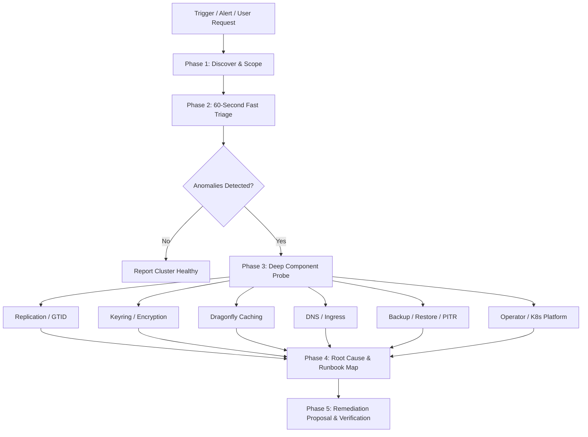

# Bloodraven Doctor (`bloodraven-doctor`)

`bloodraven-doctor` provides systematic, non-destructive diagnosis and actionable remediation for Bloodraven MySQL clusters running in Kubernetes environments.

When an operator or developer encounters issues with a cluster, replication, failover, backup, encryption, or Dragonfly caching, follow this structured runbook.

---

## Safety & Non-Destructive Operation Rules

1. **Read-Only First**: Initial triage and diagnostics MUST ONLY query cluster state, metrics, logs, and sidecar endpoints. Do NOT modify CRDs, trigger promotions, restart pods, or wipe PVCs during investigation without explicit user approval.
2. **First-Party Tools**: Use `kubectl bloodraven <command>` (the official day-2 plugin) wherever applicable (`status`, `promote`, `reclone`, `backup`, `verify-backup`).
3. **Transparent Remediation**: Before executing any state-changing command:
   - State the **Root Cause**.
   - State the **Blast Radius & Downtime Impact**.
   - State the **Data Loss Risk (RPO / RTO)**.
   - Present the exact command and seek user confirmation.
4. **Dynamic Container Resolution**: Never assume fixed container names (e.g. `sidecar` vs `bloodraven-sidecar`). Always discover container names dynamically from `.spec.containers[*].name`. Helper scripts in `scripts/` handle this automatically.
5. **Resource name**: the `mfg` short name exists only once the v1.6.0 CRD is applied. If `kubectl get mfg` reports "the server doesn't have a resource type", use `mysqlfailovergroup` (or `mysqlfailovergroups.shipstream.io`); the helper scripts already do.

---

## Systematic Diagnostic Workflow



### Phase 1: Discover & Scope

1. Identify the target namespace and `MySQLFailoverGroup` (MFG):
   ```bash
   kubectl get mysqlfailovergroups.shipstream.io -A
   ```
2. If multiple groups exist and the user didn't specify one, ask or list the options.

### Phase 2: The 60-Second Fast Triage

Run the bundled triage script or execute the baseline inspection:

```bash
# Option A: Run the bundled non-destructive triage script
./.agents/skills/bloodraven-doctor/scripts/triage.sh -n <namespace> <group-name>

# Option B: Run native kubectl bloodraven status
kubectl bloodraven status <group-name> -n <namespace>
```

Check the core conditions and status fields:
- `.status.activeSite`: Is there an active primary site?
- `.status.topologyGeneration`: Has authoritative topology changed since the deployment's grant or the start of this investigation? This is durable across restarts, not the CR generation.
- `.status.plannedFailover`: read `phase`, `runID`, `result.outcome`, `result.reason`, `result.warnings` and `admission` (`kubectl bloodraven status` prints them). The phases are `Admitting`, `Deferred`, `Fencing`, `Draining`, `WaitingForLag`, `WaitingForDragonflySync`, `PromotingDragonfly`, `Promoting`, `Publishing`, `RollingBack`, `Succeeded`, `Failed`.
  - `Deferred` with `admission.deferReason: DeploymentHold` normally means a live deployment hold, not a failed promotion. Inspect `admission.retryTime` and the message's operation ID and instance. If it remains deferred past expiry, check operator logs for Lease persistence errors.
  - `Admitting` owns nothing and fences nothing; `admission.waitReason` says what it waits for. `PeerUnreadable` means a `primary-candidate` or `dr-only` site does not answer: a planned failover is strict and will end `NotStarted/AdmissionTimeout` after 2 minutes. That is by design, not a bug. `AuthorityUnsettled` with an empty `status.activeSite` (or a newer failover record not yet published) means an emergency failover is in flight: admission skips validation until it settles, then a run whose target was just promoted ends `NotStarted/AlreadyActive`. Investigate the emergency failover, not the planned run.
  - `Failed`: route by `result.outcome` with the [alert matrix](./references/alert_runbook_matrix.md) (`NotStarted`/`RolledBack`: nothing to recover, except a `RolledBack` carrying the warning `TargetReplicationNotRestored`: the target was left without a working replication channel and nothing re-points it automatically, so follow step 4 of [playbook 23](./references/troubleshooting_playbooks.md#23-ordered-update-stalls-on-the-active-site-maintenance-handoff-aborted) on the target, after first setting `super_read_only=ON` on it by hand when the result also carries `TargetSuperReadOnlyNotRestored`; `SourceLeftFenced`: [playbook 37](./references/troubleshooting_playbooks.md#37-planned-failover-left-the-source-fenced), plus the same channel restore when it carries `TargetReplicationNotRestored`; `PromotedUnconfirmed`: matrix row; `ManualRecoveryRequired`: [playbook 38](./references/troubleshooting_playbooks.md#38-automation-held-after-a-planned-failover-automaticfailoverheld)).
  - A `bloodraven.shipstream.io/planned-failover-terminal` annotation naming the run ends it whatever `phase` says (status writes had stalled); `kubectl bloodraven status` prints `Ended by terminal marker: <outcome>:<reason>` and `kubectl bloodraven promote --wait` returns that outcome. A confirmed promotion is ended by the marker only once its failover record is durable; until then the operator logs `planned failover: status stalled, but the promotion's failover record is not durable yet; retrying` and keeps retrying (both the status and the annotation write paths are failing: fix RBAC/webhooks).
  - `Promoting` or `Publishing` with the claim already released (`planned failover: claim released` `why=publishing`) is normal: once the promotion is confirmed, recorded and published, only the `Publishing` status write is left and automation (split-brain resolution, Dragonfly follow-ups, rollouts and snapshot upgrades included) is no longer deferred. After a restart such a `Promoting` block is not re-claimed when its own failover record is durable (`planned failover: promotion already recorded; publishing without the claim`), and if the `Publishing` write keeps failing the terminal marker ends it after 10 seconds. The run's own evidence for this is the `bloodraven.shipstream.io/planned-failover-confirmed` annotation (`<runID>:since=<time>`), written before the claim is released and removed when the run ends; a leftover one from a finished run is removed by the next pass.
  - Operator log `reconcile failed while a planned failover is in flight; retrying on the planned-failover cadence` means an unrelated reconcile step (credentials, ConfigMaps, Deployments, Services, PDB, a restore, a Dragonfly snapshot upgrade) is failing while a run owns the sites. The run keeps going on its own cadence; diagnose that step's `error` as its own problem.
- `.status.conditions`:
  - `Ready == True`?
  - `Bootstrapping == False`?
  - `AutomaticFailoverHeld` absent or `False` (and no `.status.plannedFailoverHold`, and no `bloodraven.shipstream.io/planned-failover-terminal` marker with `"outcome":"ManualRecoveryRequired"`)? A run that ended `ManualRecoveryRequired` while status writes were stalled is recorded only by that marker: no condition, no hold record, an empty `result.outcome`, yet the group is held exactly the same (`triage.sh` reports it as `held by the terminal marker only`, `deployment-probe.sh` as `plannedHold.source: marker`, and `kubectl bloodraven ack-planned-failover-hold` reads the run from the marker). A `True` condition, which summarises `.status.plannedFailoverHold`, means a planned failover ended `ManualRecoveryRequired` and **automatic failover, split-brain resolution, the re-assert, ordered updates, rotations, recovery and DNS reconcile are held for the group** until a human resolves the split brain and acknowledges it (`kubectl bloodraven ack-planned-failover-hold <group>`, which writes `bloodraven.shipstream.io/acknowledge-planned-failover-hold=<runID>` with `.status.plannedFailoverHold.runID`). Page on it; see [playbook 38](./references/troubleshooting_playbooks.md#38-automation-held-after-a-planned-failover-automaticfailoverheld). Never acknowledge it before the sites are resolved. While a hold stands, bootstrap, reclone and keyring-rotation refusals read `automatic failover is held after planned failover <runID>; resolve the split brain, then annotate bloodraven.shipstream.io/acknowledge-planned-failover-hold=<runID>` (rotations add `; retrying after the acknowledgement`). A `True` condition with no `.status.plannedFailoverHold` (hand-edited, or left by a CRD rollback) holds automation as well (`automatic failover is held by a True AutomaticFailoverHeld condition that names no run`); it has no run to acknowledge, so remove the condition by hand once the sites are resolved and the operator releases the hold without a restart (`claim released` with `why=orphanHold`). The hold does not stop the rest of the reconcile: backups, schedules, verification, keyring work and pod labels keep running, so a stale backup status during a hold is a separate problem.
  - `RecoveryInProgress == False`? (It is expected to stay set while a planned failover holds its claim (`Fencing` through `Promoting`, or `RollingBack`), while an automation hold stands, or while an ordered update is in flight: recovery stands down until it ends. A planned failover that is only `Admitting` or `Deferred` defers nothing, and a Dragonfly snapshot upgrade does not defer recovery at all, so a site stuck through either is a real stall.)
  - `RecoveryBlocked == False`?
- Pod status: `kubectl get pods -n <namespace> -l app.kubernetes.io/instance=<group-name>`
- Recent events: `kubectl get events -n <namespace> --sort-by=.lastTimestamp`

---

## Phase 3: Deep Component Probes & Symptom Trees

Consult [references/troubleshooting_playbooks.md](./references/troubleshooting_playbooks.md) for step-by-step diagnostic trees.

### 1. Topology & Split-Brain Triage
- **Symptom**: `NoPrimary` (both sites read-only) or multiple sites accepting writes (`read_only=OFF`).
- **Not a symptom**: `Ready`/`Degraded` `Unknown` with reason `Initializing` right after an operator restart or leader change. The operator has not confirmed the primary's writable answer yet; it clears on the next poll and nothing is promoted or fenced meanwhile (see the alert matrix).
- **Probe**:
  ```bash
  # Check read_only state on all sites
  kubectl get mfg <group-name> -n <namespace> -o jsonpath='{range .status.sites[*]}{.name}{": readOnly="}{.readOnly}{", reachable="}{.reachable}{", role="}{.role}{"\n"}{end}'
  ```
- **Action**: Refer to [Split-Brain Recovery Playbook](./references/troubleshooting_playbooks.md#split-brain--dual-writable-recovery).

### 2. Replication & GTID Divergence
- **Symptom**: High replication lag, `SecondsBehindSource > 0`, replication stopped, `Degraded=True` with reason `DivergentTransactions`, Events `DataLossDetected` / `DivergentReplicaDetected`, or an ordered update / planned failover refusing a divergent target.
- **Probe**:
  ```bash
  # Follower-first audit: reads each follower, then GTID_SUBTRACT on the primary.
  # Exit 0 all CLEAN, 2 a follower DIVERGENT, 3 a follower UNKNOWN (UNKNOWN is not clean).
  ./.agents/skills/bloodraven-doctor/scripts/gtid-audit.sh -n <namespace> <group-name>
  # Plus PITR evidence from plaintext manifests you fetched from the archive prefix:
  # Divergent rows, promotion records, and the candidate excludeGtids set.
  ./.agents/skills/bloodraven-doctor/scripts/gtid-audit.sh -n <namespace> <group-name> --manifest manifest-<site>.json
  # What the operator recorded (divergenceDetectedBy is OldPrimaryRecovery or ReplicaAudit):
  kubectl get mysqlfailovergroup <group-name> -n <namespace> -o jsonpath='{range .status.sites[*]}{.name}{": "}{.recoveryState}{" by="}{.divergenceDetectedBy}{" vs="}{.divergenceComparedTo}{" "}{.divergentGtid}{"\n"}{end}'
  ```
- **Key fact**: a divergent replica can keep replicating with healthy IO/SQL threads. Thread health never proves the replica holds nothing the primary lacks (issue #202). Since v1.6.0 the operator audits replicas every ~30s, keeps the block until a fresh containment proof, and refuses to promote a divergent site in ordered updates and planned failovers; emergency failover only ranks it last.
- **Action**:
  - If replica simply stopped or lagged due to network, restart replication or wait for sync.
  - If GTIDs diverged on an old primary: [playbook 2](./references/troubleshooting_playbooks.md#2-divergent-transactions--errant-gtid-on-replica).
  - If a replicating replica is divergent, or an update / planned failover refuses one: [playbook 33](./references/troubleshooting_playbooks.md#33-a-healthy-replica-reports-divergent-transactions-or-an-ordered-updateplanned-failover-refuses-a-divergent-target). Preserve the errant events, then discard them (`kubectl bloodraven reclone <group-name> <site> -n <namespace>`) or keep them by making the primary contain the set. There is no ignore setting.

### 3. Keyring & Data-at-Rest Encryption
- **Symptom**: `KeyringNotSealed`, `KeyringEscrowMissing`, or `KeyringEscrowCorrupt`.
- **Probe**:
  ```bash
  # Probe sidecar keyring status
  ./.agents/skills/bloodraven-doctor/scripts/sidecar-probe.sh -n <namespace> <group-name> keyring
  ```
- **CRITICAL SAFETY RULE**: If `KeyringEscrowMissing` or `KeyringEscrowCorrupt` is detected on a sealed pod, **DO NOT delete, restart, or reschedule the pod**. Recover the escrow Secret first.
- **Escrow Secret**: named by `status.encryptionAtRest.sites[].keyringSecret` (`mysql-<group>-<site>-keyring-v<N>`). `/keyring/status` returns metadata and digests only; the recoverable copy is the keyring file in the running pod. Recreate a missing Secret with `./.agents/skills/bloodraven-doctor/scripts/keyring-escrow-recover.sh -n <namespace> <group-name> <site>`; it never deletes or overwrites an existing Secret unless re-run with `--replace-corrupt <secret-name>` after a human confirms. Follow [playbook 3](./references/troubleshooting_playbooks.md#3-keyring--encryption-at-rest-troubleshooting).

### 4. Dragonfly Cache & Session Degradation
- **Symptom**: `status.dragonfly.phase=Degraded`, `DragonflyPromotionFailed`, or active cache service has no endpoints.
- **Probe**:
  ```bash
  kubectl get mfg <group-name> -n <namespace> -o jsonpath='{.status.dragonfly}{"\n"}'
  kubectl get endpoints <group-name>-dragonfly -n <namespace>
  ```
- **Emergency promotion**: Dragonfly follows a MySQL emergency failover in the background. The MySQL failover only queues the request; the group's Dragonfly manager runs it between its polls.
  - `dragonfly emergency: ... (sessions lost)` means the cache was promoted empty via `REPLICAOF NO ONE`. That happens when the takeover failed, or was skipped because the old master was unreachable.
  - `REPLICAOF NO ONE failed` or `re-dial for REPLICAOF NO ONE failed` is an unconfirmed attempt, not the outcome. The operator waits for the commands to settle (about 13s after a takeover), reads the target's role, and logs the result: `promotion outcome unconfirmed; target observed as master` (recorded as promoted, sessions may be lost) or `promotion failed; target not observed as master` (old source's traffic label restored). Report from that line, not from the earlier failure.
  - `dragonfly promotion: request coalesced`, `manager stopping; request dropped`, `yielding to another owner; skipping`, `planned failover in flight; skipping` and `target already promoted since the request; skipping` are normal: a newer request, a stopping manager, a waiting planned failover or rollout, or an earlier promotion made this one unnecessary. If MySQL and Dragonfly still disagree, the manager's next poll promotes.
  - A fallback can legitimately take up to about 14s, and an unconfirmed outcome up to about 13s more.
  - `dragonfly gate busy; retrying` on a planned failover, rollout or snapshot upgrade means the Dragonfly manager (or a stopping manager's last step) held the group's Dragonfly gate; it requeues in 1s and is not stuck unless it repeats for minutes. A planned failover waiting this way also emits Warning `DragonflyPromotionWaiting` and sets `status.plannedFailover.dragonfly.message`: MySQL writes stay paused until the in-progress promotion finishes (about 12-13s typically, about 40s worst case).
  - A planned failover finishes its Dragonfly takeover only on a `REPLTAKEOVER` success reply received by the operator process running the run. `status.plannedFailover.dragonfly.takeover.state: Failed` with a `dragonfly.message` containing `unconfirmed` (a target already reporting master, a lost reply, or a re-run after an operator restart or leader change) changed no Dragonfly role: only the source's traffic label was put back, and `onSyncTimeout` decided MySQL. The Dragonfly manager reconciles Dragonfly with MySQL afterwards; check `status.dragonfly` converges before acting on it.
  - `dragonfly promotion: request superseded by a newer decision; skipping` is normal after a quick failback or planned failover. A snapshot upgrade `Failed` with reason `ActiveSiteChanged` was abandoned because a promotion moved the Dragonfly master; re-run it against the new active site.
- **Action**: Refer to [Dragonfly Degraded Playbook](./references/troubleshooting_playbooks.md#dragonfly-degradation).

### 5. Backups, PITR Archiver & Verification
- **Symptom**: `BloodravenBackupStale`, failed backup Job, or stale backup verification.
- **`PITRArchiveReady=False` with pods Ready**: archiving has stopped on a site while MySQL, readiness and fencing are fine. The reason says where to look: `ArchiveStoreInitFailed` (the sidecar cannot build its archive store: unreadable passphrase or S3 credentials file, invalid endpoint, empty PVC mount path, PVC mount path that is not a mount point or not writable; it retries on its own from 5 s up to every 5 min, which picks up Secret, endpoint and permission fixes, but `is not a mount point` never clears by retrying: fix whatever removed the `pitr-archive` volume (mutating webhook, policy engine, manual edit) and restart the pod, after a planned failover away from the site if it is the primary), `ArchiverError` (an upload/manifest error on 2 consecutive archiver scans), `ArchiverDisabled` (the sidecar runs without PITR configuration although no rollout is pending; check `spec.backup.pitr.profileName`), `SidecarUnreachable` (3 failed polls over ≥ 60 s, or 5 min for a sidecar that has not answered since the operator started; with an older sidecar image this is the crash loop), `SidecarOutdated` (an enabled archiver reports no archive-identity block: `spec.sidecarImage` pins a sidecar older than v1.7.0; `Unknown`/`AwaitingRollout` while that site's ordered update is pending, at most 30 min; upgrade or clear `spec.sidecarImage`), and the archive identity refusals below, which rank after `ArchiveStoreInitFailed`. `Unknown`/`AwaitingRollout` is the normal state while a site's ordered update is pending after enabling PITR, for at most 30 minutes and only for a `profileName` that renders an archiver. `PITRArchiveReady=True` does not prove a PVC archive is on the PVC; check the pod's volumes. Current sidecars never exit or go unready over an archive init failure, so it no longer removes the pod from Services. Read `/archiver/status` (`storeReady`, `lastError`) and the condition message, which lists every affected site. See [playbook 31](./references/troubleshooting_playbooks.md#31-pitr-enabled-pods-ready-pitrarchivereadyfalse).
- **Archive identity refusals** (`PITRArchiveReady=False` with `ArchiveForeign`, `ArchiveCopy`, `ArchiveLegacy`, `ArchiveDescriptorMissing`, `ArchiveEncryptionMismatch`, `ArchiveKeyMismatch`, `ArchiveVersionUnsupported` or `ArchiveStoreUnsupported`): every archive has a write-once plaintext descriptor `<prefix>/binlogs/archive.json` (archive ID derived from the group UID and the normalized destination, source `{namespace,name,uid}`, encryption mode and passphrase `keyCheck`), and manifests are version 2 naming that ID. A writer refuses a descriptor of another group (`Foreign`), of its own group at another destination (`Copy`: copies are read-only), a pre-v1.7.0 prefix (`Legacy`, expected right after upgrading), version 2 manifests without a descriptor (`DescriptorMissing`), a mismatched encryption or key, a newer format or a damaged `archive.json` (`VersionUnsupported`: undecodable, trailing data, wrong kind, a malformed field, source names outside Kubernetes bounds, or larger than 64 KiB; the message then says `archive.json is damaged …` and gives the repair, restore the original object or use a new prefix, instead of upgrading), or a store without conditional writes (`StoreUnsupported`). These never clear by retrying. Read `status.pitr.archive` (`destination`, `archiveID`, `encryptionMode`, `state` `AwaitingDescriptor`/`Verified`/`Refused`, `reason`, `observedTime`) and each site's `/archiver/status` `archive` block; `lastError` starts with the token. The remedy is usually a new prefix plus a full backup. The sidecar needs `s3:ListBucket`, `s3:GetObject`, `s3:PutObject` and `s3:DeleteObject`. See [playbook 39](./references/troubleshooting_playbooks.md#39-pitr-archive-identity-refused-archivelegacy-archiveforeign-archivecopy-archivedescriptormissing-encryption-store).
- **Unsafe history marker** (`ArchiveUnsafeHistory`, Warning `PITRArchiveUnsafeHistoryDetected`): a site found a replication or binlog filter, `binlog_format≠ROW`, `binlog_row_image≠FULL` or `replica_preserve_commit_order` off, persisted `historyIntegrity{violation,detail,at}` in its manifest, and stopped uploading. The marker is permanent for the prefix; removing the setting does not clear it, and it removes every restore target that needs that site's bytes, including targets before the violation (a new prefix restores only future targets). While PITR is enabled the operator refuses such keys in `spec.mysqlConf` (group or site; the effective value is judged per site): it leaves them out of the rendered my.cnf, sets `PITRMysqlConfAccepted=False`/`PITRUnsafeSettingRefused` naming `site: <field> sets <key>[=<value>]`, and emits a Warning `PITRMysqlConfRefused`; it owns `replica-preserve-commit-order=ON` (legacy `slave-*` aliases are normalized, so they cannot override it). A marker therefore comes only from an out-of-band change (`SET GLOBAL`, a hand-edited my.cnf). Remedy: fix the setting, new prefix plus full backup. A `lastError: history integrity: …` without a marker means the check itself could not run. See [playbook 40](./references/troubleshooting_playbooks.md#40-pitr-unsafe-history-marker-archiveunsafehistory).
- **Reissue risk** (Warning `PITRArchiveReissueRiskDetected`): the active site changed to a site whose `/archiver/status` reports `divergentRows + quarantinedRows > 0`, or a site was promoted after a `NoPrimary` interval (active site A, then none, then B) on a group that has failed over before. A recloned server keeps its `server_uuid`, so after a lossy failover, a reclone and a failback it reissues the lost GTIDs and every restore from the archive refuses `PITRArchiveHistoryReset`. If the site was recloned since the lossy failover, start a new prefix and take a full backup. See [playbook 41](./references/troubleshooting_playbooks.md#41-reissue-risk-after-a-reclone-pitrarchivereissueriskdetected).
- **Backup identity**: every backup Job starts with a `backup-stamp` init container that writes `<location>.bloodraven-backup.json` (backup and source refs, `pitrArchiveID`, site, `serverID`, dump filters, the dumped server's `serverClock{start,end}`), encrypted with the dump passphrase when the profile encrypts. `MysqlBackup.status.failoverGroupUID` and `status.pitrArchiveID` are pinned on the Job (annotations `bloodraven.shipstream.io/failover-group-uid`, `bloodraven.shipstream.io/pitr-archive-id`) and recovered from it. A termination message starting `backup stamp: ` fails the backup; `check dumped server` means the Job reached a server whose `server_id` is not the source site's (101 + site index).
- **Encrypted PITR startup failure**: `failed to init archive store` with `permission denied` for the passphrase file. Current sidecars keep serving HTTP, readiness and fencing, report `storeReady:false` with the error, and retry; sidecars that predate that exit before starting HTTP or fencing and crash-loop. Check sidecar logs and the pod's `pitr-passphrase` Secret projection mode. It must be `0444` for a non-root sidecar without fsGroup, matching PITR S3 credentials. See [playbook 25](./references/troubleshooting_playbooks.md#25-encrypted-pitr-sidecar-fails-to-init-archive-store).
- **PITR encryption drift or incompatible archive**: encryption settings and selected passphrase bytes trigger ordered updates in both credential modes. After a change, compare the desired reference/key with the rendered sidecar mount and rollout state; `ArchiveEncryptionMismatch` (mode changed) or `ArchiveKeyMismatch` (passphrase changed) means the existing archive's descriptor records the old settings. Preserve the old passphrase and archive; rollout does not migrate them. See [playbook 26](./references/troubleshooting_playbooks.md#26-pitr-archival-stops-after-an-encryption-change).
- **PITR after reclone or rebuild**: `backlogFiles=0` alone does not prove historical coverage. New manifest rows distinguish reused names with content IDs (keyed for encrypted profiles); legacy rows retain plain keys with persisted verified `contentId`. Surviving rollback-stripped IDs are recovered only from exact confined object keys. History work yields between rotations; no full-file scratch space is required. Inspect divergent/missing-file `lastError`, durable `divergent`/`quarantined`/`acknowledged` records and `epoch.resetReason`; use the reversible `bloodraven pitr-quarantine` procedure with a verified canonical backup. GTID reuse needs verified conflicting issuance, not upload order. Bootstrap/clone observations do not establish divergence; eligible audits clear recovered foreign-source flags, but known loss from the current server UUID requires verified or explicit canonical recovery because replacement bytes may still be active. Legacy issuance verification runs independently of retention. An obsolete guard can be acknowledged after a canonical backup covers every active stream and overlapping issuance is verified; this removes no rows or older recovery windows. A quarantined row is never data and never an acknowledgement: its in-window transactions still need `excludeGtids`, and an unreadable one is waived only for a backup taken after the quarantine, so take a full backup after quarantining. Prefer a new prefix/full backup after RESET. Check retained history and reader/writer compatibility before calling recovery complete. See [playbook 27](./references/troubleshooting_playbooks.md#27-pitr-history-after-a-site-reclone-or-data-rebuild).
- **Retention deferred**: deletion needs content-bound complete binlog GTIDs covered by every retained group backup's pre-dump `status.gtidExecuted`, across profiles. In-flight group backups pause new retirements. `noRetainedBackups` and `backupInFlight` are normal Info waits; missing metadata, unsupported files, or version skew retain objects. Backfill is bounded and persists IDs/proofs together. Normal progress logs at Info; failed coverage identities wait the normal interval while other backfill can progress. Unresolved issuance can pause all new retirements for the site. Its failure stays in lastError during cooldown, and retention deferred logs archiveIssuanceUnverified at Warn with the row/error and repair/quarantine remedy; monitor archive capacity until resolved. Cutoff throttling follows source IP, so check direct Service routing and shared-NAT callers on a Warn lookup failure. The support bundle captures projected backup bounds in `backups.json`. See [playbook 28](./references/troubleshooting_playbooks.md#28-pitr-retention-deferred-because-gtid-coverage-is-unknown).
- **Retention cleanup retry**: `retention: delete object` and `retention: save delete acknowledgements` preserve durable pending records in the manifest's `pruned` list. Approved deletes retry even without a new operator proof; restores select only live `files`. See [playbook 29](./references/troubleshooting_playbooks.md#29-retention-object-deletion-or-acknowledgement-keeps-failing).
- **Retired local binlogs**: matching retired content stays out of upload/backlog after restart; different bytes reusing the filename still archive. Every running site maintains its own archive, including replicas. Acknowledged records remain until the filename leaves a readable local index and the file is absent; pending records are never compacted. See [playbook 30](./references/troubleshooting_playbooks.md#30-retired-local-binlogs-or-growing-retirement-metadata).
- **Probe**:
  ```bash
  kubectl get mysqlbackups.shipstream.io -n <namespace> --sort-by=.metadata.creationTimestamp
  kubectl get mysqlbackupverifications.shipstream.io -n <namespace>
  kubectl get mysqlfailovergroup <group-name> -n <namespace> \
    -o jsonpath='{.status.conditions[?(@.type=="S3CredentialsReady")]}'
  ```
  `S3CredentialsReady=False` means an S3 `credentialsSecret` lacks `AWS_ACCESS_KEY_ID` or `AWS_SECRET_ACCESS_KEY`; Jobs fail instead of using ambient credentials. Fix the Secret before re-running anything.
- **initFromBackup not yet succeeded**: a new group whose `status.restore.phase` is not `Succeeded` (unobserved, `Pending`, `Running` or `Failed`) is deliberately out of service even though its seed is writable and `status.activeSite`: no DNS record, no `-primary`/`-replicas`/per-site Service endpoints, no clones, no promotion of another site, `Ready=False` with reason `InitFromBackupInProgress` or `InitFromBackupFailed`. Do not relabel pods or point DNS by hand. After a failure, follow the `Ready` message / `RestoreFailed` Event: if the Job log has `BLOODRAVEN_LOAD_START`, empty the target (delete and recreate the group, or delete its MySQL PVCs), then delete the restore Job. See the `InitFromBackup*` rows in the alert matrix.
- **MySQL authentication**: If backup or restore reports `Access denied` while the operator connects successfully, check whether the Job script predates the exact-content credential reader. Older scripts strip password whitespace and normalize CRLF, including newlines intentionally stored by `--from-file`. Fixed scripts preserve mounted MySQL credentials and honor an empty password file over environment fallback. Follow the [credential playbook](./references/troubleshooting_playbooks.md#12-backup-or-restore-reports-access-denied-with-valid-credentials); do not print or collect password contents.
- **Artifact identity**: If a successful backup cannot be found by restore, verification, or cleanup, compare `status.location` with the original Job's main-container output/storage env. Account for one kubelet expansion when comparing env values; consumer Jobs escape literal dollars while status keeps the actual path. Legacy records without a metadata condition retain their producer-reported locations. Older completion encoding corrupted underscores and could not distinguish them from spaces. New dump and sanity sentinels use versioned percent encoding (`v=2`). Never repair old locations by globally substituting spaces or underscores; follow the [location playbook](./references/troubleshooting_playbooks.md#13-succeeded-backup-cannot-be-found-at-its-recorded-location).
- **Deleted backup stuck Terminating**: read the `ArtifactCleanup` condition (`scripts/triage.sh` section 8 prints it with `status.artifactStorage`). Cleanup runs `bloodraven artifact-cleanup` from the operator image against the bucket/endpoint/region or claim recorded in `status.artifactStorage` when the backup ran, never the live profile; only credentials come from the profile. Cleanup requires `status.location` to equal the recorded `status.artifactStorage.location` exactly (immutable once set, CEL-enforced). `CleanupFailed` (exit 75, a crash, deadline, eviction) retries 5 min after the Job failed, `CleanupRejected` (exit 64) 30 min after; `CleanupPending` names a pod that cannot start (waiting reason, or >1 min unscheduled/`ContainerCreating`); `ForegroundDeletion`/`OrphanDeletion` wait for the garbage collector; `CleanupJobInvalid` means the recorded destination cannot become a Job; an empty `status.location` on a deleted Succeeded backup is restored from the record (`ArtifactLocationRestored`); a new backup whose `mysqlbackup-<name>` Job is not its own waits in `Pending` (`BackupJobConflict`) and fails after 30 min; the pod termination message carries `BLOODRAVEN_CLEANUP_FAILED: <reason>`. `DestinationUnverified` / `DestinationMismatch` need a human: inspect storage, delete by hand, then remove the finalizer. Before releasing an abandoned backup's leftovers (a never-succeeded backup, or one whose group or profile is gone) the operator first stops the producing backup Job and waits for its pods, so a dump still writing is never deleted under it; a never-succeeded encrypted backup's leftovers are read with the passphrase Secret recorded in `status.artifactStorage.passphraseSecret`. `ProducerStopStuck` (Warning `ArtifactCleanupProducerStuck`, after 10 min) means a producer pod has not stopped, usually on an unreachable node: the deletion stays held; once the node is confirmed down, `kubectl delete pod <pod> -n <ns> --force --grace-period=0`. Counted by `bloodraven_backup_artifact_cleanup_failures_total{group,profile,reason}`. Old operators' `cleanup.py` Jobs always failed on S3 (MySQL Shell has no `util.rmdump`) and are replaced automatically after upgrade. See [playbook 35](./references/troubleshooting_playbooks.md#35-deleted-mysqlbackup-stuck-terminating-artifact-cleanup).
- **Verification holds**: a `MysqlBackupVerification` annotates the backup it reads with `hold.verification.shipstream.io/<verification UID>: <name>`. While the hold is live, retention skips the backup (`RetentionDeferred`), a manual delete waits (`ArtifactCleanup=False/HeldByVerification`, `ArtifactCleanupDeferred`), and a Terminating held backup still bounds the PITR binlog cutoff. A hold lasts until the run's Job is finished or gone and no pod labelled `shipstream.io/mysqlbackup-verification=<name>` is pending or running, so a run that failed with `keepOnFailure: true` while its pod still runs keeps it. Unstamped runs from older operators are found by `status.backupRef.uid`. Retention logs `backup prune held by verification` (`backup`, `backupUID`, `verifications`, `verificationUIDs`); dead holds on a Terminating backup are removed (`removed dead verification holds`). A verification never launches against a Terminating backup (`BackupNotAvailable`). See [playbook 36](./references/troubleshooting_playbooks.md#36-backup-kept-past-retention-or-deletion-waiting-on-a-verification).
- **Completion metadata**: `MetadataComplete=False` with `SentinelUnavailable` or `SentinelMissing` can accompany a usable Succeeded backup: the destination came from the owned Job, but optional size/GTID/binlog observations may be absent. Transient reads retry every 15 seconds for ten minutes after completion, including after restart. The operator also repairs historical missing or underscore-damaged locations from owned Jobs before cleanup. `DestinationUnavailable` means `Ready=False` and needs investigation. Use the [metadata playbook](./references/troubleshooting_playbooks.md#14-backup-completed-with-incomplete-metadata); helpers project public backup/Job fields without collecting Secret contents.
- **Scheduled retries**: Inspect the failed run's own UID, `shipstream.io/backup-retry-of` successors, root UID and `shipstream.io/backup-attempt` annotation. Earlier runs' higher attempt counters do not suppress the current chain. Launch metadata survives a lost status patch; the backup reconciler restores `status.attempt`. New retry names contain a predecessor UID hash and attempt. `status.backupSchedules[].retryConflict` identifies a blocking object; unchanged conflicts do not repeat warnings across reconciles or restarts. Follow the [retry playbook](./references/troubleshooting_playbooks.md#15-scheduled-backup-fails-without-the-expected-retry); keep retained history for diagnosis.
- **Verification identity**: Latest selection happens once. Compare `status.backupRef` name/UID/location/storage with the Job's immutable pod-template `shipstream.io/verification-backup` snapshot and original source env (decrypt prefix for encrypted sources). Newer backups and removed launch inputs do not retarget a running Job. A pre-launch UID replacement fails `BackupNotAvailable`; an unprovable or mismatched running identity fails `BackupIdentityMismatch`. Follow the [verification-source playbook](./references/troubleshooting_playbooks.md#16-verification-source-does-not-match-the-expected-backup); helpers project only public identity/input fields.
- **Encryption attribution**: A restore or verification reporting `missing BRV1 magic` after profile encryption was enabled may refer to an older plaintext Job incorrectly marked encrypted. Compare the backup's status with its producing Job's `shipstream.io/backup-encrypted` label and `backup-encrypt-upload` container, including `BLOODRAVEN_ENCRYPTION_ALGORITHM`. The fixed operator repairs completed records while their owned Job exists and emits `EncryptionAttributionCorrected`; it preserves attribution if the Job is gone. Follow the [attribution playbook](./references/troubleshooting_playbooks.md#11-restore-or-verification-reports-missing-brv1-magic). Do not enable plaintext fallback to bypass an unexplained mismatch or expose passphrase contents.
- **Action**: Trigger on-demand backup or verification:
  ```bash
  kubectl bloodraven backup <group-name> -n <namespace>
  kubectl bloodraven verify-backup <group-name> -n <namespace>
  ```
- **After a full-instance in-place restore**: `status.restoreReclones.pending` lists the peers not yet recloned from the restored primary. They are excluded from automatic promotion and removed from the `-replica` and read-only Services until their clone succeeds, and their replication receiver (IO thread) is stopped by design until then: `Degraded`/deployment API reason `RestoreReclonePending`, `sourceConvergenceReason: RestorePeerHold`, and `bloodraven_restore_reclone_pending{phase}=1` are expected, not a replication fault. Never `START REPLICA` on a queued site: after a failed restore (`phase: Held`) that replicates the restore's `DROP` statements into the only intact copies. See [playbook 20](./references/troubleshooting_playbooks.md#20-peers-not-yet-recloned-after-a-full-instance-in-place-restore).

### 6. DNS & Application Traffic
- **Symptom**: App writes hitting wrong site, DNS records not updating after failover, or a hostname rename that never reached DNS.
- **Probe**:
  ```bash
  kubectl get mysqlfailovergroup <group> -n <namespace> -o jsonpath='{.spec.dns}{"\n"}'
  kubectl get dnsendpoint -n <namespace> -o jsonpath='{range .items[*]}{.metadata.name}{" "}{.spec.endpoints[0].dnsName}{" -> "}{.spec.endpoints[0].targets[0]}{" ttl="}{.spec.endpoints[0].recordTTL}{"\n"}{end}'
  kubectl logs -n external-dns deploy/external-dns --tail=100
  ```
- **Hostname mismatch**: if `DNSEndpoint.spec.endpoints[0].dnsName` != `spec.dns.hostname`, the operator is not applying the live spec (RBAC/apply failure, or an unpatched operator that cached the name at start). Check operator logs for `DNS reconcile failed` / `DNS reconciled to active site` (`hostname` field). Restarting the operator is only a workaround on versions before the live-spec fix.

---

### 7. Deployment coordination and self-fencing

Run `bash ./.agents/skills/bloodraven-doctor/scripts/deployment-probe.sh <namespace> <group>` for topology, authorized database clients, and projected public fields from durable `coordination.k8s.io/Lease` records. Requires `jq` and read access to MFGs, MysqlDatabases, and Leases. The helper never requests Secrets or outputs lease token hashes. `triage.sh` and `support-bundle.sh` include it. Do not collect raw Lease annotations or request headers.

The optional `/deploy/v1` API runs only on the escrow TLS listener, default `8443`; never use plaintext `8082` or disable certificate checks. It uses projected ServiceAccount TokenReview (audience `bloodraven-deploy` by default) and `MysqlDatabase.spec.deploymentClients`. A `401` is authentication failure; a non-disclosing `403 forbidden` is authorization failure. Compare caller namespace and ServiceAccount with the database assigned to the path group; `instance` is the database CR name. Do not mint a token or impersonate an identity without approval.

For timeouts, inspect `auxiliary.deployAPI.enabled`, `auxiliary.escrowTLS.enabled/existingSecret`, Service endpoints, certificate trust/SANs, and NetworkPolicy. Deployment ingress requires pod label `bloodraven.shipstream.io/deploy-client=true` AND namespace label `shipstream.io/mysql-client=true`. The chart intentionally preserves managed MySQL escrow ingress and metrics/probes/auxiliary ports; custom escrow peers may need `auxiliary.deployAPI.networkPolicy.additionalIngress`.

Renewal `404/409` or a changed topology generation means the deployment must stop; post-DDL uncertainty is manual recovery, never automatic migration retry. A same-operation POST is a mutating idempotent re-grant that rotates the token because storage is hash-only. Never call POST/PUT/DELETE as a diagnostic probe. Leases survive operator restart. Planned failover, ordered update, and restore-in-place defer behind a hold; emergency failover and fencing do not. The approved revoke annotation is `bloodraven.shipstream.io/revoke-deployment-leases=true`, producing `operator_revoked`; request explicit approval and coordinate with all deployment owners before using it. Never delete the leader-election Lease or reset topology generation.

`spec.leaseDurationSeconds: Invalid value: 0: must be greater than 0` in housekeeping or hold checks identifies the deployment Lease persistence bug, not a TLS failure or a renewed hold. See the [invalid Lease duration playbook](./references/troubleshooting_playbooks.md#invalid-lease-duration-blocks-expiry). Propose an approved rollout of the positive-duration fix, preserving records and coordinating queued maintenance; restarting the affected binary, deleting Leases, or requesting revocation does not safely remedy the bug. Fixed records use a duration of at least one second, but annotation state and exact expiry still govern authority with no added grace period. The existing deployment probe already projects these authoritative fields without hashes.

Probe self-fencing using `sidecar-probe.sh ... fencing` (`/status`, field `self_fenced`) and `sidecar-probe.sh ... peer` (`/peer/active-site`). There is no `/fencing` endpoint. `self_fenced` is scoped to the current sidecar process; an empty or false value is not proof that MySQL is writable. With a 60s DNS TTL require `max(configured leaseTimeout, 3s, 3 * effective peerCheckInterval) < 60s`; the peer interval itself is clamped to at least 1s. Defaults 20s/5s produce 20s. Actual fence completion also includes polling, probe, scheduling, and SQL time, so verify margin under faults. Deployment holds never delay this self-fence.

Sidecar probes are split. Liveness probes `/peer/ping`, which never touches MySQL, so a hung or restarting `mysqld` should leave the sidecar running and its pod **unready**, not restarting. Readiness probes `/health`, which checks MySQL within 2s against a 3s probe timeout. `sidecar-probe.sh ... livez` reads `/livez`, which reports `fencingMonitor.secondsSinceProgress` against `stallThresholdSeconds`. A 503 there means the fencing loop is wedged; collect logs before anyone restarts the container. If the sidecar restarts repeatedly while MySQL is stalled, check the rendered probe path (`kubectl get deploy <deploy> -o jsonpath='{.spec.template.spec.containers[?(@.name=="sidecar")].livenessProbe}'`). A path of `/health` means the operator predates the fix. After a stall, grep sidecar logs for `msg` starting `safety net:`. `could not set initial super_read_only; the fencing monitor will retry` and `MySQL was unreachable long enough to have restarted; re-arming` mean the monitor still has to fence the instance unless the operator confirms the site. `set super_read_only=ON after MySQL became reachable` or `super_read_only=ON confirmed; staying fenced` means that check completed. See [playbook 8](./references/troubleshooting_playbooks.md#8-sidecar-restarting-unready-or-not-fencing-during-a-mysql-stall).

Correlate `DeploymentLeaseRevoked`, `PlannedFailoverDeferred`, lease active/age/revocation/expiry metrics, and `bloodraven_planned_failovers_deferred_total`. Filter request logs on `msg="deploy api"` with `handler, group, instance, namespace, operationId, status, duration_ms`; `duration_ms` is a deliberate exception to camelCase. Keep deployment IDs out of metric labels and all tokens out of bundles.

---

### 7b. Ordered update not finishing on the active site

`maintenance handoff refused; source not fenced` (before any write pause, usually a lagging standby) or `maintenance handoff aborted; source unfenced` (after the fence) in the operator log means an `OrderedUpdate` refused to promote a standby that could not be proven to hold every transaction committed on the active site. The active site was unfenced and keeps serving, and the rollout retries later. The `error` field says why: the standby is lagging, its applier failed, or a GTID set was unreadable. An ERROR `maintenance handoff: rollback failed: source may be left read-only` needs immediate attention. See [playbook 23](./references/troubleshooting_playbooks.md#23-ordered-update-stalls-on-the-active-site-maintenance-handoff-aborted).

An ERROR `ordered update: old active has transactions the new primary lacks; not repointing it`, or `ordered update failed` with an error containing `before repointing`, comes after a handoff that succeeded. The new primary is serving. The old active is fenced (`super_read_only=ON`, unless the error says `fence old active`) and not replicating, because the rollout refused to repoint it without proof that the new primary holds its transactions. Do not repoint it by hand. Old-primary recovery takes it on a later poll and either rejoins it or reports `divergentGtid` with `divergenceDetectedBy=OldPrimaryRecovery` and blocks. Page on the ERROR. An old active that came back on an empty datadir also trips it, but is then left to auto-clone with no `divergentGtid`. See [playbook 23](./references/troubleshooting_playbooks.md#23-ordered-update-stalls-on-the-active-site-maintenance-handoff-aborted), remediation step 5.

`Updating=False` with reason `OrderedUpdateStalled`, a Warning Event `OrderedUpdateStalled`, or WARN `ordered update: stalled; site pod not Ready` means the rollout stopped on a site whose pod is not Ready, which for the ordered update means Ready continuously for 30s: a site it just rolled (often a sidecar that cannot start or crash-loops), or one that already runs the new pod template. A pod that shows `Ready` in `kubectl get pod` can still hold the update if it became Ready, or restarted a container, less than 30s ago. MySQL answering proves nothing here, because the `-internal` Service publishes not-ready addresses. Nothing else is rolled or handed off, the active site keeps serving, and the update retries every 30s. The message names the site, the pod and the cause; read the pod's events and `--previous` logs, fix the cause or the spec, and do not promote the stalled site by hand. See [playbook 34](./references/troubleshooting_playbooks.md#34-ordered-update-stalled-on-a-pod-that-is-not-ready-orderedupdatestalled).

### 7c. One group frozen while the operator is healthy

If one group's status stops changing and the operator logs `failed to start topology manager` for it, that group has no running topology manager: no polling, no status writes, no failover. The error names the Secret to fix, and the runner retries every 30s. A WARN `connection material unreadable; keeping the running topology manager` means a Secret is being replaced and the existing manager is still running. See [playbook 24](./references/troubleshooting_playbooks.md#24-one-group-stopped-updating-no-running-topology-manager).

### 8. Tenant database pending, adoption refused or account cleanup skipped

- **Symptom**: a `MysqlDatabase` is `Failed` with `reason` `DatabasePreExists`, `PreExistingOwnerUser`, `PreExistingUser`, `UserClaimedBySibling`, `OwnerUserReserved`, `UserReserved`, `DatabaseNameConflict`, `OwnerConflict`, or `GrantUserMissing`; or a delete left an account behind with `OwnerUserDropSkipped` / `UserDropSkipped` / `OwnerUserReservedSkipped` / `UserReservedSkipped` / `UserTransferred`.
- **Probe** (status only — never read the tenant Secrets):
  ```bash
  kubectl get mysqldatabases.shipstream.io -n <namespace> -o custom-columns=\
  'NAME:.metadata.name,PHASE:.status.phase,REASON:.status.conditions[?(@.type=="Ready")].reason,MESSAGE:.status.message'
  kubectl get mysqldatabase <name> -n <namespace> -o jsonpath=\
  '{.status.databaseCreated}{" owner="}{.status.ownerUser}{.status.ownerHosts}{" pendingOwner="}{.status.pendingOwnerUser}{.status.pendingOwnerHosts}{" ledger="}{.status.appliedUsers}{"\n"}'
  kubectl describe mysqldatabase <name> -n <namespace> | sed -n '/Events:/,$p'
  ```
- **`Pending` / `PartialRevokesOff`**: tenant changes wait until the primary confirms `partial_revokes=ON`. The Warning event and `status.message` distinguish a failed read from a refused `SET GLOBAL`. Existing grants and ownership records are preserved; deletion still works. See [playbook 9](./references/troubleshooting_playbooks.md#tenant-pending-with-partialrevokesoff-or-ready-with-escaped-grants).
- **Ready with access denied after a mode change**: inspect the tenant's literal and escaped grant rows. Upgrading to a release containing the escaped-grant reapplication fix reapplies affected tenants from intermediate builds or the former SET-refused fallback. Later out-of-band mode changes need a spec edit; a metadata-only edit does not force SQL. Never fabricate attribution in status.
- **Read the records per `user@host`, not per username.** `ownerUser`/`ownerHosts`, `pendingOwnerUser`/`pendingOwnerHosts`, and each `appliedUsers[]` entry's `username`/`hosts` and `pendingUsername`/`pendingHosts` are the operator's memory of which exact accounts it created. `pendingOwnerHosts` and `appliedUsers[].pendingHosts` are tracked separately from `ownerHosts`/`hosts` because the two names' host lists differ mid-rotation; an empty pending host list with a pending username set is the legacy shape an older operator wrote and falls back to the settled list. Owning `acme_app@10.0.0.1` says nothing about `acme_app@10.0.0.2`.
- **A `pendingOwnerUser` or `pendingUsername` is normal mid-rotation, not a fault.** It is a write-ahead record, cleared by the next successful apply. Do not hand-edit it: clearing it strands whatever account it names, and inventing one authorizes a `DROP USER`.
- **Action**: these are refusals by design, and none of them is remedied by editing status. See [playbook 7](./references/troubleshooting_playbooks.md#7-tenant-database-adoption-refused-mysqldatabase).

### 9. Shared principal denied on a tenant schema

- **Symptom**: a shared `grants[]` principal loses independently granted global access, `TenantPrivilegeRestriction` warns, or an older operator restricted its own admin account and tenant apply/deletion fails.
- **Probe**: inspect explicit `mysql.db` rows separately from `mysql.user.User_attributes` restrictions through an approved admin connection. `PartialRevokeLifted` reports repair of an impossible legacy escaped schema name, not general restoration of global access. A restricted grantor prevents repair on that spelling for every account; repair errors warn and continue normal apply/deletion.
- **Action**: upgrade to row-derived tenant revokes. Review restrictions on real schema names with the privilege owner; metadata alone cannot identify who created them. Use a separate unrestricted administrator when the operator account restricted itself. Preserve the intentional `app` restriction on `mysql.*`. See [playbook 10](./references/troubleshooting_playbooks.md#10-shared-principal-loses-global-access-to-a-tenant-schema).

### 10. PITR restore or verification refused or downgraded

- **Symptom**: `status.restore.reason` or the verification `Verified` condition reason is a `PITR*` token (the message starts with it), or a restore completed with `PointInTimePartial`, or Warnings `PITRDivergentHistoryExcluded` / `PITROnHistoryTransactionsExcluded` were emitted.
- **Probe**: read the status message and every Job container's termination message (`dump-meta`, `pitr-download`, `decrypt-download`, main): the earliest failing container is the cause. The operator certifies a PITR Job only from the main container's `BLOODRAVEN_PITR_VERDICT v=2 …` plus `BLOODRAVEN_PITR_RESULT v=1 …`, and records `status.restore.pointInTime` / MBV `status.pointInTime` (`outcome`, `archive`, counts, `gtidExecuted`). `scripts/triage.sh` prints both.
- **Rules to apply**:
  - **Order of checks**: the dump (`dump-meta` runs first: `PITRBackupIdentityUnknown`, `IdentityMismatch`, `Inconsistent`, `Filtered`, `Incomplete`) → archive identity → `PITRArchiveHistoryReset` → `PITRExcludeIntersectsBackup` → the frontier (`PITRArchiveNamespaceReuse`, `PITRBackupAfterTarget`) → the witness (`PITRTargetNotCovered`, `PITRStopAmbiguous`, `PITRArchiveUnsafeHistory`) → lineage (`PITRBackupNotOnLineage`, `PITRArchiveDivergentHistory`) → identity and order (`NamespaceReuse`, `PITRArchiveOrderInversion`) → search (`UnsafeHistory`, `PITRArchiveGap`, `PITRArchiveOrderConflict`, `PITRPlanTooLarge`) → `PITRReplayUnsupported` (XA). `restore.py` adds `PITRCoverageInvalid`, `PITRArchiveIdentityMismatch` (plan vs dump identity), `PITRExcludeIntersectsBackup`, `PITRNoArchivedReplay`, `PITRReplayUnsupported` (no `mysqlbinlog`), `PITRReplayMismatch`, `BLOODRAVEN_PITR_FAILED`. Reconcile adds `PITRTargetInvalid` (also for a verification against a group with PITR disabled, and an `excludeGtids` entry that does not start with a server UUID or whose canonical set exceeds 64 KiB), `PITRBackupFiltered`, `PITRArchiveDestinationShared`; `PITRBackupAfterTarget` is enforced by `dump-meta` against the stamp's `serverClock.end`, not at reconcile.
  - **D ⊆ X**: every archived transaction committed between the backup's newest transaction and the target that is outside the target history (lost at a failover, errant, other branch) must be in `excludeGtids`; `PITRArchiveDivergentHistory` prints that set. A backup taken after the event needs no exclusion. Neither the divergence audit nor quarantine is an acknowledgement.
  - **Frontier**: the target must be after the dump's end, and after every backup transaction; when backup bytes are pruned, also after `serverClock.end + 1 s` (NTP assumption). A backup GTID archived after the dump finished is a reissue (`NamespaceReuse`).
  - **Anchors**: a witness archived only as a replica copy needs a promotion record (not containing it) or an archived origin file; within one `PEER_CHECK_INTERVAL` (5 s) after a promotion it can refuse `PITRStopAmbiguous` with the window and safe targets.
  - **Loss evidence (latest)**: a head transaction committed before some site was promoted without it refuses `PITRArchiveDivergentHistory` ("lost at the promotion of …"); two incomparable heads refuse `PITRArchiveSplitBrain`.
  - **Marker**: a site with `historyIntegrity` set cannot certify history; plans that need its rows refuse `PITRArchiveUnsafeHistory`. New prefix plus full backup.
  - **On-history exclusions**: excluding a transaction on the target history (a bad `UPDATE`) is allowed but uncertified; check `pointInTime.onHistoryExclusions`.
  - `pointInTime.sites`, `allowUnverifiedCrossSite`, `PITRBackupBoundUnknown`, `PITRCrossSiteOrder`, `PITRArchiveSiteOmitted` and `PointInTimeCrossSiteUnverified` are gone in v1.7.0. `initFromBackup.pointInTime.archiveProfileName` is required and may not resolve to the group's own active PITR destination.
- **Action**: do not rewrite manifests or `archive.json`, rewrite archived timestamps, or point a restored group's own PITR profile at the source archive. Refusals after the dump load leave the bootstrap target loaded; empty it before retrying. See [playbook 32](./references/troubleshooting_playbooks.md#32-pitr-restore-or-verification-refused-archive-identity-dump-target-coverage) and, for divergent history, split brain, gap, order and reuse, [playbook 42](./references/troubleshooting_playbooks.md#42-pitr-refused-divergent-history-lost-at-promotion-split-brain-gap-order-conflict-or-inversion-reuse); the marker is [playbook 40](./references/troubleshooting_playbooks.md#40-pitr-unsafe-history-marker-archiveunsafehistory) and reissue risk [playbook 41](./references/troubleshooting_playbooks.md#41-reissue-risk-after-a-reclone-pitrarchivereissueriskdetected).

## Phase 4: Standard Diagnostic Report Format

When reporting findings to the operator, structure your analysis as follows:

```markdown
### 🩺 Bloodraven Cluster Health Report: `<group-name>` (`<namespace>`)

**Overall Status**: 🔴 CRITICAL / 🟡 DEGRADED / 🟢 HEALTHY
**Active Primary**: `<site>` (Writable, GTID: `...`)
**Replica Sites**: `<site>` (Lag: `Xs`, Replicating: `true/false`, ReadOnly: `true`)

#### 🔍 Findings & Root Cause Analysis
- **Primary Issue**: ...
- **Affected Subsystem**: [Topology | Replication | Keyring | Dragonfly | Backups | DNS | Platform]
- **Diagnostic Evidence**: ...

#### 🛠️ Recommended Remediation Plan
1. **Action**: `kubectl bloodraven ...`
2. **Blast Radius**: (e.g., Read-only replica resync; no primary downtime)
3. **Data Loss Risk (RPO)**: (e.g., Zero RPO / Divergent transactions discarded from replica)

*Would you like me to proceed with executing step 1?*
```

---

## Phase 5: Support & Post-Mortem Bundle

If the issue requires escalation or post-incident analysis, generate a support bundle:

```bash
./.agents/skills/bloodraven-doctor/scripts/support-bundle.sh -n <namespace> [-o <bundle.tar.gz>] <group-name>
```

`-o` is the path of the tarball to write (`.tar.gz` is appended if missing); it defaults to `./bloodraven-bundle-<timestamp>.tar.gz`. The script collects into a private `mktemp -d` staging directory, removes only that directory, and refuses to overwrite an existing output path.

This captures the MFG spec and status (with obvious `password`/`secret`/`key`/`token` fields redacted), resources, events, the deployment-probe output, and operator and MySQL pod container logs. Events and logs are collected raw, not redacted, so review the bundle before sharing it outside your team. Each MySQL pod's `/archiver/status` is saved as `<pod>-archiver-status.json`. The sidecar image is distroless (no shell, `wget` or `curl`), so `triage.sh` and the bundle fetch it through another container of the pod (the mysql image ships `curl`), then through the API server's pod proxy (`pods/proxy`); when nothing answers, the file holds `{"error": …, "tried": …}` instead of being empty.
