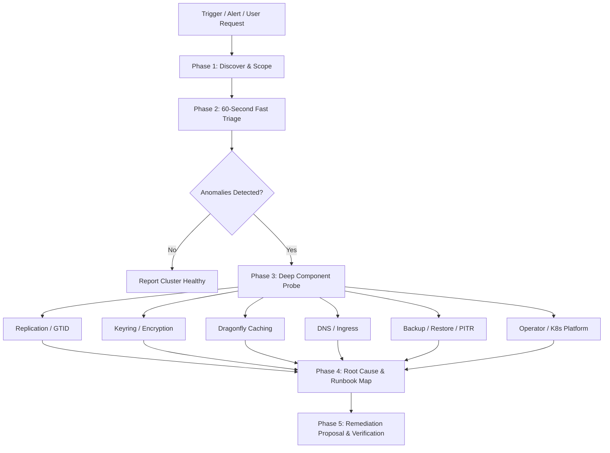

# Bloodraven Doctor (`bloodraven-doctor`)

`bloodraven-doctor` provides systematic, non-destructive diagnosis and actionable remediation for Bloodraven MySQL clusters running in Kubernetes environments.

When an operator or developer encounters issues with a cluster, replication, failover, backup, encryption, or Dragonfly caching, follow this structured runbook.

---

## Safety & Non-Destructive Operation Rules

1. **Read-Only First**: Initial triage and diagnostics MUST ONLY query cluster state, metrics, logs, and sidecar endpoints. Do NOT modify CRDs, trigger promotions, restart pods, or wipe PVCs during investigation without explicit user approval.
2. **First-Party Tools**: Use `kubectl bloodraven <command>` (the official day-2 plugin) wherever applicable (`status`, `promote`, `reclone`, `backup`, `verify-backup`).
3. **Transparent Remediation**: Before executing any state-changing command:
   - State the **Root Cause**.
   - State the **Blast Radius & Downtime Impact**.
   - State the **Data Loss Risk (RPO / RTO)**.
   - Present the exact command and seek user confirmation.
4. **Dynamic Container Resolution**: Never assume fixed container names (e.g. `sidecar` vs `bloodraven-sidecar`). Always discover container names dynamically from `.spec.containers[*].name`. Helper scripts in `scripts/` handle this automatically.
5. **Resource name**: the `mfg` short name exists only once the v1.6.0 CRD is applied. If `kubectl get mfg` reports "the server doesn't have a resource type", use `mysqlfailovergroup` (or `mysqlfailovergroups.shipstream.io`); the helper scripts already do. Likewise `mbk` (MysqlBackup) and `mbv` (MysqlBackupVerification) exist only from v1.7.0 on; spell out `mysqlbackups` and `mysqlbackupverifications` against an older CRD.

---

## Systematic Diagnostic Workflow



### Phase 1: Discover & Scope

1. Identify the target namespace and `MySQLFailoverGroup` (MFG):
   ```bash
   kubectl get mysqlfailovergroups.shipstream.io -A
   ```
2. If multiple groups exist and the user didn't specify one, ask or list the options.

### Phase 2: The 60-Second Fast Triage

Run the bundled triage script or execute the baseline inspection:

```bash
# Option A: Run the bundled non-destructive triage script
./.agents/skills/bloodraven-doctor/scripts/triage.sh -n <namespace> <group-name>

# Option B: Run native kubectl bloodraven status
kubectl bloodraven status <group-name> -n <namespace>
```

Check the core conditions and status fields:
- `.status.activeSite`: Is there an active primary site?
- `.status.topologyGeneration`: Has authoritative topology changed since the deployment's grant or the start of this investigation? This is durable across restarts, not the CR generation.
- `.status.observedGeneration` against `.metadata.generation`: has the topology manager applied the latest spec? Equal means it has (an edit that leaves its configuration unchanged, such as a backup-schedule-only change, still advances it). Lower means the last spec edit is not applied yet, and the topology conditions (`Ready`, `Degraded`, `Bootstrapping`, `Updating`, `RecoveryPending`), which carry the same `observedGeneration`, still describe the previous spec. `DivergentPromotion` keeps the generation at which its record was written, because only an administrator removes it. A gap that does not close within a few polls usually means no topology manager runs for the group (section 7c). `AutomaticFailoverHeld`, the PITR, S3-credential and encryption conditions carry the generation their own writer evaluated, and `.status.encryptionAtRest.observedGeneration` is the encryption reconcile's own, so they can differ legitimately.
- `.status.plannedFailover`: read `phase`, `runID`, `result.outcome`, `result.reason`, `result.warnings` and `admission` (`kubectl bloodraven status` prints them). The phases are `Admitting`, `Deferred`, `Fencing`, `Draining`, `WaitingForLag`, `WaitingForDragonflySync`, `PromotingDragonfly`, `Promoting`, `Publishing`, `RollingBack`, `Succeeded`, `Failed`.
  - `Deferred` with `admission.deferReason: DeploymentHold` normally means a live deployment hold, not a failed promotion. Inspect `admission.retryTime` and the message's operation ID and instance. If it remains deferred past expiry, check operator logs for Lease persistence errors.
  - `Admitting` owns nothing and fences nothing; `admission.waitReason` says what it waits for. `PeerUnreadable` means a `PrimaryCandidate` or `DisasterRecovery` site does not answer: a planned failover is strict and will end `NotStarted/AdmissionTimeout` after 2 minutes. That is by design, not a bug. `AuthorityUnsettled` with an empty `status.activeSite` (or a newer failover record not yet published) means an emergency failover is in flight: admission skips validation until it settles, then a run whose target was just promoted ends `NotStarted/AlreadyActive`. Investigate the emergency failover, not the planned run.
  - `Failed`: route by `result.outcome` with the [alert matrix](./references/alert_runbook_matrix.md) (`NotStarted`/`RolledBack`: nothing to recover, except a `RolledBack` carrying the warning `TargetReplicationNotRestored`: the target was left without a working replication channel and nothing re-points it automatically, so follow step 4 of [playbook 23](./references/troubleshooting_playbooks.md#23-ordered-update-stalls-on-the-active-site-maintenance-handoff-aborted) on the target, after first setting `super_read_only=ON` on it by hand when the result also carries `TargetSuperReadOnlyNotRestored`; `SourceLeftFenced`: [playbook 37](./references/troubleshooting_playbooks.md#37-planned-failover-left-the-source-fenced), plus the same channel restore when it carries `TargetReplicationNotRestored`; `PromotedUnconfirmed`: matrix row; `ManualRecoveryRequired`: [playbook 38](./references/troubleshooting_playbooks.md#38-automation-held-after-a-planned-failover-automaticfailoverheld); with `result.reason: SourceUnfenced` the hold is for a source that restarted on older data and is writable, the message names the transactions it lost, and no site that holds them may be recloned before they are saved). A `SourceLeftFenced` message that says `source "<site>" left as it is` means the run did not prove its fence: read the source's flags before assuming it is fenced.
  - A `bloodraven.shipstream.io/planned-failover-terminal` annotation naming the run ends it whatever `phase` says (status writes had stalled); `kubectl bloodraven status` prints `Ended by terminal marker: <outcome>:<reason>` and `kubectl bloodraven promote --wait` returns that outcome. A confirmed promotion is ended by the marker only once its failover record is durable; until then the operator logs `planned failover: status stalled, but the promotion's failover record is not durable yet; retrying` and keeps retrying (both the status and the annotation write paths are failing: fix RBAC/webhooks).
  - `Promoting` or `Publishing` with the claim already released (`planned failover: claim released` `why=publishing`) is normal: once the promotion is confirmed, recorded and published, only the `Publishing` status write is left and automation (split-brain resolution, Dragonfly follow-ups, rollouts and snapshot upgrades included) is no longer deferred. After a restart such a `Promoting` block is not re-claimed when its own failover record is durable (`planned failover: promotion already recorded; publishing without the claim`), and if the `Publishing` write keeps failing the terminal marker ends it after 10 seconds. The run's own evidence for this is the `bloodraven.shipstream.io/planned-failover-confirmed` annotation (`<runID>:since=<time>`), written before the claim is released and removed when the run ends; a leftover one from a finished run is removed by the next pass.
  - Operator log `reconcile failed while a planned failover is in flight; retrying on the planned-failover cadence` means an unrelated reconcile step (credentials, ConfigMaps, Deployments, Services, PDB, a restore, a Dragonfly snapshot upgrade) is failing while a run owns the sites. The run keeps going on its own cadence; diagnose that step's `error` as its own problem.
- `.status.conditions`:
  - `Ready == True`? `True/Healthy` is the only good answer. `False/NoWritablePrimary` means no site is writable, `False/ReplicationUnhealthy` a writable site with a replica whose replication is not healthy, `False/InitFromBackupInProgress` or `False/InitFromBackupFailed` an `initFromBackup` restore that has not succeeded; `Unknown/Initializing` follows an operator start.
  - `Degraded == False` (reason `Healthy`)? When `True`, the reason is the most important problem, in this order: a cross-site alert (`SplitBrain`, `NoPrimary`, `TotalLoss`, `CrossSiteAlert`), `BootstrapFailed`, `SiteUnhealthy` (a site unreachable while the primary is up, the failover row about to promote, or a writable non-promotable site being fenced), then the per-site reasons (`ReplicationBroken`, `ReplicationError`, `ReplicationLagging`, `ReplicationSourceMismatch`, `DivergentTransactions`, `RestoreReclonePending`). `DivergentTransactions` outranks the replication reasons; `WorkloadSelectorMismatch` (a site's Deployment or Dragonfly StatefulSet has an immutable selector the operator does not render, so it is refused, not updated) and `MetadataVersionUnsupported` (the planned-failover terminal marker or a deployment lease record has an unknown `schemaVersion`) outrank the replication reasons and `RestoreReclonePending`. Both come with a Warning Event of the same reason naming the object: [playbook 44](./references/troubleshooting_playbooks.md#44-a-site-workload-is-refused-workloadselectormismatch-or-an-internal-payload-is-unreadable-metadataversionunsupported).
  - `Bootstrapping == False`? It is `True` only while a clone runs (reason `Cloning`, `WaitingForRestart` or `SetupReplication`). `False/NotBootstrapping` is both "no clone yet" and "the last clone succeeded" (message `<Bootstrap|Reclone|Auto-clone> completed successfully`). `False/BootstrapFailed` means the last clone failed; it also sets `Degraded=True/BootstrapFailed`, which stands, and refuses deployment leases (`unstableReason: BootstrapFailed`), until the target replicates (`replication` `Healthy` or `Lagging`) or is the writable primary, or a new clone starts; once the target has replicated, a later break of it reports its own reason, not the old clone failure. The failure lives in the topology manager's memory: an operator restart or manager replacement drops both conditions back to the topology verdict and `False/NotBootstrapping` although the target still does not replicate, so check its `replication` too. A clone you asked for has finished when `Bootstrapping` reads `False/NotBootstrapping` with a `lastTransitionTime` after the request **and** the target site's `status.sites[].replication` is `Healthy` or `Lagging`; `NotBootstrapping` alone proves nothing.
  - `AutomaticFailoverHeld` absent or `False` (and no `.status.plannedFailoverHold`, and no `bloodraven.shipstream.io/planned-failover-terminal` marker with `"outcome":"ManualRecoveryRequired"`)? A run that ended `ManualRecoveryRequired` while status writes were stalled is recorded only by that marker: no condition, no hold record, an empty `result.outcome`, yet the group is held exactly the same (`triage.sh` reports it as `held by the terminal marker only`, `deployment-probe.sh` as `plannedHold.source: marker`, and `kubectl bloodraven ack-planned-failover-hold` reads the run from the marker). A `True` condition, which summarises `.status.plannedFailoverHold`, means a planned failover ended `ManualRecoveryRequired` and **automatic failover, split-brain resolution, the re-assert, ordered updates, rotations, recovery and DNS reconcile are held for the group** until a human resolves the split brain and acknowledges it (`kubectl bloodraven ack-planned-failover-hold <group>`, which writes `bloodraven.shipstream.io/acknowledge-planned-failover-hold=<runID>` with `.status.plannedFailoverHold.runID`). Page on it; see [playbook 38](./references/troubleshooting_playbooks.md#38-automation-held-after-a-planned-failover-automaticfailoverheld). Never acknowledge it before the sites are resolved. While any of these holds stands, the deployment API answers `unstableReason: AutomaticFailoverHeld` (`PlannedFailover` means only a run in flight or its claim). Argo CD shows the group `Degraded` only while the condition is `True`: its health check reads conditions, not annotations, so a marker-only hold can show `Healthy`. While a hold stands, bootstrap, reclone and keyring-rotation refusals read `automatic failover is held after planned failover <runID>; resolve the split brain, then annotate bloodraven.shipstream.io/acknowledge-planned-failover-hold=<runID>` (rotations add `; retrying after the acknowledgement`). A `True` condition with no `.status.plannedFailoverHold` (hand-edited, or left by a CRD rollback) holds automation as well (`automatic failover is held by a True AutomaticFailoverHeld condition that names no run`); it has no run to acknowledge, so remove the condition by hand once the sites are resolved and the operator releases the hold without a restart (`claim released` with `why=orphanHold`). The hold does not stop the rest of the reconcile: backups, schedules, verification, keyring work and pod labels keep running, so a stale backup status during a hold is a separate problem.
  - `RecoveryInProgress == False`? (It is expected to stay set while a planned failover holds its claim (`Fencing` through `Promoting`, or `RollingBack`), while an automation hold stands, or while an ordered update is in flight: recovery stands down until it ends. A planned failover that is only `Admitting` or `Deferred` defers nothing, and a Dragonfly snapshot upgrade does not defer recovery at all, so a site stuck through either is a real stall.)
  - `RecoveryBlocked == False`?
- Pod status: `kubectl get pods -n <namespace> -l app.kubernetes.io/instance=<group-name>`
- Recent events: `kubectl get events -n <namespace> --sort-by=.lastTimestamp`

---

## Phase 3: Deep Component Probes & Symptom Trees

Consult [references/troubleshooting_playbooks.md](./references/troubleshooting_playbooks.md) for step-by-step diagnostic trees.

### 1. Topology & Split-Brain Triage
- **Symptom**: `NoPrimary` (both sites read-only) or multiple sites accepting writes (`read_only=OFF`).
- **Not a symptom**: `Ready`/`Degraded` `Unknown` with reason `Initializing` right after an operator restart or leader change. The operator has not confirmed the primary's writable answer yet; it clears on the next poll and nothing is promoted or fenced meanwhile (see the alert matrix).
- **Probe**:
  ```bash
  # Observed state of every site: Writable, ReadOnly, Unreachable or Unknown
  kubectl get mfg <group-name> -n <namespace> -o jsonpath='{range .status.sites[*]}{.name}{": state="}{.state}{"\n"}{end}'
  ```
- **Action**: Refer to [Split-Brain Recovery Playbook](./references/troubleshooting_playbooks.md#split-brain--dual-writable-recovery).

### 2. Replication & GTID Divergence
- **Symptom**: High replication lag, `SecondsBehindSource > 0`, replication stopped, `Degraded=True` with reason `DivergentTransactions`, Events `DataLossDetected` / `DivergentReplicaDetected`, or an ordered update / planned failover refusing a divergent target.
- **Probe**:
  ```bash
  # Follower-first audit: reads each follower, then GTID_SUBTRACT on the primary.
  # Exit 0 all CLEAN, 2 a follower DIVERGENT, 3 a follower UNKNOWN (UNKNOWN is not clean).
  ./.agents/skills/bloodraven-doctor/scripts/gtid-audit.sh -n <namespace> <group-name>
  # Plus PITR evidence from plaintext manifests you fetched from the archive prefix:
  # Divergent rows, promotion records, and the candidate excludeGtids set.
  ./.agents/skills/bloodraven-doctor/scripts/gtid-audit.sh -n <namespace> <group-name> --manifest manifest-<site>.json
  # What the operator recorded (divergenceDetectedBy is OldPrimaryRecovery or ReplicaAudit):
  kubectl get mysqlfailovergroup <group-name> -n <namespace> -o jsonpath='{range .status.sites[*]}{.name}{": "}{.recoveryState}{" by="}{.divergenceDetectedBy}{" vs="}{.divergenceComparedTo}{" "}{.divergentGtid}{" lost="}{.lostGtid}{"\n"}{end}'
  # Per-site replication health (Healthy, Lagging, Broken, Unknown, NotApplicable on the primary):
  kubectl get mysqlfailovergroup <group-name> -n <namespace> -o jsonpath='{range .status.sites[*]}{.name}{": replication="}{.replication}{" lag="}{.secondsBehindSource}{" lastSeenTime="}{.lastSeenTime}{"\n"}{end}'
  ```
- **`status.sites[].replication`**: `Healthy` and `Lagging` both mean the IO and SQL threads ran with a source set for consecutive polls; `Lagging` means `secondsBehindSource` exceeds `spec.replication.maxLagSeconds` (the `Degraded=True/ReplicationLagging` threshold) and the replica stays acceptable wherever a healthy one is. `Broken` means a thread is stopped or no source is set. `Unknown` means the status could not be read, the site was not probed yet, or the healthy streak is still building. `NotApplicable` is the writable primary.
- **Key fact**: a divergent replica can keep replicating with healthy IO/SQL threads. Thread health never proves the replica holds nothing the primary lacks (issue #202). Since v1.6.0 the operator audits replicas every ~30s, keeps the block until a fresh containment proof, and refuses to promote a divergent site in ordered updates and planned failovers; emergency failover only ranks it last.
- **Action**:
  - If replica simply stopped or lagged due to network, restart replication or wait for sync.
  - If GTIDs diverged on an old primary: [playbook 2](./references/troubleshooting_playbooks.md#2-divergent-transactions--errant-gtid-on-replica).
  - If a replicating replica is divergent, or an update / planned failover refuses one: [playbook 33](./references/troubleshooting_playbooks.md#33-a-healthy-replica-reports-divergent-transactions-or-an-ordered-updateplanned-failover-refuses-a-divergent-target). Preserve the errant events, then discard them (`kubectl bloodraven reclone <group-name> <site> -n <namespace>`) or keep them by making the primary contain the set. There is no ignore setting.

### 3. Keyring & Data-at-Rest Encryption
- **Symptom**: `KeyringNotSealed`, `KeyringEscrowMissing`, or `KeyringEscrowCorrupt`.
- **Probe**:
  ```bash
  # Probe sidecar keyring status
  ./.agents/skills/bloodraven-doctor/scripts/sidecar-probe.sh -n <namespace> <group-name> keyring
  ```
- **CRITICAL SAFETY RULE**: If `KeyringEscrowMissing` or `KeyringEscrowCorrupt` is detected on a sealed pod, **DO NOT delete, restart, or reschedule the pod**. Recover the escrow Secret first.
- **Group seal state**: the `EncryptionAtRestReady` condition is `True` with reason `AllSitesSealed` only when every site is sealed; `False`/`KeyringNotSealed` and `False`/`KeyringFailed` name the sites in the message. Per site, `bloodraven_keyring_phase{phase="sealed"}` is `1` when sealed. There is no group-level `sealed` status field.
- **Coverage flags**: in `/keyring/status`, `coverage.systemTablespaceEncrypted`, `redoLogEncrypted`, `undoLogEncrypted` and `binlogEncrypted` are omitted when MySQL did not report them (no row, NULL, or an unrecognized value). An absent flag means "not reported", never `false`; `sidecar-probe.sh ... keyring` prints it as `not-reported`. The same holds for `status.encryptionAtRest.sites[].coverage` (including `keyringReadOnly`), and `bloodraven_encryption_coverage{aspect}` has no series for an unreported aspect. `unencryptedTablespaces` and `component.readOnly` are always present.
- **What `component.readOnly` means**: it is MySQL's `Read_only` status of the keyring component, set by the component config. It shows that mysqld loaded the sealed config; it does not stop writes (MySQL 8.4 and 9.7 store keys in a writable keyring file with it set). A sealed site's keyring cannot change because its `keyring` volume is the escrow Secret, mounted read-only. When diagnosing a keyring that changed, check the pod's volumes (`kubectl get pod <pod> -o jsonpath='{.spec.volumes[?(@.name=="keyring")]}'`: a `secret` when sealed, an `emptyDir` when unsealed), not this flag.
- **Escrow Secret**: named by `status.encryptionAtRest.sites[].keyringSecret` (`mysql-<group>-<site>-keyring-v<N>`). `/keyring/status` returns metadata and digests only; the recoverable copy is the keyring file in the running pod. Recreate a missing Secret with `./.agents/skills/bloodraven-doctor/scripts/keyring-escrow-recover.sh -n <namespace> <group-name> <site>`; it never deletes or overwrites an existing Secret unless re-run with `--replace-corrupt <secret-name>` after a human confirms. Follow [playbook 3](./references/troubleshooting_playbooks.md#3-keyring--encryption-at-rest-troubleshooting).

### 4. Dragonfly Cache & Session Degradation
- **Symptom**: `status.dragonfly.phase=Degraded`, `DragonflyPromotionFailed`, or active cache service has no endpoints.
- **Probe**:
  ```bash
  kubectl get mfg <group-name> -n <namespace> -o jsonpath='{.status.dragonfly}{"\n"}'
  kubectl get endpoints <group-name>-dragonfly -n <namespace>
  ```
- **Dragonfly-only failure**: when the Dragonfly master dies and MySQL does not fail over, the manager promotes the single healthy replica after `spec.failureThreshold` consecutive missed polls (default 3; `dragonfly: active master not observed; waiting before promoting a replica` is logged once). Nothing shortens that wait: a replica reporting `master_link_status:down` is not evidence that the master is gone. See playbook 4, step 7.
- **Dragonfly master restarted** (pod recreated, process replaced): the master answers as a new instance (new `master_replid`, empty or holding a snapshot), and its replica keeps the cache with the link down. The manager does not re-attach that replica (`REPLICAOF` would empty it); it promotes it: `dragonfly: active master restarted without the cache; promoting the replica that holds it`, then `target promoted via REPLICAOF NO ONE (sessions lost)`. Dragonfly then follows MySQL back with `REPLTAKEOVER` about 30s later. Do not run `REPLICAOF` on such a replica by hand. See playbook 4, step 10.
- **Planned failover or rollout sync**: the target must reach the source's replication position on every flow (`DFLY REPLICAOFFSET` on the master, `DEBUG REPLICA OFFSET` on the replica); the replica's `info replication` alone does not show lag. A site that refuses those commands (`NOPERM`, `unknown command`) ends a planned failover's wait at once (`the sync cannot be proven, so the wait was ended`) and stalls a rollout (`state=Unprovable`, Event `DragonflyRolloutStalled` after two minutes). See playbook 4, step 9.
- **Emergency promotion**: Dragonfly follows a MySQL emergency failover in the background. The MySQL failover only queues the request; the group's Dragonfly manager runs it between its polls.
  - `dragonfly emergency: ... (sessions lost)` means the target was promoted with `REPLICAOF NO ONE` instead of `REPLTAKEOVER`. The target keeps every key it holds; what is lost is what the old master had written and the target had not received. That happens when the takeover failed, was skipped because the old master was unreachable, or was not sent because the master had restarted without the cache.
  - `REPLICAOF NO ONE failed` or `re-dial for REPLICAOF NO ONE failed` is an unconfirmed attempt, not the outcome. The operator waits for the commands to settle (about 13s after a takeover), reads the target's role, and logs the result: `promotion outcome unconfirmed; target observed as master` (recorded as promoted, sessions may be lost) or `promotion failed; target not observed as master` (old source's traffic label restored). Report from that line, not from the earlier failure.
  - `dragonfly promotion: request coalesced`, `manager stopping; request dropped`, `yielding to another owner; skipping`, `planned failover in flight; skipping` and `target already promoted since the request; skipping` are normal: a newer request, a stopping manager, a waiting planned failover or rollout, or an earlier promotion made this one unnecessary. If MySQL and Dragonfly still disagree, the manager's next poll promotes.
  - A fallback can legitimately take up to about 14s, and an unconfirmed outcome up to about 13s more.
  - `dragonfly gate busy; retrying` on a planned failover, rollout or snapshot upgrade means the Dragonfly manager (or a stopping manager's last step) held the group's Dragonfly gate; it requeues in 1s and is not stuck unless it repeats for minutes. A planned failover waiting this way also emits Warning `DragonflyPromotionDeferred` and sets `status.plannedFailover.dragonfly.message`: MySQL writes stay paused until the in-progress promotion finishes (about 12-13s typically, about 40s worst case).
  - A planned failover finishes its Dragonfly takeover only on a `REPLTAKEOVER` success reply received by the operator process running the run. `status.plannedFailover.dragonfly.takeover.state: Failed` with a `dragonfly.message` containing `unconfirmed` (a target already reporting master, a lost reply, `Couldn't execute takeover: Operation canceled`, or a re-run after an operator restart or leader change) means the run changed no Dragonfly role, label or pod: only the source's traffic label was put back, and `onSyncTimeout` decided MySQL. It does not mean nothing happened on the servers: after a lost reply or `Operation canceled` the source may still complete the takeover and exit (seen on v1.38), and the message lists the roles the two sites reported right afterwards. The Dragonfly manager reconciles Dragonfly with MySQL afterwards, and promotes the target if the source returns empty (playbook 4, step 10); check `status.dragonfly` converges before acting on it.
  - `dragonfly promotion: request superseded by a newer decision; skipping` is normal after a quick failback or planned failover. A snapshot upgrade `Failed` with reason `ActiveSiteChanged` was abandoned because MySQL failed over or a promotion moved the Dragonfly master.
  - **Snapshot-restore upgrades are requested in spec** (`spec.dragonfly.upgradeStrategy: SnapshotRestore` plus a new `spec.dragonfly.image`), never by annotation, and the operator never writes spec. A run starts when a site's live StatefulSet image (`kubectl get sts <group>-dragonfly-<site> -o jsonpath='{.spec.template.spec.containers[0].image}'`) differs from `spec.dragonfly.image`; `status.dragonfly.image` is the active site's StatefulSet image, an observation only. A `Failed` run is not restarted while `spec.dragonfly` matches `status.dragonfly.upgrade.specDigest`: change `spec.dragonfly` to retry. Only when every site still runs one image may you instead set the image back to it (the `Failed` record is removed) and then forward again; with mixed images (some sites already on the target) setting it back starts a run toward the old image that downgrades the sites that moved, so keep the target and fix `spec.dragonfly` or switch to `Rolling`. A needed run that does not start is waiting: look for the Normal `DragonflyUpgradeDeferred` Event and log `dragonfly snapshot-upgrade deferred` (`reason`: the sites do not yet run `spec.dragonfly`'s non-image settings, no `status.activeSite`, a planned failover or hold owns the sites, the Dragonfly master is not the MySQL active site, or a refused StatefulSet). While a run waits or after one failed, no site moves; switching `upgradeStrategy` to `Rolling` rolls the pending image the ordinary way. A run in flight ends `Failed` on any `spec.dragonfly` change (`SpecChanged`, after the active has loaded if its image had moved), on disable (`DragonflyDisabled`) and an hour after it started (`TimedOut`). An active the run restarted that is still loading when the run ends keeps its traffic off (the message says so) until it answers as loaded; the label sweep then restores it.
- **Action**: Refer to [Dragonfly Degraded Playbook](./references/troubleshooting_playbooks.md#dragonfly-degradation).

### 5. Backups, PITR Archiver & Verification
- **Symptom**: `BloodravenBackupStale`, failed backup Job, or stale backup verification.
- **`PITRArchiveReady=False` with pods Ready**: archiving has stopped on a site while MySQL, readiness and fencing are fine. The reason says where to look: `ArchiveStoreInitFailed` (the sidecar cannot build its archive store: unreadable passphrase or S3 credentials file, invalid endpoint, empty PVC mount path, PVC mount path that is not a mount point or not writable; it retries on its own from 5 s up to every 5 min, which picks up Secret, endpoint and permission fixes, but `is not a mount point` never clears by retrying: fix whatever removed the `pitr-archive` volume (mutating webhook, policy engine, manual edit) and restart the pod, after a planned failover away from the site if it is the primary), `ArchiverError` (an upload/manifest error on 2 consecutive archiver scans; also a server that could reissue GTIDs its archive already holds, `lastError` "… no longer has archived transactions … that it issued … and reuses their GTIDs when it writes", playbook 41), `ArchiverDisabled` (the sidecar runs without PITR configuration although no rollout is pending; check `spec.backup.pitr.profileName`), `SidecarUnreachable` (3 failed polls over ≥ 60 s, or 5 min for a sidecar that has not answered since the operator started; with an older sidecar image this is the crash loop), `SidecarOutdated` (an enabled archiver reports no archive-identity block: `spec.sidecar.image` pins a sidecar older than v1.7.0, so upgrade or clear it, `Unknown`/`AwaitingRollout` while that site's ordered update is pending, at most 30 min; or, right after an upgrade to v1.7.0 with no pin, the Deployments' update is deferred (`pitr render deferred`) and only a switch to a new prefix rolls them, playbook 26), and the archive identity refusals below, which rank after `ArchiveStoreInitFailed`. `Unknown`/`AwaitingRollout` is the normal state while a site's ordered update is pending after enabling PITR, for at most 30 minutes and only for a `profileName` that renders an archiver. `PITRArchiveReady=True` does not prove a PVC archive is on the PVC; check the pod's volumes. Current sidecars never exit or go unready over an archive init failure, so it no longer removes the pod from Services. Read `/archiver/status` (`storeReady`, `lastError`) and the condition message, which lists every affected site. See [playbook 31](./references/troubleshooting_playbooks.md#31-pitr-enabled-pods-ready-pitrarchivereadyfalse).
- **Archive identity refusals** (`PITRArchiveReady=False` with `ArchiveForeign`, `ArchiveCopy`, `ArchiveLegacy`, `ArchiveDescriptorMissing`, `ArchiveEncryptionMismatch`, `ArchiveKeyMismatch`, `ArchiveVersionUnsupported` or `ArchiveStoreUnsupported`): every archive has a write-once plaintext descriptor `<prefix>/binlogs/archive.json` (archive ID derived from the group UID and the normalized destination, source `{namespace,name,uid}`, encryption mode and passphrase `keyCheck`), and manifests are version 2 naming that ID. A writer refuses a descriptor of another group (`Foreign`), of its own group at another destination (`Copy`: copies are read-only), a pre-v1.7.0 prefix (`Legacy`, expected right after upgrading), version 2 manifests without a descriptor (`DescriptorMissing`), a mismatched encryption or key, a newer format or a damaged `archive.json` (`VersionUnsupported`: undecodable, trailing data, wrong kind, a malformed field, source names outside Kubernetes bounds, or larger than 64 KiB; the message then says `archive.json is damaged …` and gives the repair, restore the original object or use a new prefix, instead of upgrading), or a store without conditional writes (`StoreUnsupported`). These never clear by retrying. Read `status.pitr.archive` (`destination`, `archiveID`, `encryptionMode`, `state` `AwaitingDescriptor`/`Verified`/`Refused`, `reason`, `observedTime`) and each site's `/archiver/status` `archive` block; `lastError` starts with the token. The remedy is usually a new prefix plus a full backup. The sidecar needs `s3:ListBucket`, `s3:GetObject`, `s3:PutObject` and `s3:DeleteObject`. See [playbook 39](./references/troubleshooting_playbooks.md#39-pitr-archive-identity-refused-archivelegacy-archiveforeign-archivecopy-archivedescriptormissing-encryption-store).
- **Unsafe history marker** (`ArchiveUnsafeHistory`, Warning `PITRArchiveUnsafeHistoryDetected`): a site found a replication or binlog filter, `binlog_format≠ROW`, `binlog_row_image≠FULL` or `replica_preserve_commit_order` off, persisted `historyIntegrity{violation,detail,at}` in its manifest, and stopped uploading. The marker is permanent for the prefix; removing the setting does not clear it, and it removes every restore target that needs that site's bytes, including targets before the violation (a new prefix restores only future targets). While PITR is enabled the operator refuses such keys in `spec.mysqlConf` (group or site; the effective value is judged per site): it leaves them out of the rendered my.cnf, sets `PITRMysqlConfAccepted=False`/`PITRUnsafeSettingRefused` naming `site: <field> sets <key>[=<value>]`, and emits a Warning `PITRMysqlConfRefused`; it owns `replica-preserve-commit-order=ON` (legacy `slave-*` aliases are normalized, so they cannot override it). A marker therefore comes only from an out-of-band change (`SET GLOBAL`, a hand-edited my.cnf). Remedy: fix the setting, new prefix plus full backup. A `lastError: history integrity: …` without a marker means the check itself could not run. See [playbook 40](./references/troubleshooting_playbooks.md#40-pitr-unsafe-history-marker-archiveunsafehistory).
- **Divergent rows are evidence, not a failure** (`/archiver/status` `divergentRows`, `reissuableGtids`): each sidecar audits its own manifest against its server every scan and records the rows whose transactions the server no longer has in the manifest's `divergent` list. After a lossy failover that ends in a reclone, the recloned site records the tail it archived before the clone. That is correct archive content: `lastError` stays empty, `uploadFailures` does not move, `PITRArchiveReady` stays `True` and names the site in its message (`...; iad: 1 divergent row (...)`), the sidecar logs INFO `archive divergence evidence recorded` once, and uploads and retention continue. Do not quarantine such a row; restores across it refuse `PITRArchiveDivergentHistory` until `excludeGtids` lists the set (playbook 42). `reissuableGtids` is the part of those transactions the server could issue again (the ones under its own current `server_uuid`): `""` means none, absent means the last maintenance pass has no verdict (no audit has run yet, the manifest or the server's state could not be read, the manifest carries a recorded GTID reuse, or the server has no history); a verdict is never kept from an earlier pass. Probe: `scripts/sidecar-probe.sh -n <namespace> <group-name> archiver` prints a `divergence:` summary line per pod, and `scripts/triage.sh` prints `reissuableGtids=` per site (`none`, the set with a pointer to playbook 41, or `not-evaluated`).
- **Reissue risk** (`reissuableGtids` not empty, `PITRArchiveReady=False`/`ArchiverError`, Warning `PITRArchiveReissueRiskDetected` at a promotion): a server that lost transactions it issued and still has the `server_uuid` it issued them under reuses their GTIDs with its next writes; once those are archived, every restore from the archive refuses `PITRArchiveHistoryReset`. A clone gives its recipient a new `server_uuid`, so this is a data directory restored or reset without a clone, or a clone that did not rotate the `server_uuid` (Warning `CloneServerUUIDNotRotated`, or a clone by an earlier release). Quarantined rows count too. While the site is a replica, reclone it: the error clears and the row stays as evidence. The Warning fires only when the promoted site reports a non-empty `reissuableGtids` (or, from a sidecar with no verdict, any divergent or quarantined row; the message then says the risk was not evaluated); after it, start a new prefix and take a full backup. See [playbook 41](./references/troubleshooting_playbooks.md#41-reissue-risk-a-server-that-could-reissue-archived-gtids-pitrarchivereissueriskdetected).
- **A site that lacks transactions it issued itself** (`status.sites[].recoveryState: RecloneRequired` with `lostGtid`, Warning `OwnTransactionsLost`, `RecoveryPending`/`Degraded` reason `OwnTransactionsLost`, operator WARN `own transactions lost`): a site came back on an older data directory while another site holds what it issued. MySQL's replication receiver drops events with the replica's own `server_id`, so replication never returns them, and the site would issue the same GTIDs again if promoted. There are two cases, and the Event and the `RecoveryPending` message say which. If the primary holds the transactions, the operator does not configure or start the site's replication, does not promote it (`PromotionRefusedOwnTransactionsLost`), and reclones it on its own through the reclone path; right before the clone it fences the site and compares it with the primary again, and clones only if the primary holds everything the site holds. The report ends when the clone completes; failed clones are retried after 5 minutes, doubling to at most 2 hours (`OwnTransactionsLostRecloneFailing` from the third failure). If only another site holds them (a divergent replica, `RecoveryBlocked`), the reported site keeps replicating and is not recloned automatically; it is not promoted until that other site is recloned or the primary contains the transactions. Do not "fix" a site that lacks what the primary holds by starting replication by hand: it runs clean and stays wrong. A site that also has a `divergentGtid` stays `RecoveryBlocked` and is not cloned automatically. The operator keeps the `server_uuid`s each site has had, and where a clone into it was issued, in the group annotation `bloodraven.shipstream.io/server-uuid-history` (a site keeps its `server_id` and changes its `server_uuid` at every clone); what a site lacks of an identity it had before a clone it gave up at that clone, so another site that still holds it is divergent and is no evidence against the site at a promotion. A site in `status.restoreReclones.pending` is never evidence against another site and never the copy to promote. `kubectl bloodraven status <group>` prints the lost set and the whole condition message under "Site reports"; `gtid-audit.sh` prints `OWN TRANSACTIONS LOST` for a follower's current identity against the primary. On a CRD from before `RecloneRequired` the site reads `RecoveryBlocked` without sets (operator WARN `status written with the values an older CRD accepts`): apply the release's CRDs. See playbook 48.
- **Server identity after a clone** (Warning `CloneServerUUIDNotRotated`, operator log `clone recipient server_uuid rotated` / `clone recipient kept its server_uuid`): every clone (reclone, fresh-deploy bootstrap, auto-clone, post-restore reclone queue) gives its recipient a new `@@server_uuid`. The mysql container's `command` is the operator's launcher, which removes `auto.cnf` on the start that installs a finished clone and logs `bloodraven-launcher: … removed auto.cnf …` in the mysql container. An ordinary restart, a pod replacement and a failed or killed clone keep the identity. So read a site's `server_uuid` after a clone, and never compare GTID sets by a UUID remembered from before one. The Warning means a recipient kept its identity (a pod that has not rolled onto the launcher yet, an image that bypasses it, a file it could not remove, or with encryption at rest and an encrypted binary log a clone installed by a sealed pod); the site works, and the risk is a later reissue of GTIDs it lost. The comparison survives an operator restart: the pre-clone value is kept in the group annotation `bloodraven.shipstream.io/clone-server-uuid` until the clone has an outcome, and with encryption at rest the recipient stays `Unsealed`/`Clone` for as long (operator log `clone restart not confirmed; keeping the recipient's keyring hold`). See playbook 47.
- **Outgoing primary's tail** (`/archiver/status` `tail`, Warning `PITRArchiveTailNotArchived`): a writable site uploads every sealed binlog; a read-only site uploads only the tail of its own last writable era (every unarchived sealed binlog up to the last one holding a transaction its own server originated), never pure replica copies. So a read-only former primary can show `filesArchived`/`lastUploadAt` advancing and `backlogFiles` above 0 while it drains or fails to drain that tail; a site that was only ever a replica uploads nothing. `/archiver/status` reports it in `tail{state, activeFile, newestSealedFile, pendingFiles, reason}` (`state` is `Drained`, `Pending` or `Blocked`; the block is absent until a scan has read the binlog index, and from older sidecars). A read-only site that may not upload its tail (latest manifest record is a reset record or there is none, archive session not verified, binlog files unreadable under `binlog_encryption=ON`) is `Blocked` with a `reason`, logs WARN `binlog tail not archived while read-only` once per reason, and sets neither `lastError` nor `uploadFailures`. A tail upload that fails is an archiver error like a writable site's: `lastError` and `backlogFiles` stay set from the failing scan until a scan uploads the file or finds nothing left to upload. `tail.state` is about the index in which `tail.activeFile` was the active file (a rotation after that scan's index read is not in it), and a scan that could not read the index reports no file names. The operator rotates binary logs itself, each time one best-effort `FLUSH BINARY LOGS` bounded at 1 second that never blocks or fails its caller: on the promoted site at every promotion (WARN `promotion binlog rotation failed`), on the fenced source of a planned failover or ordered-update handoff (WARN `outgoing primary binlog rotation failed`), and on a site before a reclone (WARN `pre-reclone binlog rotation failed`). With PITR enabled a reclone then waits up to 2 minutes for `tail.state: Drained` from a scan that saw the rotation; if it is not confirmed, the clone starts anyway with WARN `pre-reclone archive tail not archived` and the Warning Event `PITRArchiveTailNotArchived` (site and cause). CLONE wipes that tail and nothing recovers it: only restore windows that need transactions it alone held refuse `PITRArchiveGap`; take a full backup. A tail archived after a lossy failover holds the lost transactions: restores across it refuse `PITRArchiveDivergentHistory` until excluded, and after the old primary is recloned its audit records that row as divergent (`divergentRows`), which is evidence and not an error unless the server kept its `server_uuid` (`reissuableGtids`, playbook 41). Probe: `scripts/sidecar-probe.sh -n <namespace> <group-name> archiver` prints each pod's raw status and a `tail:` summary line, and `scripts/triage.sh` prints `tail=` per site; an absent block is reported as not reported, never as drained. See [playbook 45](./references/troubleshooting_playbooks.md#45-binary-log-rotation-failed-at-a-promotion-planned-handoff-or-reclone-promotion-binlog-rotation-failed) and [playbook 46](./references/troubleshooting_playbooks.md#46-a-reclone-started-without-its-binary-log-tail-archived-pitrarchivetailnotarchived-or-a-read-only-site-does-not-archive-its-tail).
- **PITR with encryption at rest archives nothing** (`PITRArchiveReady=False`/`ArchiverError`, `lastError` `archive mysql-bin.NNNNNN: invalid binlog magic`, `filesArchived: 0`): with `spec.encryptionAtRest` MySQL encrypts the binary log unless `coverage.binaryLog` is `false`, and the archiver cannot read encrypted binlog files. No binlog is uploaded, a read-only site's tail is `Blocked` (`read the header of …`), promotion records have no promotion set, and admission does not refuse the combination. Confirm with `status.encryptionAtRest.sites[].coverage.binlogEncrypted` and `SHOW BINARY LOGS` (`Encrypted: Yes`). It is a known limitation: the group's restore points are its full backups. See playbook 49.
- **Backup identity**: every backup Job starts with a `backup-stamp` init container that writes `<location>.bloodraven-backup.json` (backup and source refs, `pitrArchiveID`, site, `serverID`, dump filters, the dumped server's `serverClock{start,end}`), encrypted with the dump passphrase when the profile encrypts. `MysqlBackup.status.failoverGroupUID` and `status.pitrArchiveID` are pinned on the Job (annotations `bloodraven.shipstream.io/failover-group-uid`, `bloodraven.shipstream.io/pitr-archive-id`) and recovered from it. A termination message starting `backup stamp: ` fails the backup; `check dumped server` means the Job reached a server whose `server_id` is not the source site's `spec.sites[].serverID`.
- **Encrypted PITR startup failure**: `failed to init archive store` with `permission denied` for the passphrase file. Current sidecars keep serving HTTP, readiness and fencing, report `storeReady:false` with the error, and retry; sidecars that predate that exit before starting HTTP or fencing and crash-loop. Check sidecar logs and the pod's `pitr-passphrase` projection: it names the binding's key snapshot (`optional: true`, so a missing snapshot leaves mysqld running and the archiver failing closed with `PITRArchiveBindingReady=False/KeyMaterialLost`), and its mode must be `0444` for a non-root sidecar without fsGroup, matching PITR S3 credentials. See [playbook 25](./references/troubleshooting_playbooks.md#25-encrypted-pitr-sidecar-fails-to-init-archive-store).
- **PITR archive encryption bindings** (condition `PITRArchiveBindingReady`, `status.pitrArchiveBindings[]`): the group records, per archive destination it writes or reads, the encryption identity it accepted: `id` (`pab-` + 16 hex), `destination`, `archiveID`, `source`, `encryption{mode, algorithm, keySecretName}`, `state` (`Pending`/`Bound`/`Refused`), `reason` and `check{jobName, jobUID}`. Read `encryption` only when `state` is `Bound`. For `Passphrase` the operator copies the trimmed passphrase into an immutable **key snapshot** Secret `mysql-<group>-pitr-key-<h10>` (labels `app.kubernetes.io/name=mysql-pitr-key`, `bloodraven.shipstream.io/failover-group-uid=<uid>`, `bloodraven.shipstream.io/pitr-binding-id=<id>`; annotation `bloodraven.shipstream.io/pitr-accepted` with a `keyCheck` once accepted). The sidecar (mounted `optional: true`), restore, verification and `pitr-archive-check` Jobs mount the snapshot, never the user's Secret, and `BLOODRAVEN_PITR_KEY_REVISION` is the snapshot name or `plaintext`. A binding becomes `Bound` only by proof: a sidecar reports the descriptor `Verified` with that exact revision and mode, or a `pitr-archive-check` Job (labels `app.kubernetes.io/name=mysql-backup`, `bloodraven.shipstream.io/resource=pitr-archive-check`) verifies it. Once `Bound`, pods render the binding, so a passphrase or encryption edit only turns the condition `False` (`KeyChangeRefused`, `EncryptionChangeRefused`, Warnings `PITRArchiveKeyChangeRefused` / `PITRArchiveEncryptionChangeRefused`) and archiving continues under the accepted key: **rotation means a new prefix**. Other reasons: `KeyMismatch`, `ArchiveForeign`, `ArchiveCopy`, `ArchiveLegacy`, `ArchiveDescriptorMissing`, `ArchiveNotFound`, `ArchiveEncryptionMismatch`, `ArchiveVersionUnsupported` (refusals; nothing new renders), `KeyMaterialLost` (the snapshot is gone or does not hold the accepted key; mysqld keeps running and the archiver fails closed; never delete a snapshot that is present but fails the check, it may hold the only copy of the key: see playbook 26), `BindingLimitReached` (16 entries that stay: `Bound` or used by a target; a reader gets it only when all 16 are `Bound`, otherwise it waits with "the binding list is full of entries that are not Bound; waiting for the group's binding pass to make room for <dest>"; at the limit a new active destination is never rendered). A check that cannot list the prefix is no refusal: the entry stays `Pending/Authenticating` with `ArchiveListFailed: ... retrying in 1m0s` and is retried every minute (restores and MBVs wait). Check Jobs carry annotation `bloodraven.shipstream.io/pitr-key-secret-uid` (the candidate snapshot's UID at creation); a `Verified` verdict for a snapshot replaced under the same name is dropped and re-checked. Check refusals read "<token> reported by the writer check of ..." or "... reported by the reader check of ...". Snapshots have **no owner reference** and are **never pruned**: they survive group deletion and go only by release (`kubectl annotate mfg <group> bloodraven.shipstream.io/release-pitr-archive-binding=<id>:confirm=<group>:uid=<group uid>`, one id per annotation, refused while anything uses it) or by hand. Each `MysqlBackup` gets its own immutable dump-key snapshot (`app.kubernetes.io/name=mysql-dump-key`, named in `status.artifactStorage.passphraseSecretKeyRef`), deleted only after a cleanup Job confirms its artifacts are deleted; a deleted encrypted backup that recorded neither its producing Job nor its artifact destination keeps it (Warning `ArtifactCleanupSkipped` names it). Encrypted backups from before v1.7.0 recorded no dump key: verifying one fails `PITRBackupDumpKeyMissing` for good (no override); restore it with `decryption`. Never read snapshot `data` while diagnosing; list metadata only (`support-bundle.sh` does). See [playbook 26](./references/troubleshooting_playbooks.md#26-pitr-archive-encryption-binding-refused-or-key-material-lost).
- **Backup and restore reasons from bindings**: a `MysqlBackup` of the active PITR profile waits `Pending` with `PITRArchiveRolloutPending` while the site Deployments render different archive IDs (a roll in progress); other backups, and every backup while the render is deferred (any site Deployment lacks a decodable `bloodraven.shipstream.io/pitr-render` annotation while the write binding is not `Bound`/`Establishing`: re-creating one site Deployment does not lift it), proceed without an archive stamp (Normal Event `PITRArchiveStampSkipped`, not a PITR baseline). A Deployment of a site no longer in `spec.sites` is ignored once scaled to zero with no pod; while it may run, the disagreement reason appends "; Deployments <names> belong to sites no longer in spec.sites and are never re-rendered: scale them to zero or delete them" (admission refuses removing a site, so such a Deployment is a leftover: scale or delete it). The ordered update also repairs a hand-edited or lost `pitr-render` annotation (drift is reported when it differs from the resolved render although the spec hash matches); `PassphraseSecretMissing` when its encrypted profile's Secret or key is missing (also blocks an abandoned cleanup whose recorded dump-key snapshot is gone), and `DumpKeySnapshotConflict` when its dump-key snapshot name is held by another backup; it fails `ProfileReadOnly` on a read-only profile (Warning `BackupScheduleRefused` for schedules). Restores and verifications wait on a not-ready read binding and fail with `PITRArchiveBindingNotReady` on `ArchiveNotFound`, `ArchiveDescriptorMissing`, `ArchiveLegacy`, `ArchiveVersionUnsupported` (verifications also on `BindingLimitReached`). A verification of an encrypted backup whose recorded dump-key Secret is gone fails at launch with `PITRBackupDumpKeyMissing` ("backup <b> is encrypted and the Secret <s> it recorded as its dump key is gone; restore that Secret"). A `pointInTime` verification with no `archiveProfileName` on a group with PITR disabled is refused (`PITRTargetInvalid`: "... so group <g> has no active PITR archive to replay; set pointInTime.archiveProfileName to the profile of the archive to replay (a retained archive needs no writer), enable spec.backup.pitr, or verify without pointInTime"). Dump decryption uses `decryption`, else `status.artifactStorage.passphraseSecretKeyRef` (the backup's own snapshot), never the live profile Secret (`PITRBackupDumpKeyMissing` otherwise).
- **PITR after reclone or rebuild**: `backlogFiles=0` alone does not prove historical coverage. Manifest rows distinguish reused names with content IDs (keyed for encrypted profiles); a manifest holding a row without an `id` (written before archive identity, stripped by an older writer, or hand-edited) is refused, `PITRArchiveObjectInvalid`, and nothing repairs it. History work yields between rotations; no full-file scratch space is required. Inspect `lastError`, the durable `divergent`/`quarantined`/`acknowledged` records and `epoch.resetReason`; for a missing or unreadable object use the reversible `bloodraven pitr-quarantine` procedure with a verified canonical backup. Divergent rows are evidence and need no quarantine (bullet above). GTID reuse needs verified conflicting issuance, not upload order. Bootstrap/clone observations do not establish divergence; every eligible audit recomputes the records, but known loss from the current server UUID is kept when its numbers return, because replacement bytes may still be active (reissue risk, playbook 41). Issuance verification of rows with unbound coverage runs independently of retention. An obsolete guard can be acknowledged after a canonical backup covers every active stream and overlapping issuance is verified; this removes no rows or older recovery windows. A quarantined row is never data and never an acknowledgement: its in-window transactions still need `excludeGtids`, and an unreadable one is waived only for a backup taken after the quarantine, so take a full backup after quarantining. Prefer a new prefix/full backup after RESET. Check retained history and reader/writer compatibility before calling recovery complete. See [playbook 27](./references/troubleshooting_playbooks.md#27-pitr-history-after-a-site-reclone-or-data-rebuild).
- **Retention deferred**: deletion needs content-bound complete binlog GTIDs covered by every retained group backup's pre-dump `status.gtidExecuted`, across profiles. In-flight group backups pause new retirements. `noRetainedBackups` and `backupInFlight` are normal Info waits; missing metadata, unsupported files, or version skew retain objects. Backfill is bounded and persists IDs/proofs together. Normal progress logs at Info; failed coverage identities wait the normal interval while other backfill can progress. Unresolved issuance can pause all new retirements for the site. Its failure stays in lastError during cooldown, and retention deferred logs archiveIssuanceUnverified at Warn with the row/error and repair/quarantine remedy; monitor archive capacity until resolved. Cutoff throttling follows source IP, so check direct Service routing and shared-NAT callers on a Warn lookup failure. The support bundle captures projected backup bounds in `backups.json`. See [playbook 28](./references/troubleshooting_playbooks.md#28-pitr-retention-deferred-because-gtid-coverage-is-unknown).
- **Retention cleanup retry**: `retention: delete object` and `retention: save delete acknowledgements` preserve durable pending records in the manifest's `pruned` list. Approved deletes retry even without a new operator proof; restores select only live `files`. See [playbook 29](./references/troubleshooting_playbooks.md#29-retention-object-deletion-or-acknowledgement-keeps-failing).
- **Retired local binlogs**: matching retired content stays out of upload/backlog after restart; different bytes reusing the filename still archive. Every running site maintains its own archive, including replicas. Acknowledged records remain until the filename leaves a readable local index and the file is absent; pending records are never compacted. See [playbook 30](./references/troubleshooting_playbooks.md#30-retired-local-binlogs-or-growing-retirement-metadata).
- **Probe**:
  ```bash
  kubectl get mysqlbackups.shipstream.io -n <namespace> --sort-by=.metadata.creationTimestamp
  kubectl get mysqlbackupverifications.shipstream.io -n <namespace>
  kubectl get mysqlfailovergroup <group-name> -n <namespace> \
    -o jsonpath='{.status.conditions[?(@.type=="S3CredentialsReady")]}'
  ```
  `S3CredentialsReady=False` means an S3 `credentialsSecretName` lacks `AWS_ACCESS_KEY_ID` or `AWS_SECRET_ACCESS_KEY`; Jobs fail instead of using ambient credentials. Fix the Secret before re-running anything. The `spec.initFromBackup.source.s3` Secret is checked only until `status.restore.phase` is `Succeeded`.
- **initFromBackup not yet succeeded**: a new group whose `status.restore.phase` is not `Succeeded` (unobserved, `Pending`, `Running` or `Failed`) is deliberately out of service even though its seed is writable and `status.activeSite`: no DNS record, no `-primary`/`-replicas`/per-site Service endpoints, no clones, no promotion of another site, `Ready=False` with reason `InitFromBackupInProgress` or `InitFromBackupFailed`. Do not relabel pods or point DNS by hand. After a failure, follow the `Ready` message / `RestoreFailed` Event: if the Job log has `BLOODRAVEN_LOAD_START`, empty the target (delete and recreate the group, or delete the group's MySQL pods and PVCs together with `kubectl delete pvc,pod -l app.kubernetes.io/instance=<group>,app.kubernetes.io/name=mysql -n <ns>` and wait until the re-created claims are `Bound` and the pods `Running`; deleting the PVCs alone leaves them `Terminating` under the running pods), then delete the restore Job. `spec.initFromBackup` is fixed at creation (admission refuses adding, editing or removing it), so a cause inside the block means deleting the never-bootstrapped group and creating it again with the corrected block, after checking that `status.restore.phase` never reached `Succeeded`. See the `InitFromBackup*` rows in the alert matrix.
- **Admission refusals of edits (v1.7.0)**: sites cannot be removed or renamed (replace the group: site docs "Replacing a site"); a site's `zone`, `storage` and `serverID`, a backup profile's `pvc.provisioned`, `spec.initFromBackup`, the keyring paths while encryption is enabled, and a `MysqlBackup`'s or `MysqlBackupVerification`'s group, profile, source site, backup, `pointInTime` and `sanityCheck` cannot change; `spec.encryptionAtRest.enabled` cannot go back to false, even after a refused adoption. Do not delete and recreate a group that holds data to get around them: a group with data is replaced by a new group from a final backup taken after writes stop, with downtime until the cut-over (site docs "Replacing a site" > "A group that holds data"; each new site's `zone` must be a zone label no node of any old-group site's zone carries, because pods of both groups are placed by zone alone and either group's failover taints the nodes its selectors match; a scratch-group rehearsal before writes stop proves scheduling, not isolation). An empty `status.activeSite` proves nothing about history: it is empty whenever no site or more than one site is writable. Treat a group as never having held data only when every check of "Does the group hold data?" passes: every site queryable (or its data claim never bound: empty `spec.volumeName`), no schema but `mysql`/`information_schema`/`performance_schema`/`sys` and no client but the operator, sidecar and replication on every site, no `MysqlDatabase` naming the group, no `Succeeded` `status.restore.phase`, no `status.lastFailover`. A site that cannot be inspected, or any doubt, means it holds data. Only then may it be deleted and re-applied corrected ("A group that never held data"), after confirming with the user. Any group deletion follows "Deleting a group without losing backups": suspend `spec.backup.schedules[]` (which also stops their retries) and profile `verification` schedules and wait for their Jobs; copy every artifact to keep off the group-owned claim `mysql-<group>-backup-<profile>` (from `pvc.provisioned`) to S3 or a `claimName` claim and check the copy, and for an encrypted backup copy the base64 data of its dump-key snapshot Secret (named in `status.artifactStorage.passphraseSecretKeyRef`; do not build the name by hand) into a new Secret the user owns without decoding it, and compare the two values (a `Delete` backup's cleanup deletes the snapshot; restore the copy with `initFromBackup.decryption.passphraseSecretKeyRef`), because that claim is deleted with the group whatever the backup's `deletionPolicy` (`Retain` keeps only S3 and `claimName` artifacts; do not strip the claim's ownerReference, the operator restores it); set `deletionPolicy: Retain` on the S3/`claimName` backups to keep, delete all the group's `MysqlBackup` objects and wait until they are gone; then `kubectl delete mfg <group> --cascade=foreground` and wait until `kubectl get pvc,mysqlbackup,mysqlbackupverification -l bloodraven.shipstream.io/failover-group=<group>` is empty before re-applying the same name. Give profiles new prefixes when the old S3 or `claimName` prefix holds any object. A `MysqlBackup` failing `BackupStorageMismatch` found an owned claim `mysql-<group>-backup-<profile>` of another class or a smaller request than `pvc.provisioned` (left by an earlier profile of the same name). Only backup Jobs are refused: a PITR archiver of that profile keeps writing binlogs to the claim. To replace the claim, disable PITR on that profile (or switch `spec.backup.pitr.profileName`) and wait for the MySQL pods to roll, keep or copy what it holds, then delete it; or restore the profile's values. A larger request (an expanded claim) is accepted with Normal `BackupStorageExpansionAccepted`. A site PVC expanded beyond `spec.sites[].storage.size` comes back at the spec size when deleted: for a reclone, stop the operator, scale the site Deployment `mysql-<group>-<site>` to 0, delete the claim, pre-create it at the expanded size, then restart the operator and scale the site Deployment back to 1 by hand (under OrderedUpdate the operator does not) (site docs "Recreating an expanded claim").
- **MySQL authentication**: If backup or restore reports `Access denied` while the operator connects successfully, check whether the Job script predates the exact-content credential reader. Older scripts strip password whitespace and normalize CRLF, including newlines intentionally stored by `--from-file`. Fixed scripts preserve mounted MySQL credentials and honor an empty password file over environment fallback. Follow the [credential playbook](./references/troubleshooting_playbooks.md#12-backup-or-restore-reports-access-denied-with-valid-credentials); do not print or collect password contents.
- **Artifact identity**: If a successful backup cannot be found by restore, verification, or cleanup, compare `status.artifactStorage.location` with the original Job's main-container output/storage env. Account for one kubelet expansion when comparing env values; consumer Jobs escape literal dollars while status keeps the actual path. Legacy records without a metadata condition retain their producer-reported locations. Older completion encoding corrupted underscores and could not distinguish them from spaces. New dump and sanity sentinels use versioned percent encoding (`v=2`). Never repair old locations by globally substituting spaces or underscores; follow the [location playbook](./references/troubleshooting_playbooks.md#13-succeeded-backup-cannot-be-found-at-its-recorded-location).
- **Deleted backup stuck Terminating**: read the `ArtifactCleanup` condition (`scripts/triage.sh` section 8 prints it with `status.artifactStorage`). Cleanup runs `bloodraven artifact-cleanup` from the operator image against the bucket/endpoint/region or claim recorded in `status.artifactStorage` when the backup ran, never the live profile; only credentials come from the profile. Cleanup checks that `status.artifactStorage.location` (immutable once recorded, CEL-enforced) ends in the backup name, is in the recorded bucket or under the PVC mount, and matches the producing Job's destination when the Job still exists (`DestinationMismatch` otherwise). A successful backup with no recorded `status.artifactStorage` is released without deleting anything, with Warning `ArtifactCleanupSkipped` ("no recorded artifact destination"). `CleanupFailed` (exit 75, a crash, deadline, eviction) retries 5 min after the Job failed, `CleanupRejected` (exit 64) 30 min after; `CleanupPending` names a pod that cannot start (waiting reason, or >1 min unscheduled/`ContainerCreating`); `ForegroundDeletion`/`OrphanDeletion` wait for the garbage collector; `CleanupJobInvalid` means the recorded destination cannot become a Job; a new backup whose `mysqlbackup-<name>` Job is not its own waits in `Pending` (`BackupJobConflict`) and fails after 30 min; the pod termination message carries `BLOODRAVEN_CLEANUP_FAILED: <reason>`. `DestinationMismatch` needs a human: inspect storage, delete by hand, then remove the finalizer. `status.cleanupStartTime` is set just before the first cleanup Job is created; once it is set, switching `spec.deletionPolicy` to `Retain` no longer stops the cleanup (the Events say "deletionPolicy was changed to Retain after the cleanup started"). Before releasing an abandoned backup's leftovers (a never-succeeded backup, or one whose group or profile is gone) the operator first stops the producing backup Job and waits for its pods, so a dump still writing is never deleted under it; a never-succeeded encrypted backup's leftovers are read with the passphrase Secret recorded in `status.artifactStorage.passphraseSecretKeyRef`. An abandoned cleanup that finds no stamp but objects at the location exits 0 with `BLOODRAVEN_CLEANUP_SKIPPED: <reason>`: nothing is deleted, the finalizer is released WITHOUT deleting the dump-key snapshot, and a Warning `ArtifactCleanupSkipped` names the location, stamp key and kept snapshot (a foreign stamp, or no stamp over an empty location, is still `BLOODRAVEN_CLEANUP_COMPLETE objects=0`). `ProducerStopStuck` (Warning `ArtifactCleanupStalledProducerStop`, after 10 min) means a producer pod has not stopped, usually on an unreachable node: the deletion stays held; once the node is confirmed down, `kubectl delete pod <pod> -n <ns> --force --grace-period=0`. Counted by `bloodraven_backup_artifact_cleanup_failures_total{group,profile,reason}`. Old operators' `cleanup.py` Jobs always failed on S3 (MySQL Shell has no `util.rmdump`) and are replaced automatically after upgrade. See [playbook 35](./references/troubleshooting_playbooks.md#35-deleted-mysqlbackup-stuck-terminating-artifact-cleanup).
- **Retention**: after each terminal backup or verification, the operator prunes the CRs of that group and profile. A successful backup is kept while it is one of the newest `profiles[].retention.keepLast` (default 7, at least 1) or completed within `keepWithinDays`; failed backups are capped by `keepFailed` (default 10; `0` keeps none), except that the latest backup of a schedule in `spec.backup.schedules`, failed or not, is kept until a newer backup of that schedule exists (the retry input and the `status.backupSchedules` result). Verifications use `verification.retention.keepLast`/`keepFailed` (30/10; `0` keeps none). A keep-none rule waits two minutes after the operator records a run's verdict (and after an operator start) before deleting it, not two minutes after its Job ended. A backup of a removed profile keeps every success. There is no "never prune" setting. See [playbook 43](./references/troubleshooting_playbooks.md#43-backups-or-verifications-kept-or-deleted-against-expectation-retention).
- **Verification holds**: a `MysqlBackupVerification` annotates the backup it reads with `verification-hold.bloodraven.shipstream.io/<verification UID>: <name>`. While the hold is live, retention skips the backup (`RetentionDeferred`), a manual delete waits (`ArtifactCleanup=False/HeldByVerification`, `ArtifactCleanupDeferred`), and a Terminating held backup still bounds the PITR binlog cutoff. A hold lasts until the run's Job is finished or gone and no pod labelled `bloodraven.shipstream.io/mysqlbackup-verification=<name>` is pending or running, so a run that failed with `keepOnFailure: true` while its pod still runs keeps it. Unstamped runs from older operators are found by `status.backupRef.uid`. Retention logs `backup prune held by verification` (`backup`, `backupUID`, `verifications`, `verificationUIDs`); dead holds on a Terminating backup are removed (`removed dead verification holds`). A verification never launches against a Terminating backup (`BackupNotAvailable`). See [playbook 36](./references/troubleshooting_playbooks.md#36-backup-kept-past-retention-or-deletion-waiting-on-a-verification).
- **Restore holds**: a restore with `source.backupRef` (`spec.initFromBackup`, or `spec.restoreInPlace` from its `Preflight` phase) pins its `MysqlBackup` by UID in `status.restore.backupRef` / `status.restoreInPlace.backupRef` (`name`, `uid`, `holdID`) and annotates the backup `restore-hold.bloodraven.shipstream.io/<holdID>: <restoring group>` before its restore Job exists. While that restore is neither `Succeeded` nor `Failed`, retention skips the backup (`RetentionDeferred`, "the restore of group <name>"), a manual delete waits (`ArtifactCleanup=False/HeldByRestore`, `ArtifactCleanupDeferred`), and a Terminating held backup still bounds the PITR binlog cutoff. After the terminal status the hold lasts only while a restore Job of that group (`app.kubernetes.io/name=mysql-restore`, `bloodraven.shipstream.io/failover-group=<group>`) is unfinished or one of its pods is pending or running; the group's next reconcile then removes the annotation, and the backup's reconciler removes a hold whose group is gone (checked once a minute). A restore that has not pinned yet (bootstrap waiting in `Pending`) still counts for the live `Succeeded` backup its `backupRef` names. Once the hold is on a backup, a delete waits for the restore, which still reads the Terminating backup; a waiting bootstrap restore then says so in `status.restore.message` ("MysqlBackup `<b>`, which this restore has pinned, is being deleted, …"). A backup that cannot be held (gone, not `Succeeded`, being deleted before the hold was taken, replaced by a same-name backup after the pin) ends the restore before its Job: `RestoreBuildFailed` for `initFromBackup`, `RestoreInPlaceBuildFailed` in `Preflight` for `restoreInPlace` (nothing fenced, `confirm` consumed). Direct `source.s3`/`source.pvc` restores hold nothing. Retention logs `backup prune held by restore` (`backup`, `backupUID`, `restoreGroups`); dead holds are removed with `removed dead restore holds`. See [playbook 36](./references/troubleshooting_playbooks.md#36-backup-kept-past-retention-or-deletion-waiting-on-a-verification).
- **Completion metadata**: `MetadataComplete=False` with `SentinelUnavailable` or `SentinelMissing` can accompany a usable Succeeded backup: the destination came from the owned Job, but optional size/GTID/binlog observations may be absent. Transient reads retry every 15 seconds for ten minutes after completion, including after restart. The operator also repairs historical missing or underscore-damaged locations from owned Jobs before cleanup. `DestinationUnavailable` means `Ready=False` and needs investigation. Use the [metadata playbook](./references/troubleshooting_playbooks.md#14-backup-completed-with-incomplete-metadata); helpers project public backup/Job fields without collecting Secret contents.
- **Scheduled retries**: Inspect the failed run's own UID, `bloodraven.shipstream.io/backup-retry-of` successors, root UID and `bloodraven.shipstream.io/backup-attempt` annotation. Earlier runs' higher attempt counters do not suppress the current chain. Launch metadata survives a lost status patch; the backup reconciler restores `status.attempt`. New retry names contain a predecessor UID hash and attempt. `status.backupSchedules[].retryConflict` identifies a blocking object; unchanged conflicts do not repeat warnings across reconciles or restarts. Follow the [retry playbook](./references/troubleshooting_playbooks.md#15-scheduled-backup-fails-without-the-expected-retry); keep retained history for diagnosis.
- **Verification identity**: Latest selection happens once. Compare `status.backupRef` name/UID/location/storage with the Job's immutable pod-template `bloodraven.shipstream.io/verification-backup` snapshot and original source env (decrypt prefix for encrypted sources). Newer backups and removed launch inputs do not retarget a running Job. A pre-launch UID replacement fails `BackupNotAvailable`; an unprovable or mismatched running identity fails `BackupIdentityMismatch`. Follow the [verification-source playbook](./references/troubleshooting_playbooks.md#16-verification-source-does-not-match-the-expected-backup); helpers project only public identity/input fields.
- **Encryption attribution**: A restore or verification reporting `missing BRV1 magic` after profile encryption was enabled may refer to an older plaintext Job incorrectly marked encrypted. Compare the backup's status with its producing Job's `bloodraven.shipstream.io/backup-encrypted` label and `backup-encrypt-upload` container, including `BLOODRAVEN_ENCRYPTION_ALGORITHM`. The fixed operator repairs completed records while their owned Job exists and emits `EncryptionAttributionCorrected`; it preserves attribution if the Job is gone. Follow the [attribution playbook](./references/troubleshooting_playbooks.md#11-restore-or-verification-reports-missing-brv1-magic). Do not enable plaintext fallback to bypass an unexplained mismatch or expose passphrase contents.
- **Action**: Trigger on-demand backup or verification:
  ```bash
  kubectl bloodraven backup <group-name> -n <namespace>
  kubectl bloodraven verify-backup <group-name> -n <namespace>
  ```
- **After a full-instance in-place restore**: `status.restoreReclones.pending` lists the peers not yet recloned from the restored primary. They are excluded from automatic promotion and removed from the `-replica` and read-only Services until their clone succeeds, and their replication receiver (IO thread) is stopped by design until then: `Degraded`/deployment API reason `RestoreReclonePending`, `sourceConvergenceReason: RestorePeerHold`, and `bloodraven_restore_reclone_pending{phase}=1` are expected, not a replication fault. Never `START REPLICA` on a queued site: after a failed restore (`phase: Held`) that replicates the restore's `DROP` statements into the only intact copies. See [playbook 20](./references/troubleshooting_playbooks.md#20-peers-not-yet-recloned-after-a-full-instance-in-place-restore).

### 6. DNS & Application Traffic
- **Symptom**: App writes hitting wrong site, DNS records not updating after failover, or a hostname rename that never reached DNS.
- **Probe**:
  ```bash
  kubectl get mysqlfailovergroup <group> -n <namespace> -o jsonpath='{.spec.dns}{"\n"}'
  kubectl get dnsendpoint -n <namespace> -o jsonpath='{range .items[*]}{.metadata.name}{" "}{.spec.endpoints[0].dnsName}{" -> "}{.spec.endpoints[0].targets[0]}{" ttl="}{.spec.endpoints[0].recordTTL}{"\n"}{end}'
  kubectl logs -n external-dns deploy/external-dns --tail=100
  ```
- **Hostname mismatch**: if `DNSEndpoint.spec.endpoints[0].dnsName` != `spec.dns.hostname`, the operator is not applying the live spec (RBAC/apply failure, or an unpatched operator that cached the name at start). Check operator logs for `DNS reconcile failed` / `DNS reconciled to active site` (`hostname` field). Restarting the operator is only a workaround on versions before the live-spec fix.

---

### 7. Deployment coordination and self-fencing

Run `bash ./.agents/skills/bloodraven-doctor/scripts/deployment-probe.sh <namespace> <group>` for topology, authorized database clients, and projected public fields from durable `coordination.k8s.io/Lease` records, including each record's `schemaVersion` and whether this operator reads it (`readable`; an unreadable one is [playbook 44](./references/troubleshooting_playbooks.md#44-a-site-workload-is-refused-workloadselectormismatch-or-an-internal-payload-is-unreadable-metadataversionunsupported)). Requires `jq` and read access to MFGs, MysqlDatabases, and Leases. The helper never requests Secrets or outputs lease token hashes. `triage.sh` and `support-bundle.sh` include it. Do not collect raw Lease annotations or request headers.

The optional `/deploy/v1` API runs only on the escrow TLS listener, default `8443`; never use plaintext `8082` or disable certificate checks. It uses projected ServiceAccount TokenReview (audience `bloodraven-deploy` by default) and `MysqlDatabase.spec.deploymentClients`. A `401` is authentication failure; a non-disclosing `403 forbidden` is authorization failure. In its responses, `health.replicationRunning` is `true` when every non-active spec site has a status entry whose `replication` is `Healthy` or `Lagging` (a lagging replica still counts; lag is reported separately in `health.replicationLagSeconds`). Compare caller namespace and ServiceAccount with the database assigned to the path group; `instance` is the database CR name. Do not mint a token or impersonate an identity without approval.

For timeouts, inspect `auxiliary.deployAPI.enabled`, `auxiliary.escrowTLS.enabled/existingSecret`, Service endpoints, certificate trust/SANs, and NetworkPolicy. Deployment ingress requires pod label `bloodraven.shipstream.io/deploy-client=true` AND namespace label `bloodraven.shipstream.io/mysql-client=true`. The chart intentionally preserves managed MySQL escrow ingress and metrics/probes/auxiliary ports; custom escrow peers may need `auxiliary.deployAPI.networkPolicy.additionalIngress`.

Renewal `404/409` or a changed topology generation means the deployment must stop; post-DDL uncertainty is manual recovery, never automatic migration retry. A same-operation POST is a mutating idempotent re-grant that rotates the token because storage is hash-only. Never call POST/PUT/DELETE as a diagnostic probe. Leases survive operator restart. Planned failover, ordered update, and restore-in-place defer behind a hold; emergency failover and fencing do not. The approved revoke annotation is `bloodraven.shipstream.io/revoke-deployment-leases=true`, producing `OperatorRevoked`; request explicit approval and coordinate with all deployment owners before using it. Never delete the leader-election Lease or reset topology generation.

`spec.leaseDurationSeconds: Invalid value: 0: must be greater than 0` in housekeeping or hold checks identifies the deployment Lease persistence bug, not a TLS failure or a renewed hold. See the [invalid Lease duration playbook](./references/troubleshooting_playbooks.md#invalid-lease-duration-blocks-expiry). Propose an approved rollout of the positive-duration fix, preserving records and coordinating queued maintenance; restarting the affected binary, deleting Leases, or requesting revocation does not safely remedy the bug. Fixed records use a duration of at least one second, but annotation state and exact expiry still govern authority with no added grace period. The existing deployment probe already projects these authoritative fields without hashes.

Probe self-fencing using `sidecar-probe.sh ... fencing` (`/status`, field `self_fenced`) and `sidecar-probe.sh ... peer` (`/peer/active-site`). There is no `/fencing` endpoint. `self_fenced` is scoped to the current sidecar process; an empty or false value is not proof that MySQL is writable. With a 60s DNS TTL require `max(configured leaseTimeout, 3s, 3 * effective peerCheckInterval) < 60s`; the peer interval itself is clamped to at least 1s. Defaults 20s/5s produce 20s. Actual fence completion also includes polling, probe, scheduling, and SQL time, so verify margin under faults. Deployment holds never delay this self-fence.

Sidecar probes are split. Liveness probes `/peer/ping`, which never touches MySQL, so a hung or restarting `mysqld` should leave the sidecar running and its pod **unready**, not restarting. Readiness probes `/health`, which checks MySQL within 2s against a 3s probe timeout. `sidecar-probe.sh ... livez` reads `/livez`, which reports `fencingMonitor.secondsSinceProgress` against `stallThresholdSeconds`. A 503 there means the fencing loop is wedged; collect logs before anyone restarts the container. If the sidecar restarts repeatedly while MySQL is stalled, check the rendered probe path (`kubectl get deploy <deploy> -o jsonpath='{.spec.template.spec.containers[?(@.name=="sidecar")].livenessProbe}'`). A path of `/health` means the operator predates the fix. After a stall, grep sidecar logs for `msg` starting `safety net:`. `could not set initial super_read_only; the fencing monitor will retry` and `MySQL was unreachable long enough to have restarted; re-arming` mean the monitor still has to fence the instance unless the operator confirms the site. `set super_read_only=ON after MySQL became reachable` or `super_read_only=ON confirmed; staying fenced` means that check completed. See [playbook 8](./references/troubleshooting_playbooks.md#8-sidecar-restarting-unready-or-not-fencing-during-a-mysql-stall).

Correlate `DeploymentLeaseRevoked`, `PlannedFailoverDeferred`, lease active/age/revocation/expiry metrics, and `bloodraven_planned_failovers_deferred_total`. Filter request logs on `msg="deploy api"` with `handler, group, instance, namespace, operationId, status, duration_ms`; `duration_ms` is a deliberate exception to camelCase. Keep deployment IDs out of metric labels and all tokens out of bundles.

---

### 7b. Ordered update not finishing on the active site

`maintenance handoff refused; source not fenced` (before any write pause, usually a lagging standby) or `maintenance handoff aborted; source unfenced` (after the fence) in the operator log means an `OrderedUpdate` refused to promote a standby that could not be proven to hold every transaction committed on the active site. The active site was unfenced and keeps serving, and the rollout retries later. The `error` field says why: the standby is lagging, its applier failed, or a GTID set was unreadable. An ERROR `maintenance handoff: rollback failed: source may be left read-only` needs immediate attention. See [playbook 23](./references/troubleshooting_playbooks.md#23-ordered-update-stalls-on-the-active-site-maintenance-handoff-aborted).

An ERROR `ordered update: old active has transactions the new primary lacks; not repointing it`, or `ordered update failed` with an error containing `before repointing`, comes after a handoff that succeeded. The new primary is serving. The old active is fenced (`super_read_only=ON`, unless the error says `fence old active`) and not replicating, because the rollout refused to repoint it without proof that the new primary holds its transactions. Do not repoint it by hand. Old-primary recovery takes it on a later poll and either rejoins it or reports `divergentGtid` with `divergenceDetectedBy=OldPrimaryRecovery` and blocks. Page on the ERROR. An old active that came back on an empty datadir also trips it, but is then left to auto-clone with no `divergentGtid`. See [playbook 23](./references/troubleshooting_playbooks.md#23-ordered-update-stalls-on-the-active-site-maintenance-handoff-aborted), remediation step 5.

`Updating=True` with reason `OrderedUpdateStalled` (the update is still in progress, stopped; Argo CD shows the group `Degraded`), a Warning Event `OrderedUpdateStalled`, or WARN `ordered update: stalled; site pod not Ready` means the rollout stopped on a site whose pod is not Ready, which for the ordered update means Ready continuously for 30s: a site it just rolled (often a sidecar that cannot start or crash-loops), or one that already runs the new pod template. A pod that shows `Ready` in `kubectl get pod` can still hold the update if it became Ready, or restarted a container, less than 30s ago. MySQL answering proves nothing here, because the `-internal` Service publishes not-ready addresses. Nothing else is rolled or handed off, the active site keeps serving, and the update retries every 30s. The message names the site, the pod and the cause; read the pod's events and `--previous` logs, fix the cause or the spec, and do not promote the stalled site by hand. See [playbook 34](./references/troubleshooting_playbooks.md#34-ordered-update-stalled-on-a-pod-that-is-not-ready-orderedupdatestalled).

### 7c. One group frozen while the operator is healthy

If one group's status stops changing and the operator logs `failed to start topology manager` for it, that group has no running topology manager: no polling, no status writes, no failover. The error names the Secret to fix, and the runner retries every 30s. A WARN `connection material unreadable; keeping the running topology manager` means a Secret is being replaced and the existing manager is still running. See [playbook 24](./references/troubleshooting_playbooks.md#24-one-group-stopped-updating-no-running-topology-manager).

### 8. Tenant database pending, adoption refused or account cleanup skipped

- **Not a failure**: a `MysqlDatabase` `Pending` with `Ready=False/GroupNotYetCreated` waits for the `MysqlFailoverGroup` named by `spec.failoverGroupRef` to exist, and proceeds on its own once it does. Check the name and namespace if the group should already exist.
- **Symptom**: a `MysqlDatabase` is `Failed` with `reason` `DatabasePreExists`, `PreExistingOwnerUser`, `PreExistingUser`, `UserClaimedBySibling`, `OwnerUserReserved`, `UserReserved`, `DatabaseNameConflict`, `OwnerConflict`, or `GrantUserMissing`; or a delete left an account behind with `OwnerUserDropSkipped` / `UserDropSkipped` / `OwnerUserReservedSkipped` / `UserReservedSkipped` / `UserTransferred`.
- **Probe** (status only — never read the tenant Secrets):
  ```bash
  kubectl get mysqldatabases.shipstream.io -n <namespace> -o custom-columns=\
  'NAME:.metadata.name,PHASE:.status.phase,REASON:.status.conditions[?(@.type=="Ready")].reason,MESSAGE:.status.message'
  kubectl get mysqldatabase <name> -n <namespace> -o jsonpath=\
  '{.status.databaseCreated}{" owner="}{.status.ownerUser}{.status.ownerHosts}{" pendingOwner="}{.status.pendingOwnerUser}{.status.pendingOwnerHosts}{" ledger="}{.status.appliedUsers}{"\n"}'
  kubectl describe mysqldatabase <name> -n <namespace> | sed -n '/Events:/,$p'
  ```
- **`Pending` / `PartialRevokesOff`**: tenant changes wait until the primary confirms `partial_revokes=ON`. The Warning event and `status.message` distinguish a failed read from a refused `SET GLOBAL`. Existing grants and ownership records are preserved; deletion still works. See [playbook 9](./references/troubleshooting_playbooks.md#tenant-pending-with-partialrevokesoff-or-ready-with-escaped-grants).
- **Ready with access denied after a mode change**: inspect the tenant's literal and escaped grant rows. Upgrading to a release containing the escaped-grant reapplication fix reapplies affected tenants from intermediate builds or the former SET-refused fallback. Later out-of-band mode changes need a spec edit; a metadata-only edit does not force SQL. Never fabricate attribution in status.
- **Read the records per `user@host`, not per username.** `ownerUser`/`ownerHosts`, `pendingOwnerUser`/`pendingOwnerHosts`, and each `appliedUsers[]` entry's `username`/`hosts` and `pendingUsername`/`pendingHosts` are the operator's memory of which exact accounts it created. `pendingOwnerHosts` and `appliedUsers[].pendingHosts` are tracked separately from `ownerHosts`/`hosts` because the two names' host lists differ mid-rotation; an empty pending host list with a pending username set is the legacy shape an older operator wrote and falls back to the settled list. Owning `acme_app@10.0.0.1` says nothing about `acme_app@10.0.0.2`.
- **A `pendingOwnerUser` or `pendingUsername` is normal mid-rotation, not a fault.** It is a write-ahead record, cleared by the next successful apply. Do not hand-edit it: clearing it strands whatever account it names, and inventing one authorizes a `DROP USER`.
- **Action**: these are refusals by design, and none of them is remedied by editing status. See [playbook 7](./references/troubleshooting_playbooks.md#7-tenant-database-adoption-refused-mysqldatabase).

### 9. Shared principal denied on a tenant schema

- **Symptom**: a shared `grants[]` principal loses independently granted global access, `TenantPrivilegeRestriction` warns, or an older operator restricted its own admin account and tenant apply/deletion fails.
- **Probe**: inspect explicit `mysql.db` rows separately from `mysql.user.User_attributes` restrictions through an approved admin connection. `PartialRevokeLifted` reports repair of an impossible legacy escaped schema name, not general restoration of global access. A restricted grantor prevents repair on that spelling for every account; repair errors warn and continue normal apply/deletion.
- **Action**: upgrade to row-derived tenant revokes. Review restrictions on real schema names with the privilege owner; metadata alone cannot identify who created them. Use a separate unrestricted administrator when the operator account restricted itself. Preserve the intentional `app` restriction on `mysql.*`. See [playbook 10](./references/troubleshooting_playbooks.md#10-shared-principal-loses-global-access-to-a-tenant-schema).

### 10. PITR restore or verification refused or downgraded

- **Symptom**: `status.restore.reason` or the verification `Verified` condition reason is a `PITR*` token (the message starts with it), or a restore completed with `pointInTime.outcome: Partial` (Warning `PITRReplayTruncated`), or Warnings `PITRDivergentHistoryExcluded` / `PITROnHistoryTransactionsExcluded` were emitted.
- **Probe**: read the status message and every Job container's termination message (`dump-meta`, `pitr-download`, `decrypt-download`, main): the earliest failing container is the cause. The operator certifies a PITR Job only from the main container's `BLOODRAVEN_PITR_VERDICT v=2 …` plus `BLOODRAVEN_PITR_RESULT v=1 …`, and records `status.restore.provenance.pointInTime` / MBV `status.pointInTime` (`outcome`, `archive`, counts, `gtidExecuted`). `scripts/triage.sh` prints both.
- **Rules to apply**:
  - **Order of checks**: the dump (`dump-meta` runs first: `PITRBackupIdentityUnknown`, `IdentityMismatch`, `Inconsistent`, `Filtered`, `Incomplete`) → archive identity → `PITRArchiveHistoryReset` → `PITRExcludeIntersectsBackup` → the frontier (`PITRArchiveNamespaceReuse`, `PITRBackupAfterTarget`) → the witness (`PITRTargetNotCovered`, `PITRStopAmbiguous`, `PITRArchiveUnsafeHistory`) → lineage (`PITRBackupNotOnLineage`, `PITRArchiveDivergentHistory`) → identity and order (`NamespaceReuse`, `PITRArchiveOrderInversion`) → search (`UnsafeHistory`, `PITRArchiveGap`, `PITRArchiveOrderConflict`, `PITRPlanTooLarge`) → `PITRReplayUnsupported` (XA). `restore.py` adds `PITRCoverageInvalid`, `PITRArchiveIdentityMismatch` (plan vs dump identity), `PITRExcludeIntersectsBackup`, `PITRNoArchivedReplay`, `PITRReplayUnsupported` (no `mysqlbinlog`), `PITRReplayMismatch`, `PITRReplayFailed` (the termination message starts `BLOODRAVEN_PITR_FAILED: ...`). Reconcile adds `PITRTargetInvalid` (also for a verification against a group with PITR disabled, and an `excludeGtids` entry that does not start with a server UUID or whose canonical set exceeds 64 KiB), `PITRBackupFiltered`, `PITRArchiveDestinationShared`; `PITRBackupAfterTarget` is enforced by `dump-meta` against the stamp's `serverClock.end`, not at reconcile.
  - **D ⊆ X**: every archived transaction committed between the backup's newest transaction and the target that is outside the target history (lost at a failover, errant, other branch) must be in `excludeGtids`; `PITRArchiveDivergentHistory` prints that set. A backup taken after the event needs no exclusion. Neither the divergence audit nor quarantine is an acknowledgement.
  - **Frontier**: the target must be after the dump's end, and after every backup transaction; when backup bytes are pruned, also after `serverClock.end + 1 s` (NTP assumption). A backup GTID archived after the dump finished is a reissue (`NamespaceReuse`).
  - **Anchors**: a witness archived only as a replica copy needs a promotion record (not containing it, observed more than 5 s before it) or an archived origin file. In a new primary's first seconds (from its first commit until 5 s after its promotion record, about 10 s) it refuses `PITRStopAmbiguous` with the window and the safe targets. The record's promotion set (`promotionGtidExecuted`) and confirmation are recorded and do not change that: the planner uses them only to refuse. An accepted copy is held to its anchor: it refuses, naming the GTIDs to exclude, when the copy lacks transactions the anchor holds or follows one whose archived copy predates the origin's episode (`the GTID was issued twice`), the marks of a server that lost its binlog tail in a crash and rejoined by replication. Not detected: the same reissue when the promotion record of the episode that issued the GTIDs again has no promotion set.
  - **Loss evidence (latest)**: a head transaction committed before some site was promoted without it refuses `PITRArchiveDivergentHistory` ("lost at the promotion of …"); two incomparable heads refuse `PITRArchiveSplitBrain`.
  - **Marker**: a site with `historyIntegrity` set cannot certify history; plans that need its rows refuse `PITRArchiveUnsafeHistory`. New prefix plus full backup.
  - **On-history exclusions**: excluding a transaction on the target history (a bad `UPDATE`) is allowed but uncertified; check `pointInTime.onHistoryExclusions`.
  - `pointInTime.sites`, `allowUnverifiedCrossSite`, `PITRBackupBoundUnknown`, `PITRCrossSiteOrder`, `PITRArchiveSiteOmitted` and `PointInTimeCrossSiteUnverified` are gone in v1.7.0. `initFromBackup.pointInTime.archiveProfileName` is required and may not resolve to the group's own active PITR destination.
- **Action**: do not rewrite manifests or `archive.json`, rewrite archived timestamps, or point a restored group's own PITR profile at the source archive. Refusals after the dump load leave the bootstrap target loaded; empty it before retrying. See [playbook 32](./references/troubleshooting_playbooks.md#32-pitr-restore-or-verification-refused-archive-identity-dump-target-coverage) and, for divergent history, split brain, gap, order and reuse, [playbook 42](./references/troubleshooting_playbooks.md#42-pitr-refused-divergent-history-lost-at-promotion-split-brain-gap-order-conflict-or-inversion-reuse); the marker is [playbook 40](./references/troubleshooting_playbooks.md#40-pitr-unsafe-history-marker-archiveunsafehistory) and reissue risk [playbook 41](./references/troubleshooting_playbooks.md#41-reissue-risk-a-server-that-could-reissue-archived-gtids-pitrarchivereissueriskdetected).

## Phase 4: Standard Diagnostic Report Format

When reporting findings to the operator, structure your analysis as follows:

```markdown
### 🩺 Bloodraven Cluster Health Report: `<group-name>` (`<namespace>`)

**Overall Status**: 🔴 CRITICAL / 🟡 DEGRADED / 🟢 HEALTHY
**Active Primary**: `<site>` (Writable, GTID: `...`)
**Replica Sites**: `<site>` (Lag: `Xs`, Replication: `Healthy/Lagging/Broken/Unknown`, ReadOnly: `true`)

#### 🔍 Findings & Root Cause Analysis
- **Primary Issue**: ...
- **Affected Subsystem**: [Topology | Replication | Keyring | Dragonfly | Backups | DNS | Platform]
- **Diagnostic Evidence**: ...

#### 🛠️ Recommended Remediation Plan
1. **Action**: `kubectl bloodraven ...`
2. **Blast Radius**: (e.g., Read-only replica resync; no primary downtime)
3. **Data Loss Risk (RPO)**: (e.g., Zero RPO / Divergent transactions discarded from replica)

*Would you like me to proceed with executing step 1?*
```

---

## Phase 5: Support & Post-Mortem Bundle

If the issue requires escalation or post-incident analysis, generate a support bundle:

```bash
./.agents/skills/bloodraven-doctor/scripts/support-bundle.sh -n <namespace> [-o <bundle.tar.gz>] <group-name>
```

`-o` is the path of the tarball to write (`.tar.gz` is appended if missing); it defaults to `./bloodraven-bundle-<timestamp>.tar.gz`. The script collects into a private `mktemp -d` staging directory, removes only that directory, and refuses to overwrite an existing output path.

This captures the MFG spec and status (with obvious `password`/`secret`/`key`/`token` fields redacted), resources, events, the deployment-probe output, and operator and MySQL pod container logs. Events and logs are collected raw, not redacted, so review the bundle before sharing it outside your team. Each MySQL pod's `/archiver/status` is saved as `<pod>-archiver-status.json`. The sidecar image is distroless (no shell, `wget` or `curl`), so `triage.sh` and the bundle fetch it through another container of the pod (the mysql image ships `curl`), then through the API server's pod proxy (`pods/proxy`); when nothing answers, the file holds `{"error": …, "tried": …}` instead of being empty.
