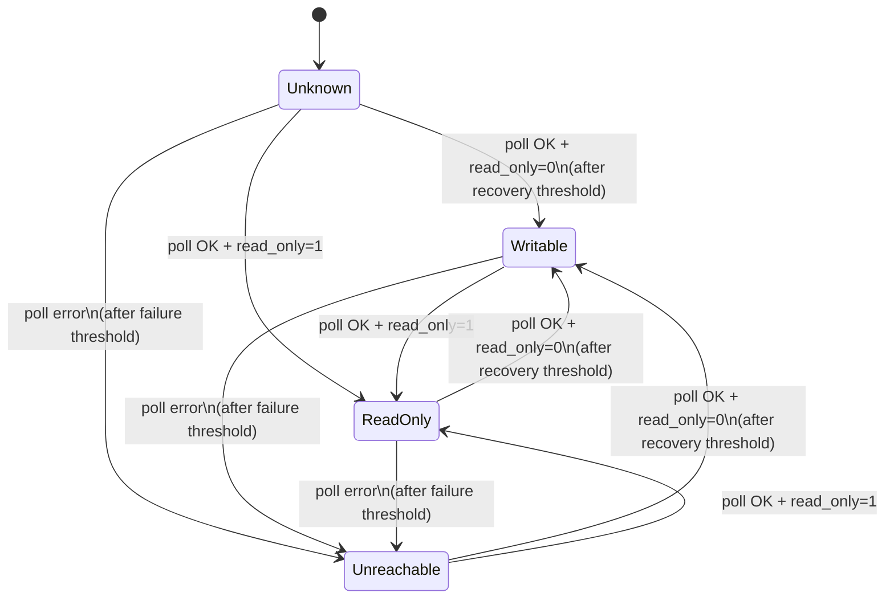
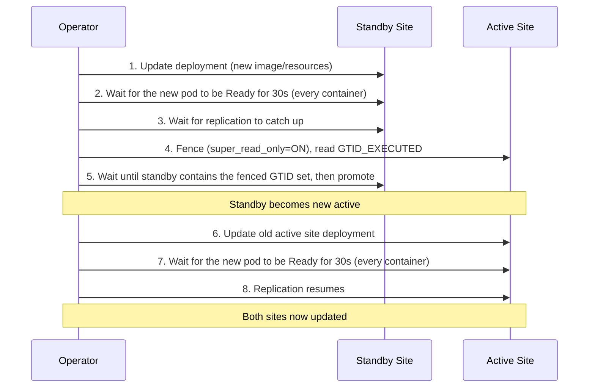

This page covers the state machine that drives MySQL failover decisions, the exact sequence of operations during a failover, Dragonfly follow-along behavior when enabled, the anti-flap cooldown, and ordered updates for zero-downtime rollouts. For the bounded-RPO contract and the exact set of transactions that can be lost on emergency failover, see [Durability and RPO](/docs/architecture/durability-and-rpo). For what happens when the operator itself is unavailable during a failure, see [Operator availability](/docs/architecture/operator-availability).

## State machine

Each site in a failover group is tracked independently. The possible states are:

| State | Meaning |
|---|---|
| `Unknown` | Initial state after an operator start, until the site is classified. A `read_only=1` answer classifies it at once; a `read_only=0` answer needs `recoveryThreshold` polls |
| `Writable` | MySQL is reachable and `read_only=0` |
| `ReadOnly` | MySQL is reachable and `read_only=1` |
| `Unreachable` | MySQL has failed the configured number of consecutive polls |

### State transitions



**Debouncing:**

- A site transitions to `Unreachable` only after **failureThreshold** consecutive failed polls (default: 3). For the first fault in an otherwise healthy group, the default 2-second base interval means about 6 seconds of downtime before the operator considers the site unreachable.
- A site transitions to `Writable` only after **recoveryThreshold** consecutive successful polls showing `read_only=0` (default: 2). This prevents premature promotion on transient successes.
- Transitions to `ReadOnly` are immediate (single poll) since this is a safe, non-destructive state.

`spec.pollInterval` is the poll loop's cadence, and every site that is
reachable is probed on every poll. A site that has reached `failureThreshold`
and keeps failing is probed less often: with the defaults its probes back off
from 2 seconds to 4, 8, 16, and then a 30-second cap. The backoff is per site.
A site that stays down does not slow the probes of any other site, so the
primary's loss is still detected in about 6 seconds while a reader or DR site
is down. A successful probe resets that site's failure count and returns it to
the base interval.

The backoff does delay noticing that a long-down site has come back: its next
probe can be up to 30 seconds away. The sidecar's self-fencing rules cover a
returning old primary during that window.

### Cross-site evaluation

After updating individual site states, the operator evaluates the pair together:

| Site A | Site B | Action |
|---|---|---|
| `Writable` | `ReadOnly` | **Healthy** -- no action needed |
| `Unreachable` | `ReadOnly` | **Promote Site B** -- the `Degraded` condition reason is `SiteUnhealthy` until topology converges |
| `ReadOnly` | `Unreachable` | **Promote Site A** -- the `Degraded` condition reason is `SiteUnhealthy` until topology converges |
| `Writable` | `Writable` | **Split brain** -- see [Split-brain resolution](#split-brain-resolution) |
| `ReadOnly` | `ReadOnly` | **No primary** -- alert, no automatic action (with one exception, below) |
| `Unreachable` | `Unreachable` | **Total loss** -- alert, no automatic action |
| `Unknown` | `ReadOnly` | **Initializing** -- right after an operator start; no alert, no automatic action (see [Initializing after an operator start](#initializing-after-an-operator-start)) |

The operator only takes automatic action for the failover case (and, opt-in, for split brain). All other anomalous states require human investigation.

`Failover` is not a `Degraded` condition reason. Alert on
`Degraded=True, reason=SiteUnhealthy` for this topology state, on the
`FailoverExecuted` Kubernetes Event for a completed promotion, or on an
increase in `bloodraven_failovers_total`. A condition alert that matches
`reason=Failover` never fires because the operator does not emit that value.

The table is the two-candidate core reduced to two columns. In an N-site
group, only `PrimaryCandidate` sites can be the active site, promotion target,
or split-brain winner. `DisasterRecovery` and `ReadOnly` sites are non-promotable. A
writable non-promotable site is an anomaly and is fenced on every poll; a
reader is fenced even when it is the sole writable site. Reader outages and
replication failures remain visible per site but are excluded from group
readiness and degradation calculations. Readers never trigger node taint
changes or become active DNS targets.

**Exception — re-asserting a fenced promoted primary.** A freshly promoted primary can be fenced back to read-only by its own sidecar: the sidecar's fencing lease may still be stale when the promotion lands (for example, the operator restarted after a full-site outage and promoted before its auxiliary Service endpoint became Ready, so the sidecar's operator probes kept failing while the operator was already driving MySQL). That leaves every site reachable and read-only — a state the table above refuses to touch, because without history it is indistinguishable from a fresh-start condition that needs human input.

The operator, however, does have history: `status.lastFailover.target` names the site it made authoritative. When **all** of the following hold, the operator restores writability on that site instead of alerting and waiting:

- a prior failover is recorded and its target is reachable, read-only, and a `PrimaryCandidate`;
- every other site is also reachable and read-only, both in the operator's debounced state and on a live `@@read_only` read just before the re-assert (an unreachable site hands the decision back to the normal failover row above);
- the target contains every other site's `GTID_EXECUTED` and the recorded `status.lastFailover.promotionGtidExecuted` — restoring it cannot lose transactions or create a second primary.

A group that has never failed over gets the same protection for the last site the operator saw as its unique writable primary (`status.activeSite` survives an operator restart, unless it was already empty), with one limit. A site the operator only *observed* as primary is lifted only from the `read_only=ON` every `mysqld` boots with (`super_read_only` OFF), never from a fence: a self-fenced primary with no failover history still waits for a human. Every `mysqld` starts with `read_only=ON`, so a primary whose MySQL container restarts comes back read-only and is re-asserted on the next poll. A site the operator made primary itself is re-asserted from any fence, as a failover target is: the fresh-deploy bootstrap reports its seed as the active site the moment it makes the seed writable, so a seed fenced by its own sidecar's startup safety net is re-asserted the same way. A site the operator re-asserted counts as one it made primary: after a total loss every pod's sidecar runs that safety net, and can fence the primary in the seconds between the re-assert from boot `read_only` and the polls that publish it as the active site; the next re-assert lifts that fence. The log line's `authority` field says which applied: `lastFailoverTarget` or `lastActiveSite`.

The re-assert is rate-limited to once per `failoverCooldown`, logs `re-asserting fenced promoted primary` (see the [log schema](/docs/observability/log-schema)), and increments `bloodraven_primary_reassert_total`. GTID divergence between the sites still blocks it — that genuinely needs a human. The one exception is a peer that already carries a divergence report ([Divergent replicas](#divergent-replicas)): its recorded `divergentGtid` is not held against the target, because those transactions are already reported, stay on the peer, and are re-audited against the re-asserted primary. Without it, an emergency failover that deliberately promoted a clean candidate over that peer could never re-assert the candidate after a fence-back. Anything the peer holds beyond its recorded set still blocks the re-assert.

### Initializing after an operator start

A new topology manager (after an operator restart, a leader change, a new group, or a change to the group's topology settings) starts every site in `Unknown`. A read-only answer classifies a site on the first poll, but the primary's writable answer needs `recoveryThreshold` polls. Until every `PrimaryCandidate` has been classified, a topology with no confirmed writable site is reported as `Initializing` rather than `NoPrimary`, because `NoPrimary` claims every candidate was seen read-only:

- `Ready` and `Degraded` are `Unknown` with reason `Initializing`, and the message names each unclassified site and whether it has answered writable. No `ALERT` log line and no `NoPrimaryDetected` or other topology Event is emitted, and the first real verdict does not emit `SiteRecovered`. The deployment API reports `stable=false` with `unstableReason: Initializing`.
- With the defaults this lasts one poll (about 2 seconds) for a healthy group. A site whose probes are failing stays `Unknown` for up to `failureThreshold` polls before it becomes `Unreachable`.
- `Initializing` is bounded. A site that is still `Unknown` after `failureThreshold` + `recoveryThreshold` probes (5 with the defaults) is alternating between answers and errors, which the debounce never classifies. It stops counting toward `Initializing`: the group reports `NoPrimary` with an alert naming the site, and the operator logs WARN `site not classified after its probe budget; probes alternate between answers and errors`. If that site had answered writable, it still holds back promotion of any other site.
- The debounce still gates every action. A site that answered writable but is not confirmed is not the active site, DNS is not steered at it, and it is not fenced. No other site is promoted while it awaits confirmation, so a peer that becomes `Unreachable` in that window cannot produce a second primary; the failover decision is made again when the site is classified. A primary that answers writable once and then dies is promoted over on the same poll as before, `failureThreshold` failures after its last answer.
- A writable answer is never hidden. If a second site answers writable, the group reports `SplitBrain` at once, with a message naming the sites not yet confirmed, and `SplitBrainDetected` fires. Fencing and `sitePriorities` resolution still wait until the second site is confirmed writable.
- A group that is genuinely all read-only is still `NoPrimary` from its first poll. A site confirmed `Unreachable` with a read-only candidate to promote still fails over while some other site has not answered yet; only a writable answer holds the promotion back.

## Failover sequence

**Choosing the candidate.** Among the reachable `PrimaryCandidate` sites the
operator reads every candidate's `GTID_EXECUTED` and promotes the most
caught-up one; priority order breaks ties. A candidate that is empty in a
group that holds data, or that lacks `status.lastFailover.promotionGtidExecuted`, is
refused. A candidate carrying a divergence report (see
[Divergent replicas](#divergent-replicas)) ranks below every candidate without
one, even when it has the fresher set: the freshest clean candidate wins
(logged `failover picker: skipping divergent candidate`). Preferring it can
leave transactions that only the divergent site holds, legitimate ones
included, off the new primary; the divergent site keeps its report, so they
are not silently dropped. Divergence never blocks an emergency failover: when
only divergent candidates remain, the freshest of them is promoted with an
ERROR `failover picker: promoting a divergent candidate; no other candidate remains`,
and once it is the confirmed primary the operator records the
`DivergentPromotion` status condition and a `DivergentSitePromoted` Warning
Event naming the set that became authoritative. The condition stays until an
administrator removes it. A further divergent promotion before that is added
to the same condition, newest last; it keeps the five newest records and says
when older ones were dropped (the Events and the operator log keep all of
them).

When the operator decides to fail over to a candidate site, it executes these
steps in order:

1. **Best-effort fence the old primary** with
   `SET GLOBAL super_read_only=ON`. If no old-primary connection is available,
   the sequence continues because the failed site is already isolated from the
   operator.
2. **Best-effort evict application connections from the old primary** so
   clients reconnect through the primary Service or DNS. A failure is logged
   and does not block promotion.
3. **Drain relay logs on the candidate**, bounded by 30 seconds. The drain is
   complete once `Executed_Gtid_Set` contains the `Retrieved_Gtid_Set` the
   candidate had when the drain began, so it returns as soon as the backlog
   already received is applied and does not wait on a receiver that is still
   fetching. A stopped SQL thread with pending relay log is restarted once.
   An IO-thread error, such as the connect error a candidate reports once its
   primary is dead, does not end the drain; only an applier (SQL thread)
   error does. A timeout or drain error is logged and promotion continues;
   the drain narrows the normal asynchronous-replication RPO but is not a
   zero-RPO gate.
4. **Stop replication on the candidate** with `STOP REPLICA`. Failure stops
   the promotion attempt.
5. **Remove the candidate's replication configuration** with
   `RESET REPLICA ALL`. Failure stops the promotion attempt.
6. **Capture the promotion GTID** with `SELECT @@global.gtid_executed` before
   the candidate accepts writes. A read failure is logged and leaves the
   recorded value empty; it does not stop promotion.
7. **Rotate the candidate's binary log** with one `FLUSH BINARY LOGS`, best
   effort and bounded at 1 second. See
   [Binary log rotation at promotion](#binary-log-rotation-at-promotion).
   An error or a timeout is logged and does not stop or change the
   promotion.
8. **Clear `super_read_only` on the candidate**. This is required because a
   sidecar or earlier fence may have set it. Failure stops the promotion.
9. **Clear `read_only` on the candidate**, making it writable. Failure stops
   the promotion.
10. **Confirm writability immediately** with a bounded `read_only` probe. This
    is part of the same promotion attempt, not the next topology poll. If the
    probe fails, DNS and failover bookkeeping are not advanced, although the
    preceding write may already have made MySQL writable.
11. **Record and publish the promotion**. The operator records anti-flap and
    promotion-GTID state and increments `bloodraven_failovers_total` before it
    best-effort updates the `DNSEndpoint`. A DNS write failure does not undo a
    successful MySQL promotion; poll-driven DNS reconciliation keeps retrying.
    Dragonfly follow-along, when enabled, starts after this MySQL path.

Node taints, the `-primary` Service selector, and follower source convergence
are poll-driven consequences rather than steps inside
`FailoverController.Execute`. The old site's transition to `Unreachable`
applies its taint before promotion. Later successful polls debounce the new
primary to `Writable` and remove its taint; the status update then lets the
resource reconciler move pod role labels and Service endpoints. Direct-source
convergence separately verifies and repairs each remaining follower after
replica status collection.

### Binary log rotation at promotion

Every promotion (emergency failover, [ordered-update handoff](#ordered-updates)
and [planned failover](/docs/operations/planned-failover)) sends one
`FLUSH BINARY LOGS` to the site being promoted, after `RESET REPLICA ALL` and
the read or proof of its `gtid_executed`, and before `super_read_only` and
`read_only` are cleared.

- **What it is for.** Everything the site logged as a replica is then in
  sealed files, which its sidecar can archive, and its first transaction as
  the primary starts a new file. Without the rotation that replica-era
  history stays in the active file until the next natural rotation, and the
  [PITR archive](/docs/backup-and-restore/backup-restore#point-in-time-recovery-pitr)
  lags behind the failover until then. The file the rotation opens also
  marks the promotion: its `Previous_gtids`, together with the sidecar's last
  read-only observation of `gtid_executed` (which supplies GTIDs that are in
  no binlog, such as a clone's), are the promotion GTID set, which
  the site's sidecar reads into its
  [promotion record](/docs/backup-and-restore/backup-restore#promotion-records-and-history-integrity)
  (`promotionGtidExecuted`). The restore planner uses that set to date the
  transactions the new primary committed from the promotion on; it does not
  yet use it to plan a restore target in the new primary's first seconds
  from another site's copies (the
  [promotion-record lag window](/docs/get-started/known-limitations) still
  refuses).
- **When the new file does not start at the recorded promotion GTID.** The
  operator expects the file the rotation opens to start at the set it records
  in `status.lastFailover.promotionGtidExecuted`, but does not prove it.
  Treat an empty or mismatching record as unknown. The two differ when:
  - the rotation was not acknowledged (WARN `promotion binlog rotation
    failed`): no file starts at the promotion, or one starts later;
  - an emergency failover could not read `gtid_executed` (step 6): the
    record is empty and the rotation is still sent;
  - an emergency failover's statements did not meet one unchanged, read-only
    server. The GTID read and the read-only clears use pooled connections
    and the rotation a connection of its own, all to the site's address,
    and `read_only` is not read again between the GTID read and the
    rotation. A candidate that was already writable, or one with `read_only`
    but not `super_read_only` and a privileged session writing, can commit
    in between. An already writable candidate is not only a fault: a split
    brain that `spec.splitBrainPolicy.sitePriorities` resolves is ended by
    fencing the other sites and running the promotion on the preferred
    site, which is taking writes while its binary log is rotated. The handoff and the planned failover prove the set on one
    pinned connection; their rotation still travels on a separate one;
  - a planned failover resumed a promotion whose target was already
    writable, or had been: that pass sends no rotation.
- **Best effort.** The rotation never blocks or fails a promotion. If it
  returns an error or has not answered within 1 second, the operator logs
  WARN `promotion binlog rotation failed` (with `timedOut` and the error) and
  continues with the same steps; the replica-era file then stays open until
  the next rotation, as it did before this step existed, and the promotion
  record's promotion set is then smaller (only what the sidecar last saw
  read-only), which dates the same episode with fewer transactions. A
  rotation abandoned at the bound may still complete on the server
  afterwards, even after writes were enabled. That is one more rotation and
  nothing depends on it: the sidecar does not take a file opened after the
  new primary's first transaction for the promotion's.
- **Own connection.** The statement runs on a connection opened for it and
  closed afterwards, not on the pooled connections the health probes use and
  not on the pinned session of a handoff or planned failover, so a slow
  rotation cannot delay a probe or break the promotion session.
- **Cost.** One connection setup (TCP, the MySQL handshake, TLS when enabled,
  authentication) plus the rotation: about 12 ms measured against a local
  MySQL 9.7.4, more over a cross-region link, where the connection's round
  trips dominate, and at most 1 second. INFO `promotion binlog rotated`
  reports the measured `durationMs` of every rotation.
- **Privilege.** `FLUSH BINARY LOGS` needs `RELOAD`, which the operator
  account's `ALL PRIVILEGES` includes. The statement is not written to the
  binary log, creates no GTID, and works under `super_read_only=ON`.

A planned failover sends the rotation at most once per run and operator
process (an operator restart mid-run can send one more), and not at all
when a re-run finds its target already writable. A planned handoff also
rotates the outgoing primary's binary log once it is fenced (a planned
failover only in the pass that sends the fence and reads it back); see
[Archiving the tail of an outgoing primary](/docs/backup-and-restore/backup-restore#archiving-the-tail-of-an-outgoing-primary).

## Direct-source convergence

Source convergence runs after replica status collection and outside the
promotion sequence. It is therefore able to repair a healthy wrong source
after an operator restart even when no failover history exists. Mutation is
allowed only when there is exactly one writable `PrimaryCandidate`, no second
writable site, and no bootstrap, update, restore, topology freeze, pending
promotion, planned failover, or split brain in flight.

For a wrong non-empty source, Bloodraven:

1. Verifies that the active primary's `GTID_EXECUTED` contains the follower's
   executed set.
2. Runs `STOP REPLICA` and repeats both GTID reads and the containment check,
   closing the race where the SQL applier advances after the first check.
3. Runs `CHANGE REPLICATION SOURCE TO` with the configured credentials and TLS
   settings, without `RESET REPLICA ALL`.
4. Runs `START REPLICA` and boundedly verifies the direct canonical hostname
   and both replication threads.

If containment fails, status becomes `Blocked/GTIDDiverged` and no unsafe
repoint occurs. A post-STOP containment failure leaves replication stopped.
Other bounded failures remain `Pending/MutationFailed` for a later safe retry.
This generic state is recorded in `sourceHost`, `sourceConvergenceState`, and
`sourceConvergenceReason`; it does not replace the
`recoveryState`/`divergentGtid` reporting of [divergent replicas](#divergent-replicas)
and old primaries.

## Divergent replicas

Healthy replication threads say nothing about whether a replica holds
transactions the primary never had. A replica keeps applying the primary's new
transactions while it carries extra history of its own, until a conflicting row
breaks it. Issue #202 is the example: an ordered update on v1.5.0 promoted a
standby before it received the old primary's last 221 transactions, and the
demoted site then replicated normally with those 221 transactions as errant
GTIDs while the group reported `Ready=True` and `Degraded=False`.

The operator audits every read-only follower with a replication channel,
promotable or not, against the confirmed primary: about every 30 seconds per
site, and immediately on the first poll after the operator starts, the
primary changes, a promotion or handoff completes, a fenced primary is
re-asserted, or a follower's receiver reports a new `Source_UUID` for the
active host (the primary was replaced under the same name). A maintenance
handoff refused because its candidate holds extra transactions makes that
candidate due on the next poll. A failed ordered-update attempt forces
nothing, so a rollout that keeps failing cannot make the audit run every
poll. It reads the follower's `@@server_uuid` and `GTID_EXECUTED`
first and the primary's second, then computes follower minus primary. A
follower's set only grows with transactions that are on the primary first, so
reading in that order never reports a transaction the follower applied between
the two reads. A result is discarded if the primary changed, a promotion or
update began, or either server's `server_uuid` changed while the audit was
reading. A failed or unparseable read changes nothing. The pass runs after the
poll's failure handling. A poll with no follower due probes nothing; when one
is due, confirming the primary and every read share one 5-second budget, so
the audit cannot delay the next poll's failure detection by more than that.
The audit is
skipped while a bootstrap, in-place restore, initial restore, planned
failover, ordered update or pending promotion is in flight.

A non-empty result makes the site divergent:

- `status.sites[].recoveryState` is `RecoveryBlocked`, `divergentGtid` and
  `divergentTransactionCount` describe the extra set,
  `divergenceDetectedBy` is `ReplicaAudit`, and `divergenceComparedTo` names
  the primary it was compared against. Old-primary recovery records the same
  fields with `divergenceDetectedBy=OldPrimaryRecovery`.
- `Degraded` is `True` with reason `DivergentTransactions` and a message
  naming the site, the count and the set. This outranks the lag, thread and
  source-mismatch reasons; split brain, no primary and total loss still win.
  `Ready` is not changed, and the [deployment API](/docs/configuration/deployment-api)
  keeps granting leases: the group is serving, and an integrity warning on a
  replica must not stop application deployments. (A returning old primary's
  block still makes the deployment API report the group unstable, as
  before.)
- `bloodraven_divergent_transactions{site}` is set, the WARN
  `divergence detected` is logged with `detectedBy=ReplicaAudit`, and a
  `DivergentReplicaDetected` Warning Event is emitted on new or changed
  evidence.
- Ordered updates and planned failovers will not promote the site (see
  [Upgrade policy](/docs/operations/upgrade-policy) and
  [Planned failover](/docs/operations/planned-failover)). Emergency failover
  still can, as a last resort.

The block is sticky. Healthy threads, a converged source and an operator
restart do not clear it; a restarted operator restores it from status. Only a
fresh audit proving the follower holds nothing the primary lacks clears it,
logged as `divergence cleared: replica holds no transactions the primary lacks`
with a `DivergenceResolved` Event. If the divergent site itself becomes the
primary, the block is not compared with itself: it becomes the
`DivergentPromotion` condition described under
[Failover sequence](#failover-sequence).

No local transaction is exempt: a `CREATE USER` run on a replica is reported
like an order that never reached the primary, because a GTID set cannot tell
them apart. There are three ways to resolve a divergent replica, and each ends
with the audit clearing the block on its own:

- **Discard the transactions.** Save the errant binlog events first (decode
  them with `mysqlbinlog --include-gtids='<divergentGtid>'` on the replica),
  then reclone the site from the primary:
  `kubectl bloodraven reclone <group> <site>`, which builds the value the
  reclone interlock requires (or annotate
  `bloodraven.shipstream.io/reclone-site=<site>:confirm=<group>:uid=<group uid>:gtidPrefix=<first 8+ characters of the divergentGtid's source UUID>`).
  Before a block is recorded, a cold reclone uses
  `reclone-site=<site>:confirm=<group>:uid=<group uid>`.
- **Keep the transactions.** Replay the decoded transactions on the primary
  (review them for conflicts first). The primary then holds their GTIDs and
  their rows, logged with its own `server_id`, so every replica receives
  them, also the site that issued them. While the replay runs that site
  shows no new report: the operator waits until its applier has passed the
  primary's position before it calls a missing transaction lost (see
  [A hole, or only lag](#a-hole-or-only-lag)). A site that carries an
  `OwnTransactionsLost` report resting on the divergent replica keeps it
  until it has applied the replayed transactions, and loses it then.
- **Accept the replica's divergence.** When the transactions carry nothing
  the primary needs, commit an empty transaction on the primary for each GTID:
  `SET GTID_NEXT='<uuid>:<n>'; BEGIN; COMMIT;` and finally
  `SET GTID_NEXT='AUTOMATIC';`. This makes the GTID sets agree without moving
  any rows: the replica keeps rows the primary lacks. Once the audit clears,
  the replica is promotable again, and a later promotion makes its rows
  authoritative with no `DivergentPromotion` record. Use it only for
  transactions whose effects are absent from both sites, harmless, or already
  reconciled.

For maintenance on a replica that must not reach the primary's history, run it
with `SET SESSION sql_log_bin=0` so it gets no GTID. There is no setting that
ignores divergence. Playbook 33 in the `bloodraven-doctor` skill walks through
the triage.

## Dragonfly during failover

When `spec.dragonfly.enabled=true`, Dragonfly follows the MySQL failover group but remains best-effort cache/session state, not durable data.

During **planned failover**, Bloodraven inserts two Dragonfly phases before MySQL promotion:

1. `WaitingForDragonflySync` reads the source Dragonfly's replication position and waits for the target Dragonfly replica to reach it, bounded by `spec.dragonfly.plannedFailover.maxSyncWait` (default `30s`). See [What the sync wait proves](#what-the-sync-wait-proves).
2. `PromotingDragonfly` removes the source pod's `bloodraven.shipstream.io/dragonfly-traffic` label, promotes the target with `REPLTAKEOVER`, stamps the target as `bloodraven.shipstream.io/dragonfly-role=master`, and best-effort closes the old master's client connections so they reconnect through the active Dragonfly Service. A successful `REPLTAKEOVER` ends the old master's process (v1.38.0, v2.1), which closes its connections by itself, and the operator then logs `client-kill: source unreachable; skipping`. Where the old master is still up (after an emergency promotion with `REPLICAOF NO ONE`), the operator lists its connections (`CLIENT LIST`) and closes each with `CLIENT KILL ID`, except its own and the replication links (`repl_ctrl_N`, `repl_flow_N`); the log line carries the number closed. Dragonfly has no `CLIENT KILL TYPE NORMAL` (it answers `ERR syntax error`), which earlier releases sent: on them nothing was closed and connections established through the Service stayed on the old master until its pod was deleted.

If sync or `REPLTAKEOVER` fails, `spec.dragonfly.plannedFailover.onSyncTimeout` controls the outcome. The default `Proceed` continues MySQL promotion and records `status.plannedFailover.dragonfly.sessions: Lost` (with `dragonfly.reason` `DragonflySyncTimeout` or `DragonflyPromotionFailed`). `Fail` rolls back before MySQL promotion and leaves the original MySQL primary active. A takeover that succeeded before the MySQL run failed leaves Dragonfly leading on the target; the run's result then carries the warning `DragonflySessionsLost`.

The run finishes a takeover (relabels the target master, demotes, evicts and recreates the source) only when this operator process sent `REPLTAKEOVER` for the run and received its success reply. Anything else is an unconfirmed takeover: a target that already reports `role:master` before `REPLTAKEOVER` is sent (a Dragonfly pod restarts with no `--replicaof` and empty data, so a target that restarted during the run is an empty standalone master), a lost reply (a timeout or transport error), the server error `Couldn't execute takeover: Operation canceled` (the target gave up waiting for the source; a source that was only cut off can still run the takeover when it is reachable again, and on v1.38 it then completes it and exits while the target stays a replica), and every re-run by another operator process (after a restart or a leader change) of a takeover whose intent is already recorded, which sends no `REPLTAKEOVER` at all. After an unconfirmed takeover the run changes no Dragonfly role itself: the source is not demoted, its clients are not killed, its pod is not deleted, and the target is not relabelled; only the source's traffic label is put back so the active Service keeps its endpoint. That is not a claim that nothing happened on the servers: for a `REPLTAKEOVER` that did not report its outcome, `dragonfly.message` says which roles the target and the source reported right afterwards. If the source later completes the takeover and its pod returns empty, the manager promotes the target, which still holds the cache, and does not re-attach it (see [A master that restarts](#a-master-that-restarts)). The takeover is recorded `Failed` with `dragonfly.reason: DragonflyPromotionFailed`, a `dragonfly.message` that says it is unconfirmed, and a `DragonflyPromotionFailed` Event, and `onSyncTimeout` applies exactly as for a failed takeover: `Fail` rolls MySQL back (nothing was sent to the MySQL target), `Proceed` promotes MySQL and records `sessions: Lost`. Whatever the target did, the Dragonfly manager reconciles Dragonfly with MySQL through its normal drift and follow-up path once the run releases Dragonfly. If the Dragonfly master is neither the run's source nor its target (a Dragonfly-only promotion moved it), the takeover is refused as failed and nothing is stripped or sent. The takeover's result is recorded in its own write while the phase still reads `PromotingDragonfly`, so `takeover.state: Succeeded` (or `Failed`) can be seen briefly before the `Promoting` intent.

After a succeeded takeover the target stays the Dragonfly master (labels, `status.dragonfly.activeSite`, replica wiring) while the run's block reads `PromotingDragonfly`, `Promoting`, `Publishing` or `RollingBack`, also after a terminal marker ended the run, until a Dragonfly promotion to another site is stamped at or after the takeover's completion or the target is observed as a replica. A replica StatefulSet rollout does not restart the run's Dragonfly target while the run owns Dragonfly (`dragonfly rollout: site is the planned failover's Dragonfly target; holding its restart`).

Ownership of Dragonfly follows the planned-failover claim slot. With the group's topology manager registered, the slot decides: a run, its provisional grant, or an [automation hold](/docs/operations/planned-failover#the-automation-hold) owns Dragonfly, and a run that released its claim after recording its promotion owns nothing, whatever its phase reads. Before the manager is registered (right after an operator restart) the status form decides: a run that still needs the claim, or a durable hold (`status.plannedFailoverHold` or a `ManualRecoveryRequired` terminal marker).

A Dragonfly snapshot upgrade pauses only the Dragonfly manager, never MySQL topology: an emergency MySQL failover during an upgrade supersedes it. The next upgrade reconcile ends the upgrade `Failed` with reason `ActiveSiteChanged` and hands the Dragonfly promotion for the new MySQL active site to the Dragonfly manager. A planned failover waits in admission (`DragonflyUpgradeInFlight`) while an upgrade is in flight. A snapshot-restore upgrade that `spec.dragonfly.image` drift asks for (`upgradeStrategy: SnapshotRestore`) does not start while a planned failover or hold owns Dragonfly, or while the effective Dragonfly master differs from `status.activeSite`: it waits, without moving any site and without holding up the rest of the reconcile (the planned failover it waits for keeps running), a Normal `DragonflyUpgradeDeferred` Event names the cause when it changes, and the run is retried every 10 seconds until the cause clears. An abandoned run is not restarted while `spec.dragonfly` is unchanged; see [Snapshot-restore upgrade](/docs/configuration/app-integration#snapshot-restore-upgrade) for the retry.

During **emergency failover**, MySQL promotion is the priority. After MySQL promotion succeeds, the MySQL poll loop only queues a Dragonfly promotion for the new MySQL active site and carries on; it never waits for the cache. The group's Dragonfly manager runs the promotion on its own goroutine between its polls, so a poll's observation, its status publication and a promotion never overlap. Only the latest queued request is kept; a newer MySQL decision replaces it even while it waits to run. When it runs it is checked against the group as it is then: it is dropped if a planned failover or snapshot upgrade owns Dragonfly, if a decision recorded after it (a planned failover claimed at or after the request's second, a MySQL failover to another site, or a Dragonfly promotion to another site while MySQL does not name the request's target) points elsewhere, or if its target has already been promoted. If the old Dragonfly master answers a 1s dial and `PING`, the operator tries `REPLTAKEOVER` with a 2s budget to preserve sessions. A takeover is coordinated by the master and cannot complete without it, so an unreachable old master skips straight to the fallback. If the takeover is skipped, or fails and the old master no longer answers as a master, the operator falls back to `REPLICAOF NO ONE` on a fresh connection with its own budget: 14s after a failed takeover, because Dragonfly keeps the replica's `REPLICAOF` lock for the takeover budget plus 10s. That restores a writable Dragonfly master but does not guarantee session continuity. That fallback emits the Warning Event `DragonflySessionsLost` (not `DragonflyPromotionSucceeded`) and increments `bloodraven_dragonfly_promotions_total{result="sessions_lost"}`. The fallback is for an old master that is gone. If the takeover fails while the old master still answers `INFO` as a master, `REPLICAOF NO ONE` is not sent ([When the old master still serves](#when-the-old-master-still-serves)): the promotion is recorded failed (`DragonflyPromotionFailed`), the old master keeps the role and its traffic, and the manager takes the master over to the MySQL active site once the replica there is in sync. If the fallback cannot be sent after a takeover, or its reply is lost, the outcome is unknown: a takeover can complete on the server after the client gives up. The operator then waits until the server can no longer be acting on the commands (the takeover budget plus 10s, plus 1s) and reads the target's role. A master is recorded as a completed promotion, with the same sessions-lost Event; anything else is a failed promotion, and the old source's traffic label is restored so the active Dragonfly Service is not left empty. Label updates, the role observation and the `status.dragonfly` stamp each get their own 5s budget, so a slow step cannot drop the status update. Every writer of a group's Dragonfly routing (the Dragonfly manager's polls and promotions, the planned failover's Dragonfly phase, the rollout promotion, the replica StatefulSet rollout, each snapshot-upgrade step and the reconciler's label sweep) holds one per-group gate and, after taking it, reads the group uncached from the API server, not from the informer cache, which can lag the previous holder's writes. The manager steps aside for a waiting planned failover or rollout only before it has sent a role-changing command; once `REPLTAKEOVER` or `REPLICAOF NO ONE` is on the wire, the promotion finishes and records its outcome first, even if the manager is being stopped. The gate outlives the manager: when a configuration or credential change restarts a group's managers, the replacement, and any planned failover in the meantime, waits for the old manager's last step. A planned failover that reaches its Dragonfly phase while an emergency promotion has already sent its command therefore waits for it with the MySQL source fenced: about 12-13s in practice (the takeover wait, then the fallback queued behind Dragonfly's lock), about 40s in the worst case with every step at its timeout. It reports the wait in `status.plannedFailover.dragonfly.message` and a Warning Event `DragonflyPromotionDeferred`. The promotion never returns an error to the MySQL path. If Dragonfly is unreachable, MySQL recovery still completes. A rollout promotion of a sync-proven target keeps the `maxSyncWait/2` takeover budget.

### When the old master still serves

Outside a planned failover, three things move the Dragonfly master with a takeover: the promotion that follows an emergency MySQL failover, the manager's take-over to the MySQL active site when the two disagree, and a rollout of the active site. Each of them sent `REPLICAOF NO ONE` after a `REPLTAKEOVER` that failed, whatever the old master was doing. (A rollout sends none at all now: see [Dragonfly template rollouts](#dragonfly-template-rollouts).) Against an old master that is alive that is destructive: Dragonfly refuses a takeover to a replica that is not in sync (`ERR Full sync not done`), `REPLICAOF NO ONE` then makes that replica a master with the part of the cache it holds, and the old master, which holds all of it, is demoted and its pod deleted.

The rule now:

- After a failed `REPLTAKEOVER`, the operator reads the old master's role again (1 s budget). If it answers as a master, `REPLICAOF NO ONE` is not sent. A refusal by the target (`Full sync not done`) fails the promotion at once; a lost reply or `Couldn't execute takeover: Operation canceled` leaves the outcome open, so the operator waits until the server can no longer be acting on the takeover (its budget plus 10 s, plus 1 s) and reads the target's role, as described above. The operator logs `dragonfly emergency: REPLTAKEOVER failed; not falling back to REPLICAOF NO ONE` and emits `DragonflyPromotionFailed`; the old master's traffic label is put back.
- If the old master does not answer, or answers in another role, the fallback is sent as before.
- One case still falls back over a master that serves: the server has no `REPLTAKEOVER` at all (it answers `unknown command`, or `NOPERM`), and the target reports stable sync (link up, no full sync, not loading). Nothing else could ever move the master on such a server. A target that is not in stable sync is left alone there too.
- The manager's take-over to the MySQL active site is made only for a replica proven in sync, with the proof a planned failover and a rollout use ([What the sync wait proves](#what-the-sync-wait-proves)): stable link, the master's `master_replid`, and the master's replication position reached on every flow, waiting up to 1 s for a replica that is linked and behind. Before, a replica that had ever received data qualified. While the replica is not ready the master stays where it is, serving; the operator logs `dragonfly/mysql active-site drift: target not in sync with the Dragonfly master; not taking over` when the state changes (`NotLinked`, `Behind`, `Unreadable`) and emits the Warning Event `DragonflyFollowStalled` once after two minutes.

What this costs: after an emergency MySQL failover whose old site still runs a healthy Dragonfly, the cache can stay on the old site for as long as the replica on the new site is not in sync, with `status.dragonfly.activeSite` naming another site than `status.activeSite`. The active Dragonfly Service follows `status.dragonfly.activeSite`, so clients keep a complete cache meanwhile. Before, they got the new site's Dragonfly at once, with whatever part of the cache it held. A failed attempt stamps `status.dragonfly.lastPromotionTime`, which holds the next one off for 30 s.

### What the sync wait proves

A Dragonfly master prints no replication offset in `INFO replication` (v1.38 and v2.1 print `role`, `connected_slaves`, one `slaveN` line per replica and `master_replid`), and a replica's own link fields do not show how far behind it is: a replica cut off from its master without a connection reset keeps reporting `master_link_status:up`, `master_last_io_seconds_ago:0` and `master_sync_in_progress:0` for more than ten seconds. The sync wait of a planned failover, and the readiness check before a Dragonfly rollout promotes a replica, therefore compare replication positions:

- Dragonfly replicates one flow per master shard. The operator reads the journal position of each shard on the source (`DFLY REPLICAOFFSET`) and the number of journal records each flow has executed on the target (`DEBUG REPLICA OFFSET`). These are counts of journal records, not bytes. `status.plannedFailover.dragonfly.sourceOffset` is the source's sum, kept for the record; the comparison is per flow, because a target can be ahead on one flow and behind on another.
- The target is ready when it reports its link up, no full sync and no load in progress, the same `master_replid` as the source, and every flow at or past the position the source had when it was read.
- A position that cannot be read is not ready: a source that does not answer or does not answer as a master (`sourceOffsetState: Unavailable`, and `onSyncTimeout` applies at once), a target that cannot be reached, a different number of flows. A server that has neither command but prints `master_repl_offset` and `slave_repl_offset` (Redis-style) is compared on those.
- The wait is for what can still happen. A target that is not yet in stable sync, is behind, or could not be reached this time is looked at again every second until `maxSyncWait`.
- **A position that can never be compared leaves the link checks and `REPLTAKEOVER`.** A site answers the position command with `unknown command`, `Unknown subcommand or wrong number of arguments` or `syntax error` (it does not have the command, or the command was renamed away), or with `NOPERM` (the operator's ACL user may not run `DEBUG` or `DFLY`), or the target gives a single offset where the source gives one per flow. Asking again does not change that. The operator's own setup (the default user with `--requirepass`) allows every command; it takes `spec.dragonfly.args` (an ACL file, renamed commands) or another image to get here. The operator then checks what the two sites' `INFO` answers say: the source is a master, and the target is a replica with its link up, data received, no full sync, no load, following the source's `master_replid`. If that holds, the run goes on to the takeover at once, under either `onSyncTimeout` policy and without a sessions-lost mark, and says so once: `dragonfly.message` and the Warning Event `DragonflySyncUnproven` read `the sync of Dragonfly replica "<target>" with master "<source>" could not be proven by position (...); relying on REPLTAKEOVER, ...`, and the operator logs `dragonfly: sync could not be proven by position; relying on REPLTAKEOVER`. The takeover is the proof that is left: the source stops taking commands and waits for the target to acknowledge every shard's journal, and a takeover that fails changes no role and applies `onSyncTimeout`. A planned takeover never falls back to `REPLICAOF NO ONE`. If the link checks do not hold, the target is looked at again every second until `maxSyncWait` like any other, and `onSyncTimeout` applies then. Give the operator's user the two commands to get the position proof back.
  - What that costs: the link checks do not show how far behind a replica is (see above), so a target that is silently cut off passes them, and the run then spends up to the takeover's budget (`maxSyncWait`) in `REPLTAKEOVER` with MySQL fenced before it fails and `onSyncTimeout` applies.
  - What was rejected: applying `onSyncTimeout` at once, as an earlier build of this release did. `Proceed` then recorded `sessions: Lost` for a takeover that preserved them, and `Fail` rolled back every planned failover of such a group. Waiting out `maxSyncWait` for a position that never comes holds MySQL fenced for nothing.
- If the source's process is replaced during the wait, the target ends up following a `master_replid` the position was not read from. The operator then reads the source's position again, once per run (`dragonfly: source restarted during the sync wait; position read again`); the wait's deadline does not move.
- The source keeps taking cache writes during the wait (only MySQL is fenced), so the wait proves that the target had applied everything the source had written when its position was read, not what it wrote afterwards. Carrying that over is `REPLTAKEOVER`'s job: the source stops taking commands, waits for the target to acknowledge every shard's journal, and refuses the takeover when that does not happen within the budget. A successful `REPLTAKEOVER` loses no write the source accepted, and the source's process then exits.
- The per-flow position is held by the operator process that read it. After an operator restart during the wait, the new process reads the source again, so the target has to reach a later position, never an earlier one.
- A rollout reads the source once per check. A target that is linked and behind gets 2 seconds to reach that position before the check reports "not ready"; a target that is not linked (link down, full sync, loading) and a site that cannot be read are reported at once, because looking again within seconds does not change them and the check runs on the worker that reconciles every group. The rollout retries on the next reconcile, 2 seconds later. It logs the state when it changes (`dragonfly rollout: target not ready for promotion`, with `state` `NotLinked`, `Behind` or `Unreadable` and the detail) and, after two minutes without a ready target, emits the Warning Event `DragonflyRolloutStalled` once.
- A rollout whose target's position can never be compared (the refusals above) does not wait for it. With the link checks holding, it promotes with `REPLTAKEOVER` and nothing else: no `REPLICAOF NO ONE` follows a takeover that fails, whatever the old master does then. It says so once per rollout (`dragonfly: sync could not be proven by position; relying on REPLTAKEOVER`, Warning Event `DragonflySyncUnproven`). With the link checks not holding it waits like any rollout whose target is not linked, and `DragonflyRolloutStalled` reports that. In an earlier build of this release such a rollout never completed: the check reported `Unprovable` on every pass, ahead of the promotion, so the active site kept its old pod for as long as the operator's user could not run the commands. Rejected: stalling for good (an operator upgrade must not leave a pod behind because of an ACL), and a field to switch the proof off (the takeover's own wait already covers what the field would give up).
- A rollout promotion is a `REPLTAKEOVER` or nothing. One that fails (the takeover is refused, or times out, or the old master stops answering) is retried with a backoff of 1, 2, 4, 8, 16 and then 32 seconds, for as long as the rollout is pending. No `REPLICAOF NO ONE` is sent for a rollout, and no number of failures makes it restart the active pod where it is. See [Dragonfly template rollouts](#dragonfly-template-rollouts).

### Dragonfly template rollouts

A change to the Dragonfly pod template (`spec.dragonfly.image` under `upgradeStrategy: Rolling`, resources, args, auth, security contexts, or a new operator release that renders the template differently) replaces every Dragonfly pod. A Dragonfly pod keeps its data in an `emptyDir`, so each replaced pod comes back empty and gets the cache again from the master by a full sync. The cache survives only if the pods are replaced one at a time and the master's pod is replaced after another site took the master over. The rollout follows that order strictly. Where it cannot prove a step safe, it waits; it does not restart the master to get on.

1. **The master must be known.** Before any StatefulSet is changed, the operator reads the group's status uncached and asks every site for its role. The master is known when status names a site (`status.dragonfly.activeSite`, or `status.activeSite` before the first Dragonfly record), that site answers as a master, and no other site that answers does. Otherwise nothing is changed, the replica's StatefulSet included: an empty or outdated status would otherwise have the rollout restart the real master as "the replica". This state is `MasterUnknown`. It is normal for a few seconds while a recreated pod has not been attached as a replica yet.
2. **One site at a time.** The template write marks the site's StatefulSet with the annotation `bloodraven.shipstream.io/dragonfly-rollout-in-flight` in the same update. The mark is removed when the site's pod is Ready on the new template and the site is a replica proven in sync with the master ([What the sync wait proves](#what-the-sync-wait-proves): link up, no full sync, not loading, the master's `master_replid`, and the master's position reached on every flow), or is the master itself. While a site carries the mark, no other site's template is written and no takeover is sent. This state is `SiteInFlight`. The mark is on the StatefulSet, so an operator restart during the rollout does not forget it.
3. **Replicas first, the master's site last.** With every replica rolled and back in sync, the operator takes the master over to the first replica that is proven in sync, with `REPLTAKEOVER`. The takeover is what writes the former master's template: after it succeeded and before the former master's pod is deleted, in the same step. The old master's process has exited by then, so that pod comes back once, on the new template, and is marked in flight until it is back in sync with the new master.
4. **A takeover that fails is retried**, with the backoff above (`TakeoverFailed`). The active site keeps its pod.

Every template write is made under the group's Dragonfly gate, so it never overlaps a promotion, a planned failover's Dragonfly phase or a snapshot upgrade step. A planned failover that owns the group's Dragonfly holds the rollout of its target site and of the active site.

The rollout logs what it waits for when that changes (`dragonfly rollout: waiting`, or `dragonfly rollout: target not ready for promotion` for the replica it wants to promote) and emits the Warning Event `DragonflyRolloutStalled` once after two minutes in the same state. The Event message names the state and the detail.

After the rollout the Dragonfly master is on the site that took it over. If that is not the MySQL active site, the manager takes it back once the replica there is proven in sync ([When the old master still serves](#when-the-old-master-still-serves)); that take-back is a second `REPLTAKEOVER` and replaces one more pod.

What this costs, against the behaviour before v1.8.0:

- A rollout no longer finishes by itself in a group that has no replica that can be promoted (a site that is down, a replica whose link to the master is broken, a `REPLTAKEOVER` that keeps being refused). The old template stays on the active site, and on every site after the one that is stuck, until the cause is fixed. Before, three failed takeovers, or the absence of a replica, ended in a restart of the master with an empty cache.
- The rollout dials every site before each write. A change to `spec.dragonfly.auth` or `spec.dragonfly.port` makes the running pods unreadable with the new settings, so such a rollout stops at `MasterUnknown` or `Unreadable` and needs the administrator's step below for each site.
- Rejected: a timeout after which the master is restarted anyway. It turns every stuck rollout into a lost cache at a moment nobody chose.

#### Restarting a site in place

When the rollout will never be able to proceed by itself and losing the cache is acceptable, an administrator names the site whose template is to be applied:

```bash
kubectl annotate mysqlfailovergroup <name> -n <namespace> \
  bloodraven.shipstream.io/dragonfly-restart-in-place=<site>
```

The operator then writes that site's pending template without knowing which site is the master and without a takeover, still under the Dragonfly gate and not while a planned failover owns the group's Dragonfly. It emits the Warning Event `DragonflyRestartedInPlace` and removes the annotation: the annotation covers one restart of one site. If the site held the master, the pod comes back empty, and the manager treats that like any other restart of the master ([A master that restarts](#a-master-that-restarts)): a replica that still holds the cache is promoted, one known to be stale is not. The operator also removes the annotation when no Dragonfly template is pending, so it does not stay armed for a later rollout.

Use it for the site that is stuck, not as a way to speed a rollout up. To keep the cache through an image change that replication cannot carry, use `upgradeStrategy: SnapshotRestore` instead.

### Dragonfly-only failures

The Dragonfly manager also handles Dragonfly-only failures. If the active Dragonfly master dies while MySQL remains healthy, the manager can promote a healthy Dragonfly replica and leave `status.activeSite` for MySQL unchanged. It does not promote a replica while another site reports the master role.

With three sites and two healthy replicas of the lost master, the one that executed the most of the master's journal (`slave_repl_offset`) is promoted, the first in `spec.sites` order among equals, and the other is then attached to it. That number is on the master's own scale: a replica that attached later starts at the master's position, so two replicas of one master that are in sync report the same value. Replicas that report different `master_replid` values, or no offset, cannot be compared, and none is promoted (`dragonfly: active master not observed and its replicas cannot be compared; not promoting any`, once per outage). Before, the promotion required exactly one healthy replica and never ran with two.

Once MySQL has moved since the cache was placed (a MySQL failover has queued its Dragonfly promotion, or `status.lastFailover` is newer than `status.dragonfly.lastPromotionTime` and names `status.activeSite`), the cache follows MySQL: only the replica on the MySQL active site is promoted, by whichever path runs first, and none while that replica was not observed in the poll. Before, a replica on another site could be promoted when the MySQL site's replica missed one observation, which made a second master beside the one the MySQL failover then promoted; writes to it were lost when it was attached to the MySQL site. A MySQL failover's queued promotion also runs before the next poll that was due while the last one ran. A cache that a Dragonfly-only failover moved off a healthy MySQL site still fails over among the other sites while that site's Dragonfly is down.

One missed observation of the master is not its loss. The manager counts the consecutive polls in which the active master did not answer (or answered without a role) and promotes the replica when the count reaches `spec.failureThreshold` (default 3), the number of failed probes after which the MySQL monitor calls a site `Unreachable`. The misses have to follow each other: any poll that reaches the master ends the count, also a poll that then steps aside for a planned failover or a rollout, and a miss made more than two poll intervals after the one before it (polls were skipped because another writer held the group's Dragonfly gate) starts a new count. The wait is logged once per outage (`dragonfly: active master not observed; waiting before promoting a replica`). The count is the operator process's own: after an operator restart it starts from zero.

There is one threshold. A replica that reports its link to the master down does not shorten it. That is a state, not an event: a replica whose path to a live master is refused (a NetworkPolicy, a firewall that rejects, a wrong `masterauth`) reports it for hours with its old keys, and one slow answer from the healthy master beside it would otherwise replace the master with that old copy. A replication connection that is reset while the master lives is the same case for a shorter time; the replica reconnects by itself within about half a second when the path is open. With `spec.failureThreshold: 1` you choose to act on one missed observation; the default does not.

One observation is evidence and is acted on without waiting: **the active site answers as a replica.** It was reached and says it is not the master.

Detection times with the defaults (`pollInterval: 2s`, `failureThreshold: 3`; a dial times out after 3 s, a command after 5 s), from the master's failure to the start of the promotion:

| Failure | What the operator and the replica see | Promotion starts after |
|---|---|---|
| The master's process or pod is killed and stays away | Dial refused at once; the replica reports the link down | 4 to 6 s: the third poll, polls 2 s apart, the first up to 2 s after the failure |
| The same, with an empty cache | The same; the replica holds no keys | 4 to 6 s |
| The master's pod is killed and is back before the third poll | The master answers as a new instance; the replica follows the earlier one | The first poll that reaches the returned master, 0 to 2 s after it accepts connections (see [A master that restarts](#a-master-that-restarts)); no threshold applies |
| The master's node or network goes silent (no reset) | Dial times out after 3 s; the replica still reports the link up | 9 to 11 s: three polls of 3 s each, back to back, the first starting up to 2 s after the failure |
| The master's process is killed and its address then swallows packets (a deleted pod whose endpoint is still routed), and stays that way | Dial times out after 3 s; the replica reports the link down, so each poll also re-issues `REPLICAOF` to it, bounded at 1 s | 9 to 13 s: three polls of 3 to 4 s each |
| The master accepts connections and does not answer | `INFO` times out after 5 s; the replica reports the link up | 15 to 17 s: three polls of 5 s each |
| The replication connection between the pods is reset or refused while the master lives | The master answers every poll; the replica reports the link down | No promotion. One missed poll of the master on top of it changes nothing; three in a row would. From the second poll that sees it, the replica counts as stale and is not promoted if the master then restarts (see [A master that restarts](#a-master-that-restarts)) |
| The master's pod is killed and returns while it loads a snapshot | The master answers as a new instance with `loading:1` | Nothing is decided while it loads; the first poll after the load ends decides |

A missed observation takes as long as its timeout, so a poll that misses a silent master lasts 3 s instead of 2 s. While the master is missed, a replica that holds keys is left as it is: `REPLICAOF` sent then would attach it to the master's empty replacement if that came up while the replica held the command, and discard its keys. Only a replica that holds nothing is told to follow the missed master again on every poll; that command is bounded at 1 s, because a replica holds it for about 20 s when the master's address swallows packets. The promotion itself then takes about a second when the old master is unreachable (a 1 s probe, then `REPLICAOF NO ONE`). While the master is gone the active Dragonfly Service has no endpoint behind it that takes writes: clients see connection errors or timeouts until the promotion relabels the replica. When the whole site is lost, MySQL fails over too (about 6 s detection), and the Dragonfly promotion that follows a MySQL failover does not wait for this count: it rests on MySQL's decision.

`REPLICAOF NO ONE` makes the replica a master that keeps every key it holds. What that promotion loses is what the old master had written and the replica had not received.

### A master that restarts

A Dragonfly master whose process is replaced (its pod is deleted and recreated, its container is restarted) answers again at the same address as a new instance: it has a new `master_replid`, and it holds nothing, or what a snapshot in its data directory held. The operator starts every Dragonfly with `--break_replication_on_master_restart`, so the replica does not attach to the new instance by itself. It stays a replica with `master_link_status:down`, holding every key and reporting the `master_replid` of the instance it followed. Sending it `REPLICAOF` is what makes it discard those keys for the new instance's content, and the manager sends `REPLICAOF` to a replica whose link is down on every poll.

So before it re-attaches a replica, the manager compares the two. A replica that follows the active site's address, reports another `master_replid` than the instance there has now, reports the link down and holds keys is not re-attached when either of these holds:

- **the new instance holds no keys**: the replica holds the only copy of the cache;
- **the operator saw the replica in stable sync with the earlier instance shortly before** (the same `master_replid`, no longer ago than the threshold's worth of polls plus one, 40 s with the defaults): the replica holds what the earlier instance held when it ended, and the new instance holds nothing newer than that except what was written to it since it started. A busy cache writes to a recreated master within a second of its return, so "no keys" alone would miss most restarts under load.

Three things overrule that evidence:

- **The replica was cut off from the master while the master was still running.** A replica whose path to the master is refused (a NetworkPolicy, a firewall that rejects, a wrong `masterauth`) keeps its old keys and reports the link down for as long as that lasts, while the master lives on and takes writes, a `FLUSHALL` included. If the master's pod is then recreated and returns empty, that replica meets every condition above, and its copy is as old as the cut-off. The manager therefore keeps a record per replica: it is set when a poll sees the replica with its link down (and no full sync in progress) while the master answers under the `master_replid` the replica follows, and cleared when the replica is seen linked again. A replica is **stale** when it was seen so in two polls or more, or once and more than 40 s ago with no poll since that saw it linked (polls can be skipped while another writer holds the group's Dragonfly gate). One sighting is not enough, because the sites are read one after the other: a master that dies between its own read and its replica's is seen alive beside a replica whose link is already down, once. A stale replica is not promoted and its last sighting in sync does not count. It is re-attached, which is what happened before this section's logic existed: it takes the restarted master's content, so with an empty master the cache starts empty. The operator says so once, with `dragonfly: replica of the restarted master holds a stale copy; not promoting it` and the Warning Event `DragonflyStaleReplicaNotPromoted`, which names how long the replica had been cut off and how many keys the restarted master holds. `master_last_io_seconds_ago` is not used for this: it reads 2 or 3 as soon as the path between the pods opens again.
- **The restarted master is loading a snapshot.** It answers `role:master` with `loading:1` and a key count that starts at 0 and grows (592462 of 6000000 one second into a load on v1.38.0), so its count says nothing about what it will hold. Nothing is decided until the load ends: the replica is neither promoted nor re-attached (`dragonfly: restarted master is loading a snapshot; leaving its replica as it is`, once). A loading master refuses a replica's sync anyway (`REPLICAOF` answers `ERR replication cancelled` and the replica keeps its keys; v1.38.0, v2.1). If `INFO persistence` cannot be read, the master is not known to be loading or not, and the replica is re-attached as before.
- **Another site reports the master role and is not known to be empty** (it holds keys, or its key count cannot be read). Promoting the replica would add a third master, and the other one would then be attached to it and lose what it holds, which can be the newest data: after a takeover whose status record was lost, the record still names the old master, which returned empty, while the promoted site is a master under its own `master_replid`. With such a master present the replica is not promoted; the stale-master rules of [The Dragonfly active-site record](#the-dragonfly-active-site-record) apply as before. An empty stray master does not stop the promotion.

The manager then promotes the replica in the same poll (`dragonfly: active master restarted without the cache; promoting the replica that holds it`): `REPLICAOF NO ONE`, without a `REPLTAKEOVER` (the replica does not follow the instance it would take over from, and Dragonfly refuses it with `Full sync not done`), then the usual labels, `CLIENT KILL` and the recreation of the old master's pod. The Event is `DragonflySessionsLost` and the metric `result="sessions_lost"`, as for any promotion without a takeover; what is lost here is what clients wrote to the restarted instance before the promotion (at most one poll interval plus the promotion). The restarted instance is attached to the promoted replica and gets the cache back. With three sites, the replica that executed the most of the earlier instance's journal is promoted and the other is attached to it.

That leaves the Dragonfly master on another site than MySQL's. Dragonfly follows MySQL ([Dragonfly during failover](#dragonfly-during-failover)): the manager promotes the Dragonfly on the MySQL active site again once the restarted instance is proven in sync ([When the old master still serves](#when-the-old-master-still-serves)) and the promotion is 30 s old, with a `REPLTAKEOVER`, which loses nothing: a takeover that fails is not followed by `REPLICAOF NO ONE` while the promoted replica still serves, so the cache stays where it is complete and the take-back is tried again 30 s later. On success the promoted replica's process exits and its pod is recreated as a replica. A planned failover in progress, a planned-failover automation hold and a snapshot upgrade pause the manager, as always: no promotion of this section is made while one of them owns the group's Dragonfly, and the first poll after it ends decides.

**A master that keeps restarting.** Each restart of the master on the MySQL active site is answered by a promotion of the replica (a `DragonflySessionsLost` Event), and each take-back puts the master on the site that restarts, where the next restart loses what was written since. To keep that from repeating without bound, the take-back to a site waits longer each time the master had to be moved away from it: 30 s after the first time, then 1, 2, 4 and 8 minutes, at most 15 minutes (`dragonfly: active master was replaced repeatedly; delaying the take-back to the MySQL active site`, once per delay). A promotion that replaces a master which stayed away past the failure threshold counts the same way. The count starts again when 30 minutes pass without the site being replaced. Meanwhile the master is on the site that does not restart and the restarting one is its replica, where a restart costs nothing; `status.dragonfly.activeSite` differs from `status.activeSite` for that long. The count is the operator process's own and starts from zero when it restarts.

This needs no missed observation and does not wait for the threshold: the master answered. It applies whether the master was never missed (a restart faster than one poll), was missed once or twice, or was replaced while the manager was paused.

What it does not cover:

- **The operator restarted during the outage and the returned master already holds keys.** The new operator process never saw the replica in sync, and a master that holds keys could be one that loaded a snapshot. The replica is re-attached, as before, and its cache is lost. With an empty returned master the replica is still promoted.
- **A key count or a replication id that cannot be read** (on either instance) decides nothing; the replica is re-attached as before (`dragonfly: key count unavailable` says when a count is missing).
- **A master that restarts from a snapshot it wrote at a clean shutdown** holds everything the replica holds. The replica is promoted all the same when it was seen in sync shortly before: the cache moves to the other site and back (two promotions, two pod restarts, clients reconnect twice) and the writes made to the restarted instance in between are lost, where re-attaching would have lost nothing.
- **A replica that lost its link less than one poll before the master restarted** was seen cut off at most once and is not stale. If the master then restarts from a snapshot that holds what the replica missed, the replica is promoted without those writes (at most one poll interval of them, plus the time the master was away).
- **The operator restarted while the replica was cut off.** The record of a cut-off replica lives in the operator process. A new process starts without it and needs two polls beside the running master to have it again: if the master restarts empty while the operator is down, or within the new process's first two polls, the stale replica is promoted, with its old copy. (It still needs the master to return empty: with keys on the returned master a new process has no sighting either, and re-attaches.) `status.dragonfly.sites[].linkStatus: down` beside a healthy master, in the last status before the operator restarted, is what shows that this was the state.
- **A stale replica is still promoted when there is no master to return to.** The rule above is about a master that restarted. If the master stays away past the failure threshold, or MySQL fails over to the replica's site, the replica is promoted with what it holds, stale or not: it is then the only copy that can serve.
- **Between the master's return and the promotion (up to one poll interval)**, clients are served by the restarted instance and see an empty cache: the recreated pod is back behind the active Dragonfly Service as soon as it is Ready and labelled, which does not wait for the manager's next poll. What they write there in that time is discarded by the promotion.

### The Dragonfly active-site record

`status.dragonfly.activeSite` is the manager's record of the Dragonfly master. It follows what the sites report: the recorded site stays the active site while it answers as a master, and when it does not, a single site that reports `role:master` replaces it. A site that reports that role is not necessarily the master, though. A Dragonfly pod that restarted without a snapshot reports it too, holding nothing, and the source of a takeover is recreated that way. A Dragonfly master also reports no replication offset in `INFO`, so the manager reads each site's key count (`INFO keyspace`) and applies three checks:

- **A missed observation does not hand the role to an empty instance.** When the recorded site cannot be observed and the only site that reports the master role holds no keys, the recorded site keeps the role until it has been unobservable for 15 seconds (`dragonfly: active site not observed; keeping its role`). The single healthy replica is not promoted in its place in that time (the Dragonfly-only promotion above), and the empty instance is left as it is: it is reattached once the recorded site answers, and becomes the active site if the 15 seconds pass. The 15 seconds are counted by the operator process and start again when it restarts. A single master that holds keys, or whose key count cannot be read, replaces the unobserved site at once.
- **The only copy of the cache is not discarded for an empty instance.** A stale master (a site other than the active one that reports the master role) is reattached as a replica, which discards what it holds, only when no replica is attached to it, and not while it holds keys and the active site holds none. It then stays a stale master, out of the active Service, until the active site holds a key or you decide which one to keep.
- **An empty recorded site gives way to the cache on the MySQL active site.** When the recorded site reports the master role and holds no keys, and the Dragonfly on the MySQL active site (another site) reports the master role and holds keys, that site becomes `status.dragonfly.activeSite` and the empty one is reattached to it (`dragonfly: recorded active site holds no keys; following the master on the MySQL active site`). This is a promotion whose record was lost, for example because the operator was restarted right after an emergency failover: the old master restarted empty and the record still named it. A recorded site that is on the MySQL active site is never displaced this way.

A master that is loading a snapshot (`loading:1` in `INFO persistence`) is not counted as empty by the first and the third check, whatever its key count reads: the count starts at 0 and grows during the load. An unobserved recorded site is held over a loading master for the same 15 seconds, and a recorded site that is loading is not displaced as "holding no keys".

These checks narrow these failures; they do not make the record immune to them. A recorded site that stays unobservable for more than 15 seconds is still replaced by an empty master, and a master that returns beside an active site that holds keys is still reattached to it. A replica left behind by a restart of the active master is a separate case, decided before any reattach: see [A master that restarts](#a-master-that-restarts).

## Old primary recovery

After an emergency failover, the old primary may come back online. The operator automatically detects this and takes action based on whether the old primary's data has diverged from the new primary.

### Detection

On each poll cycle, if a site is read-only with no active replication (the signature of a former primary) while another site is the directly confirmed writable primary, the operator initiates recovery. Recovery is deliberately **not** gated on a recorded failover: a primary can change hands without one (a replica respawns writable and is adopted while the old primary respawns fenced, or the failover record was lost to a status-write outage plus an operator restart), and the orphaned ex-primary still needs to rejoin.

Only a **genuinely fresh datadir** is skipped and left to bootstrap/auto-clone. Freshness is decided from GTID history, not from the absence of user schemas: a site whose `GTID_EXECUTED` server UUIDs share nothing with the new primary (server-init transactions under a brand-new `server_uuid`) may still be treated as empty when it also has no user schemas. GTID tags are ignored for this check, because a tag does not change which server wrote a transaction: `uuid:app:1-3` shares history with `uuid:1-10`. The divergence comparison that follows stays tag-exact. A returning cluster member always carries the cluster's shared UUIDs, so a schemaless but previously participating site still runs the divergence comparison — never a silent clone-over. If the new primary cannot be probed for this check, the operator fails safe toward recovery rather than toward the fresh-datadir path. The sequence:

1. **Fence** the returning site with `SET GLOBAL super_read_only=ON` (defensive — the sidecar may have already fenced it)
2. **Drain application sessions** until a pass finds none or `spec.connectionDrainTimeout` elapses (default `30s`). Each topology poll performs at most one bounded eviction pass, so recovery waits without blocking failure detection or failover progress. This runs after promotion, so it cannot kill the operator's promotion session. A timeout does not block recovery because the fence prevents writes; any survivor is limited to stale reads.
3. **Query `@@global.gtid_executed`** on both the old and new primary, and the old primary's `@@server_uuid` with its set
4. **Compare GTID sets** in both directions: whether the old primary has any transactions not on the new primary, and whether it lacks transactions it issued itself that the new primary holds

If the old primary returns **writable** (e.g., power was cut before the sidecar could self-fence), the operator first detects this as a split-brain condition and fences it immediately. The fence is retried on **every** poll cycle while the split-brain persists — a transient error on the first attempt (a network blip during the site's recovery turbulence) does not leave the returning site writable. Recovery proceeds once the site transitions to read-only.

### No divergence (automatic rejoin)

If the new primary's GTID set contains all transactions from the old primary, and the old primary still holds every transaction it issued itself (see [A returning site that lost its own transactions](#a-returning-site-that-lost-its-own-transactions)), there is no data loss. The operator automatically reconfigures the old primary as a replica:

1. `SET GLOBAL super_read_only=ON`
2. `STOP REPLICA`
3. `RESET REPLICA ALL`
4. `CHANGE REPLICATION SOURCE TO ... SOURCE_AUTO_POSITION=1`
5. `START REPLICA`

While the sequence runs, `status.sites[].recoveryState` is `RecoveryInProgress` and the `RecoveryPending` condition is `True` with reason `RecoveryInProgress`. The operator keeps that state until MySQL reports healthy replication and the bounded application-connection drain has completed, then writes `replication` `Healthy` (or `Lagging`) and `gtidExecuted` for the read-only site and clears recovery state.

Recovery and its connection drain stand down while another operation owns the sites: a planned failover that holds its claim (from `Fencing` until its `Publishing` or terminal record is durable), a planned-failover [automation hold](/docs/operations/planned-failover#the-automation-hold), an ordered update, or a promotion that no poll has yet observed as writable. Both kill sessions and rewrite replication, and the sites they would touch are the ones the handoff is using. A `RecoveryInProgress` site therefore stays that way for the length of the handoff (and for as long as a hold stands), and the drain starts over with a fresh `spec.connectionDrainTimeout` budget when it ends. Replication-source convergence stands down for the same window, and a topology manager restarted while its predecessor's ordered update is still finishing (a configuration or credential change) leaves the sites to that update until it exits. A planned-failover request that is only waiting for its claim (`Admitting` without a grant, or `Deferred`) owns nothing and defers nothing. A Dragonfly snapshot upgrade does not defer recovery at all: it pauses only the Dragonfly manager.

A recovery or convergence step that was already running when the handoff started finishes before the handoff touches MySQL. Each such step is bounded: a drain pass by 5s, the recovery decision and the replication rewrite by 30s each (the `RecoveryInProgress` status write between them does not hold the handoff), and a source repoint by 20s plus up to 20s to restart the unchanged channel if it fails. A handoff therefore waits at most about 40s. A planned failover waits for such a step before it is granted its claim, so before anything is fenced: it stays in `Admitting` with `admission.waitReason: RecoveryInFlight`, and only if the step outlasts the 2-minute admission deadline does it end `NotStarted` with `AdmissionTimeout`. Nothing is fenced either way.

### A returning site that lost its own transactions

A site can come back with fewer transactions than it issued: its volume came back older (a snapshot rollback, a restore outside the operator), or a crash lost the end of both the redo log and the binary log (`innodb_flush_log_at_trx_commit` and `sync_binlog` both other than 1). When the primary holds those transactions, the site's GTID set is a subset of the primary's, which looks like an old primary that is merely behind. It is not: a MySQL replication receiver drops every event that carries the replica's own `server_id`, so the site would replicate everything else, report both threads running with no error, and never get its own transactions back. Promoted later, it would issue the same GTIDs for other transactions; replicas that hold the first ones skip the second, and the PITR archive then holds one GTID for two transactions.

The filter is by `server_id`, which a site keeps for life (`spec.sites[].serverID`), while its `server_uuid` changes at every clone. The operator therefore records, in the group annotation `bloodraven.shipstream.io/server-uuid-history`, the `server_uuid`s each site has run under and where a clone was installed into the site. Every transaction under a site's `server_uuid` was committed on that site first, so whatever another site holds under it, the site once held.

What the GTID sets do not show is the `server_id` a transaction is logged with. A transaction the primary received from the site by replication carries the site's `server_id`, and the site's receiver drops it. A transaction that was applied on the primary from a decoded binary log (`mysqlbinlog | mysql`, the way to [keep a divergent replica's transactions](#divergent-replicas)) keeps its `server_uuid` and is logged with the primary's `server_id`: every replica receives it, the site that issued it included (measured on MySQL 9.7). So a site that lacks its own transactions which the primary holds has either lost them for good, or has not received them yet. The operator tells the two apart where it can, and errs toward the clone where it cannot; see [A hole, or only lag](#a-hole-or-only-lag).

#### Whose GTID set is evidence

Two questions are asked, and they take different evidence.

**Can the site be a replica of the primary?** The site is compared with the confirmed writable primary, under every `server_uuid` the site has had. This comparison runs:

- in old-primary recovery, before replication is configured on a site without a channel;
- in [direct-source convergence](#direct-source-convergence), before a stopped channel is restarted or repointed;
- in the [replica GTID audit](#divergent-replicas), for a site whose channel already runs (started by hand, by an operator release before this check, or while no operator ran);
- before a clone is skipped because the recipient already holds a subset of the donor's data;
- in an [ordered update](#ordered-updates), before it starts the replication of a site it restarted, and before it points the old active site at the new primary after a handoff;
- in a [planned failover's rollback](/docs/operations/planned-failover#a-source-that-lost-transactions), before it starts or re-creates the target's channel toward the source;
- when the automatic reclone is about to start (see below).

**May the site be made writable?** With the primary gone there is no primary to compare with, but any other site that answers (a *witness*: another candidate, a disaster-recovery site, a reader, the failed primary if it answers again) may hold what the site issued and lacks. A witness counts only under a `server_uuid` of the site that no clone has superseded: the one it runs under now, and any it had since its last clone. From a clone on, a site holds of its earlier identities exactly what its donor held, and its receiver never delivers more of them. So a witness that holds more of an earlier identity than the site does holds transactions the site gave up at that clone, on purpose: an administrator recloned a divergent site, or an in-place restore recloned its peers. That is a divergence of the witness, reported once a primary exists; it says nothing about the site, which cannot issue those GTIDs again. Two rules keep this from hiding a loss. The clone is recorded on the site's timeline when it is known to have installed, not when it is issued, so a clone that failed supersedes nothing. And the `server_uuid` a site runs under always counts, whatever the timeline says: a site seen under a `server_uuid` from before a clone (its volume came back from before it, or the clone installed without a new `server_uuid`) is recorded under it again. A site that awaits its [post-restore reclone](/docs/backup-and-restore/backup-restore#peer-reclones-after-a-full-instance-restore) (`status.restoreReclones.pending`) is no witness at all: its data is void, the operator never promotes it or replicates from it, and it is cloned over. This comparison runs:

- when an emergency failover chooses its target, against every site that answers within 250 ms of the candidates;
- in the primary re-assert, against every peer (including the part of a peer's set that is recorded as its divergence);
- in the replica GTID audit and in old-primary recovery, whenever they find a site that holds transactions the primary lacks: every other site that ever issued some of them is read, and one that no longer holds them is reported. Only the transactions the primary lacks count here; what the primary holds too is the first question's;
- every 30 seconds, for a site that carries a report which is not a hole against the current primary, against every other site (see [What ends a report](#what-ends-a-report));
- in a [planned failover's rollback](/docs/operations/planned-failover#a-source-that-lost-transactions), before the source is unfenced or the target is pointed at it: the source is compared with the target and with every other site that answers within 250 ms. The target of a run that rolls back is often the site the operator cannot read, so the target alone does not decide. The run's fenced set is the source's own report and counts whole, under whatever `server_uuid` its transactions were issued.

A planned failover's promotion and an ordered update's handoff make no comparison of their own. They refuse a target that carries a report, and the refusal says what ends it.

#### A hole, or only lag

For a site **without a running channel from the primary** (a returning old primary before replication is configured, a site whose channel is stopped or points elsewhere) the comparison is made once and stands: nothing is delivering anything to the site. If the primary holds the site's transactions because they were replayed onto it, starting replication would have delivered them and the reclone is not needed. The GTID sets cannot tell that case from a real loss. The operator takes the clone: the primary holds everything the site does, so a needless clone costs a copy of the data, while a needless rejoin would leave a site that reissues GTIDs at its next promotion.

For a site **whose channel from the primary runs** (both threads running, the receiver connected to this primary), a deficit is a loss only once it cannot be replication lag. The proof is by position, not by time. The operator reads the primary's binary log coordinates together with its executed set (`SHOW BINARY LOG STATUS`), and counts the deficit once the site's applier has executed the primary's log past those coordinates (`Relay_Source_Log_File`, `Exec_Source_Log_Pos` in `SHOW REPLICA STATUS`) and the site still lacks part of that set: everything the primary had logged by then the site has applied, or its receiver dropped. Measured on MySQL 9.7: with a real loss the site's executed position reaches the primary's while the transactions stay missing, also on an idle primary; with a delayed or stopped applier it stays behind until the transactions are applied. A site that is caught up is judged in the audit that first sees the deficit. A site that is behind is audited again every 5 seconds until it has passed the position; meanwhile nothing is reported and nothing is cloned, and the log says so once (`replica GTID audit: the follower lacks transactions under its own server_uuid …`).

This is what you see while you replay a divergent replica's transactions onto the primary: the site that issued them shows no report against the primary, receives them like every other replica, and a report that rested on the divergent replica ends when no site holds anything the site lacks.

A read of the primary's position that fails for a passing reason (a timeout, a lost connection) concludes nothing: the site is not reported, and the next audit asks again. The single comparison stands for a site whose channel runs only when the primary will not report a position at all: `SHOW BINARY LOG STATUS` returns no row (the binary log is off), or it fails with error 1227 because the operator's account on the primary lacks `REPLICATION CLIENT`. The operator then logs `own transactions lost: the primary's binary log position could not be read`. Do not replay transactions onto the primary of a group that logs this line while its replicas run: stop their replication first, or grant the privilege.

`SHOW REPLICA STATUS` needs the same privilege (measured on MySQL 9.7: without `REPLICATION CLIENT` or `SUPER` both statements fail with error 1227). An operator account that lacks it on the sites as well cannot read whether a site's channel runs, and then concludes nothing about that site: no loss is reported by the audit until the privilege is granted.

#### What happens to a reported site

A site that lacks transactions it issued **which the primary holds**:

- is **not rejoined by replication**: nothing configures or starts its channel, and it stays fenced. A channel that already runs is left alone (stopping it changes nothing) and reads `sourceConvergenceState: Blocked` with reason `OwnTransactionsLost` if it stops;
- is **not promoted** by the operator: not by an emergency failover (`PromotionRefusedOwnTransactionsLost`), not by a primary re-assert, a split-brain resolution, an ordered-update handoff or a planned failover. If it turns up writable beside another writable primary-candidate that carries no report, it is fenced, whatever `status.lastFailover.target` names and whatever `spec.splitBrainPolicy.sitePriorities` prefers;
- is reported: `status.sites[].recoveryState: RecloneRequired`, `lostGtid`, `lostTransactionCount` and `lostComparedTo` (the primary); `RecoveryPending` and `Degraded` are `True` with reason `OwnTransactionsLost`; the `bloodraven_own_transactions_lost` gauge; an `OwnTransactionsLost` Warning Event; the WARN log line `own transactions lost`;
- is **recloned by the operator**, through the same path as `kubectl bloodraven reclone`: the donor must be the confirmed writable primary, with PITR the site's [binary log tail is archived first](/docs/backup-and-restore/backup-restore#archiving-the-tail-of-an-outgoing-primary), and under encryption at rest the site's keyring is unsealed for the clone. The clone gives the site a new `server_uuid`. The report ends when the clone completes (`OwnTransactionsLostResolved`).

A site that lacks transactions it issued **which another site holds and the primary does not** (`lostComparedTo` names that site) has nothing to repair against the primary:

- it **keeps replicating**, and is rejoined like any old primary;
- it is **not promoted**, by the same paths: made writable under the `server_uuid` it runs under it would issue those GTIDs again while the other site still holds the first ones;
- it is reported the same way, and the Event, the log line's `remedy`, the condition message and the refusal of a handoff or a planned failover name the site that holds the transactions;
- it is **not recloned automatically**, and no reclone is coming. There are three ways to end the report: reclone the site that holds the transactions, which discards them; replay them onto the primary, after which this site receives them by replication; or reclone this site, which gives it a new `server_uuid`.

The automatic reclone discards the site's data, so it does not rest on the report. In the poll that starts the clone, and once more right before `CLONE INSTANCE` is issued, the operator fences the site, reads its `server_uuid` and GTID set, then the primary's set, and clones only if the primary holds everything the site holds and still holds transactions the site issued and lacks; for a site whose channel from the primary runs, only once that is a proven loss, not lag. InnoDB persists a transaction's GTID with the transaction, so a site whose set the primary contains holds no committed change the primary lacks. If the site holds transactions the primary lacks, the clone does not start, whatever was or was not recorded about the site before: the site becomes `RecoveryBlocked` with `lostGtid` set beside `divergentGtid`, nothing is cloned over it, and the reclone an administrator requests after deciding about the divergent transactions repairs both. If the site turns out to hold everything it issued, the report is cleared and nothing is cloned. Between that last check and the clone statement the site is `super_read_only`; MySQL has no conditional clone, so a writer that lifts the fence in those moments is not seen.

There is no switch for the automatic reclone. It is requested again in every poll, and only when nothing below applies, so a request never waits for a hold to end and then runs on an old comparison. The site stays `RecloneRequired`, fenced and without replication, while:

- an in-place restore holds the site or has frozen the topology (its reclone queue reclones the site), or an `initFromBackup` restore has not succeeded;
- another reclone or clone is pending or running;
- an ordered update, a planned failover or its automation hold, or a promotion that no poll has observed yet holds the sites (the same condition under which old-primary recovery and the audit stand down);
- there is no confirmed writable primary to clone from;
- the report has not been confirmed against the current primary: it was restored from status after an operator restart, or it was made against another site. Recovery or the audit compares the site with the primary first;
- the site replicates from the primary and has not applied everything the primary held when the loss was seen (it may only be behind);
- the last clone of the site failed. The operator asks again after 5 minutes, then 10, 20, 40 and 80 minutes, and every 2 hours from the sixth failure on: a clone that fails late has already made the primary send its whole data set. `Degraded` reads `BootstrapFailed` with the clone's error meanwhile, and from the third consecutive failure every failure raises an `OwnTransactionsLostRecloneFailing` Warning Event. The count is kept when the operator replaces the group's topology manager (a spec or credential change) and starts again after an operator restart, which therefore brings one attempt forward.

`RecoveryPending`'s message says which of these applies, and `kubectl bloodraven status <name>` prints it in full under "Site reports", with the site that holds the transactions. To reclone such a site by hand at any time:

```bash
kubectl bloodraven reclone <name> <site> --cold
```

::caution
If the primary is lost while a site carries a report, the operator does not promote that site: the group has no writable primary until the primary returns (a site that lacks what the primary holds is then recloned from it) or an administrator makes a site writable by hand. Fence every other site first: a reported site that becomes writable beside another writable site is fenced again. A site made the primary without a reclone issues the lost GTIDs again unless its `server_uuid` is changed first (remove `auto.cnf` from its data directory and restart it); the operator records that as an `OwnTransactionsLostSitePromoted` Warning once every other site is seen read-only. Until then the report stays, so that if another site turns out to be writable too, the reported one is the one fenced.
::

The same holds when the recorded primary itself restarts in place without part of its own history while a replica holds it: [primary re-assert](#state-machine) refuses the primary (a peer holds transactions it issued and lacks), the primary is reported `RecloneRequired`, and no site is writable until an administrator promotes the replica that holds everything. The operator does not elect a primary among read-only sites on its own. The failover record still names the first primary after that. If it then comes up writable beside the promoted replica, it is the one fenced: a site with a report never wins a split brain. If the primary gets its transactions back instead (the volume that still has them is attached again), the report ends at its next review and the re-assert restores the primary.

#### What ends a report

A report ends in one of three ways:

- **The site is recloned.** The clone makes it a copy of its donor under a new `server_uuid`.
- **A hole against the primary closes.** A report that a comparison with the current primary made ends when a new comparison with that same primary finds nothing lost.
- **No site holds the transactions.** Every other report (one that names another site, one made against a site that is no longer the primary, one restored from status and not compared yet) ends when, in one pass, every other site of the group has answered (the primary, when there is one, as the writable site; every other site read-only) and none holds transactions the site issued, under a `server_uuid` no clone has superseded, and lacks. The operator makes that pass every 30 seconds for such a report, with or without a writable primary, and at once when a site was recloned; the primary re-assert makes it for its target, since it reads every peer anyway. The pass asks every site, not only the one the report names: two sites can hold the same transactions, and when the named one is repaired the report moves to the other.

A clean comparison with the primary alone never ends a report of the third kind, and neither does silence: a site that does not answer, or is not classified read-only, leaves the report in place. A site that left `spec.sites` is not asked, and a site queued for a post-restore reclone holds nothing that counts. Only a read-only site is reviewed; the report of a site that is writable stays until it is fenced (it is what makes the split-brain fence choose it) or recorded as promoted.

**What this rule costs.** A report of the third kind cannot end while any site of the group does not answer, and a failed primary is a site that does not answer. So no such report ends during a primary outage, also not a stale one on a site that holds everything again. If the site that carries it is the only candidate, there is no automatic failover: the group has no writable primary until the old primary returns. No annotation overrides a report. There are three ways out:

- reclone the reported site (`kubectl bloodraven reclone <name> <site> --cold`), which needs a writable primary to clone from, so it is the way out before or after the outage, not during it;
- remove the site that will not return from `spec.sites`: a site that left the group is not asked, and the report ends at its next review if the remaining sites answer without the transactions;
- remove `auto.cnf` from the reported site's data directory, restart it and make it writable by hand, as in the caution above: under a new `server_uuid` it cannot issue the lost GTIDs again.

The report is stored in `status.sites[]` with the site that holds the transactions (`lostComparedTo`), and restored from there after an operator restart. A restored report keeps the site out of replication and promotion at once; the first comparison with the primary makes it a hole (the primary holds the transactions) or a report of the third kind. A restored report that named the primary and is compared clean with it names no site from then on (`lostComparedTo` is empty): the primary is known not to hold the transactions, and the site may replicate again. Until the primary has been compared, a restored report keeps the holder that status named: the review gives it no other holder while any site does not answer (in the first poll after a restart that site can be the primary itself), and it never replaces a primary that holds the transactions by another site that holds them too, which every healthy replica does. A topology manager that is replaced in the same operator process (a spec or credential change) takes over its predecessor's reports as they are.

With an installed CRD from before `lostGtid`, the report is stored as `recoveryState: RecoveryBlocked` without any set. An operator that restarts on such a status restores the report without its set or holder: the site stays out of promotion, `RecoveryPending` says that the set was not stored, and the report ends by the third rule or becomes a full report again as soon as a site that holds the transactions answers. Apply the CRDs of the running release (see [Upgrade policy](/docs/operations/upgrade-policy)). Once they are applied, such a report is stored as `recoveryState: RecloneRequired` without `lostGtid` until it ends or gets its set back, and a further operator restart restores it from that.

Before you promote a replica by hand while no site is writable, check that it is not listed in `status.restoreReclones.pending`: a site that awaits its post-restore reclone holds the data from before the restore, and promoting it undoes the restore. The operator does not report the restored primary on the evidence of such a site.

#### When one `server_uuid` can still issue a GTID twice

The checks above stop the operator from making a site writable when a site it can read holds transactions that site issued, under a `server_uuid` no clone has superseded, and lacks. A GTID is issued twice by one `server_uuid` only in these cases:

- **No site that holds the transactions answers, and there is no report.** A site is promoted while every site that holds its lost transactions is down or unreachable, and nothing had compared them before. The operator has no evidence then. `status.lastFailover.promotionGtidExecuted` still refuses a candidate that lacks the set recorded at the last promotion. When the holders return, each is reported `RecoveryBlocked` for the transactions the new primary lacks, the log names the primary as the site that lost them (`the primary lacks transactions it issued itself …`), and the re-assert refuses that primary after its next restart for as long as a peer still holds a GTID it has not issued again. What the sets cannot show any more is the part it has issued again: once the primary's numbers pass the holder's, the two sets agree while the data differs, and the holder's divergence report clears. Reclone a site that held such a primary's transactions rather than waiting for its report to clear.
- **A report is kept, a missing report is not invented.** A site with a report is refused for as long as any other site does not answer, also when the site that held its transactions is gone for good: reclone the reported site, or remove the dead site from `spec.sites`. A site with no report is promoted when no holder answers. The asymmetry is deliberate: a report is evidence the operator had, silence is not evidence either way.
- **A report made too late.** A report that rests on a site other than the primary is made when the audit or recovery next looks at that site (at most 30 seconds, and at once when a site comes back read-only). A planned failover or an ordered update's handoff that is admitted onto the site inside that window is not refused.
- **An administrator makes a reported site writable** without changing its `server_uuid` (`OwnTransactionsLostSitePromoted`).
- **A writer other than the operator** lifts a fence or boots a site writable: a site made writable while it is partitioned from the operator, or the only writable site of the group, issues under its `server_uuid` whatever its volume held. Beside another writable site the operator fences it when it sees it. Alone it stays the primary; the site that holds its lost transactions is reported `RecoveryBlocked`, and the log names the primary as the site that lost them.
- **A `server_uuid` the operator never recorded.** The history starts with this release, and a site's `server_uuid` is recorded when the operator first reads it; a volume that comes back from a time before that, under a `server_uuid` the site no longer had when the history began, is not recognised as the site's.
- **An ordered update's abort**, in one narrow window: the active site restarts between the handoff's fence and the read of its fenced set, comes back fenced by its sidecar, and has lost fewer transactions than it committed since the handoff's read before the fence. In every other case the abort leaves a restarted or regressed source read-only for the re-assert to decide (see [Ordered updates](#ordered-updates)).
- **An installed CRD older than the operator**, in one case: a site is both divergent (`RecoveryBlocked` with a `divergentGtid`) and reported for transactions only another site holds, the operator restarts, and the divergence is resolved without a reclone while that other site does not answer. The stored status cannot be told from a plain divergence, so the report is not restored. Apply the CRDs of the running release.

Limits of the comparison that err the other way, toward a report or a clone that was not needed:

- Transactions issued under a site's `server_uuid` on another server (a replay from a decoded binary log, or `SET gtid_next` by hand) read as the site's own. For a site without a running channel they lead to a clone although replication could have delivered them (see [A hole, or only lag](#a-hole-or-only-lag)).
- The position proof needs the primary's binary log coordinates. Where the primary will not report them (no binary log, or error 1227 for the operator's account), a follower that is only behind during a replay is reported and recloned.
- A replay that is still on its way at the moment the primary dies. While transactions a site issued are replayed onto the primary, another replica can hold some of them before the site has applied them. If the primary fails in that moment, the site is refused as a failover target on that replica's evidence, although it lost nothing; the report ends within 30 seconds once the site has applied its relay log.
- A clone whose installation the operator never learned of. The clone marker is written when a clone is known to have installed. A clone issued without a record of the recipient's `server_uuid` (the read before the clone failed) that installs after its operator died is not marked, so the site's earlier `server_uuid`s keep counting: it can be reported for transactions it gave up at that clone. Reclone it again to end such a report.
- A report stands while any other site does not answer, also a site that never held the transactions.

### Divergence detected (manual intervention required)

If the old primary has committed transactions that never replicated to the new primary, the operator:

- Keeps the site **fenced** (`super_read_only=ON`)
- Records the divergent GTID set and transaction count in `status.sites[].divergentGtid` and `status.sites[].divergentTransactionCount`
- Sets `status.sites[].recoveryState` to `RecoveryBlocked`
- Sets the `RecoveryPending` condition to `True` with reason `DivergentTransactions`, and `Degraded` to `True` with reason `DivergentTransactions`
- Emits the `bloodraven_divergent_transactions` Prometheus metric and a `DataLossDetected` Warning Event
- Excludes the site from ordered-update handoffs and planned failovers, and ranks it last for emergency failover (see [Divergent replicas](#divergent-replicas))

While a site is `RecoveryBlocked`, the operator re-verifies the divergence roughly every 30 seconds rather than freezing the first report. If the site diverges *further* before you resolve it (for example its pod respawned writable, accepted a few writes, and was re-fenced), `divergentGtid` and the count refresh to the full current set. A writable observation does not erase that evidence; split-brain remains blocked. When the site is both the recorded failover target and the unique, directly confirmed writable primary, the report becomes the `DivergentPromotion` condition instead of disappearing. If someone repoints the site's replication by hand, the replica GTID audit takes over re-verifying the report and keeps it until containment is proven; the report keeps `divergenceDetectedBy=OldPrimaryRecovery`, so it still makes the deployment API refuse leases. If the divergence is resolved externally — you replay the missing transactions onto the new primary so its GTID set comes to contain the old primary's — the re-check notices containment and automatically rejoins the site as a replica.

::caution

Divergent transactions mean the old primary accepted writes that the new primary never received. These transactions are effectively lost from the replication stream. There are exactly two sanctioned ways out: **re-clone** the site from the current primary (discarding the divergent transactions after you have extracted what you need), or **replay the divergent transactions onto the new primary** so its GTID set comes to contain the old primary's — the periodic re-verification then rejoins the site automatically. Do not manually reconfigure replication on the divergent site — conflicting GTID sets will cause replication errors.
::
To recover a divergent site:

1. Investigate the divergent transactions to understand what data was lost (check `status.sites[].divergentGtid`)
2. Trigger a reclone with `kubectl bloodraven reclone <name> <site>`, which builds the annotation value, or annotate by hand. The value names the group and its uid, because `CLONE INSTANCE` wipes the site's datadir, and includes the first 8+ characters of the source UUID of the observed `divergentGtid` as a confirmation token:

   ```bash
   # Read the divergent GTID and the group's uid first:
   kubectl get mysqlfailovergroup <name> -o jsonpath='{.status.sites[?(@.name=="<site>")].divergentGtid}'
   kubectl get mysqlfailovergroup <name> -o jsonpath='{.metadata.uid}'
   # Then annotate (the prefix is part of the UUID, before its first ':'):
   kubectl annotate mysqlfailovergroup <name> \
     bloodraven.shipstream.io/reclone-site=<site>:confirm=<name>:uid=<uid>:gtidPrefix=<uuid-prefix>
   ```

3. The operator validates the group name, the uid and that the prefix matches the observed `divergentGtid` — a mismatch is rejected with a `RecloneRejected` Warning Event, so a fat-fingered site name can't destroy the wrong replica. When a site has **no** `divergentGtid` (cold reclone: PVC loss, manual rebuild), use `kubectl bloodraven reclone <group> <site> --cold` to provide the required destructive confirmation.
4. The operator runs `CLONE INSTANCE` on the target site, replacing all data with a fresh copy from the current primary. A `RecloneRequested` Event marks the start.

See [Recovering a divergent old primary](/docs/operations/operations#recovering-a-divergent-old-primary) for the full procedure.

### Prerequisites

Old primary recovery uses the replication credentials in the operator Secret (`spec.credentials.operatorSecretName`): `MYSQL_REPLICATION_USER` and `MYSQL_REPLICATION_PASSWORD`, set together; with neither, the operator's `username` and `password` replicate. The first-boot init script creates a dedicated replication user with `REPLICATION SLAVE, REPLICATION CLIENT, BACKUP_ADMIN, CLONE_ADMIN` when the MySQL datadir is empty. On a datadir that already exists, create it on every site by hand with those grants. The operator does not rotate a dedicated replication user's password: change it in MySQL as well as in the Secret.

## Split-brain resolution

When the state machine observes both sites as `Writable` simultaneously, the operator's response is tiered:

1. **After a prior operator-initiated failover** -- The operator already knows which site it promoted (`status.lastFailover.target`). The other site being writable means the old primary returned. The operator fences it immediately (`SET GLOBAL super_read_only=ON`) and recovery proceeds on the next poll. This runs regardless of `spec.splitBrainPolicy`. The record does not protect a site that carries an [`OwnTransactionsLost` report](#a-returning-site-that-lost-its-own-transactions): such a site is the one fenced, and the rest is resolved by the next two rules. When every writable site carries a report the operator fences none of them and raises `PromotionRefusedOwnTransactionsLost`: no site is provably the one to keep, and an administrator decides.
2. **No prior failover history, `spec.splitBrainPolicy.sitePriorities` is non-empty** -- The first listed site that is currently writable wins. The operator fences every other writable site and re-promotes the winner through the standard failover path. The anti-flap cooldown still applies to this promotion.
3. **No prior failover history, no priorities configured** -- The operator alerts only (`SPLIT BRAIN: both sites are writable`) and takes no automated action. This is the default.

### When `sitePriorities` applies

`sitePriorities` is an ordered tiebreaker for states the operator cannot resolve from its own history. The two common triggers:

- **Fresh deploy with existing data, on pods that come up writable.** Both sites are writable and `status.lastFailover.target` is empty because this operator instance has never failed anything over. Without `sitePriorities`, the operator alerts and waits for an admin. Every `mysqld` now starts with `--read-only=ON`, so this needs pods from before that flag or a site unfenced by hand; with the flag, the same group comes up all read-only. That is `NoPrimary`, not split brain: the fresh-deploy bootstrap refuses sites that hold data, `sitePriorities` does not apply, and an admin picks the primary.
- **Operator restart amnesia.** The in-memory failover target is repopulated at startup from the newer of `status.lastFailover.target` and the out-of-band annotation (see [Where the cooldown is stored](#where-the-cooldown-is-stored)), so a failure on either durable path no longer costs the operator its history. But if a split brain occurred during the restart window — for example, an old primary came back *while* the operator was restarting — the operator may never have had an opportunity to record the most recent failover at all. `sitePriorities` provides a deterministic answer in this case.

When history *is* available (case 1 above), the operator trusts it and does **not** consult `sitePriorities`. This preserves the invariant that the site most recently promoted keeps its writes.

### Configuration

```yaml
apiVersion: shipstream.io/v1alpha1
kind: MysqlFailoverGroup
metadata:
  name: orders
spec:
  sites:
    - name: iad
      serverID: 101
      # ...
    - name: pdx
      serverID: 102
      # ...
  splitBrainPolicy:
    sitePriorities: [iad, pdx]  # iad wins when writable; pdx is next
```

Every entry must match a `PrimaryCandidate` in `spec.sites` and appear once; the CRD's CEL validation rejects other names, non-promotable sites and duplicates at admission time. An empty or omitted list leaves unresolvable split brain in alert-only mode.

### Data-loss implications

::caution

`sitePriorities` is a **policy** decision, not a safety feature. When the operator fences a losing site to resolve a split brain:

- Any transactions committed on the losing site that did *not* replicate to the winner are isolated.
- Those transactions are *not* automatically replayed, merged, or preserved. They remain on the losing site's PVC but are outside the replication stream.
- When the fenced site attempts to rejoin, Bloodraven's existing divergent-GTID detection compares `executed_gtid_set` on both sides. If the loser has GTIDs the winner never saw, rejoin is **blocked** and the site must be recloned to recover. The divergent GTID set and transaction count are recorded in `status.sites[].divergentGtid` and `status.sites[].divergentTransactionCount`.
- In other words, `sitePriorities` makes split-brain resolution fast and deterministic by selecting one history branch. The loser's unreplicated writes are isolated and surfaced through the `RecoveryBlocked` condition and `bloodraven_divergent_transactions` gauge, but they are not merged into the winner.
::
Configure `sitePriorities` only when your operational model has a clear authority order -- for example, a primary region that should win whenever it is writable, followed by explicit fallback regions.

### Observability

- Metric: `bloodraven_split_brain_auto_resolve_total{prefer_site="<name>"}` -- counter, incremented for a successful losing-site fence; the retained label name identifies the winning site.
- Log event: `split-brain auto-resolve: fencing non-preferred site per spec.splitBrainPolicy.sitePriorities` at `WARN`, with `winner` and `fencedSite` fields.
- The standard failover log, metric (`bloodraven_failovers_total`), and DNS-flip metric (`bloodraven_dns_flips_total`) also fire, since split-brain resolution runs through the same promotion path.

## Anti-flap cooldown

To prevent rapid failover oscillation (e.g., a flapping network link), the operator enforces a cooldown period between automatic failovers. The default is 5 minutes, configurable via `spec.failoverCooldown`.

During the cooldown:

- The operator continues to monitor both sites and update status
- Automatic failovers are suppressed
- Manual intervention can still be performed (see [Operations](/docs/operations/operations))

The cooldown timer resets after each failover.

### Where the cooldown is stored

The last failover time and target are written to two places on every promotion, so an operator restart cannot silently reset the cooldown:

| Location | Written by |
|---|---|
| `status.lastFailover` (`time`, `target`, `promotionGtidExecuted`) | the per-poll CR status update |
| `bloodraven.shipstream.io/last-failover`, `bloodraven.shipstream.io/last-failover-target`, `bloodraven.shipstream.io/promotion-gtid-executed` and `bloodraven.shipstream.io/promotion-gtid-executed-for` annotations | a merge patch issued inline with the promotion, conditioned on the object's `resourceVersion` |

The two travel different API paths — the status subresource has its own RBAC rule and admission chain — so an outage on one does not take the other with it. Both writes retry every poll until accepted, and a restarting operator rehydrates from whichever copy carries the later timestamp, including the promotion watermark (`status.lastFailover.promotionGtidExecuted`) that goes with it. Neither copy is ever moved to an older failover time: the annotation patch re-reads and writes only when its record is newer (at an equal time, second precision, only to change the target or to add a missing watermark), and the status write applies the same timestamp rule. A watermark over 64 KiB does not fit in an annotation; only the status copy carries it then (ERROR `promotion watermark too large for the out-of-band failover record; only the status copy carries it`). The `promotion-gtid-executed-for` annotation binds the watermark to its event (`<RFC3339 last-failover> <last-failover-target>`) and is written and deleted together with `promotion-gtid-executed`. A restart reads the watermark annotation only when that binding names the event the `last-failover` and `last-failover-target` annotations record, so a writer that advances only those two keys cannot pair a new event with an older event's watermark. A stored copy whose failover time is more than 5 minutes ahead of the writing operator's clock is no barrier: a restart already ignores such a copy, and the next promotion writes over it instead of keeping it as the newer record.

A restart that had to fall back to the annotations logs `restored lastFailover from out-of-band annotations` at WARN. That means this group's status writes were failing when it last promoted, and is worth alerting on. Losing the cooldown across a restart requires **both** paths to be rejecting writes at once; see [Known limitations](/docs/get-started/known-limitations) → Operator availability.

The annotations are operator-owned bookkeeping. Editing or removing them by hand changes what a restart believes about the cooldown; the running process keeps its in-memory value either way and rewrites both copies on its next promotion.

## Ordered updates

When `spec.updateStrategy.type` is `OrderedUpdate`, spec changes (such as a new `image`, effective per-site MySQL config, or resource adjustments) are rolled out with zero downtime:



This sequence ensures:

- The active primary is never restarted while serving traffic
- Replication is healthy and the rolled pod has been Ready for 30s before each transition
- At most one site is unavailable at any time
- No committed transaction is lost in the handoff

A change that an operator upgrade causes (a new launcher, pod render or
default sidecar image) runs the same sequence in each group, but not in
every group at once: the operator admits one group at a time, and a group
that is not admitted starts no ordered update and keeps its pods. Spec
changes that restart pods wait with it. See
[Paced rollouts](/docs/operations/upgrade-policy#paced-rollouts).

The handoff of the active site is a maintenance handoff, not an emergency
failover. The emergency path drains only the relay log the standby has
already received, which is the right trade-off when the primary is gone but
would silently drop transactions the healthy primary committed and the standby
had not yet fetched. The handoff instead proves catch-up against the source:

1. The operator reads the standby's `GTID_EXECUTED`, then the active site's
   while it is still writable. A standby holding transactions the active site
   lacks is refused here (`maintenance handoff refused; candidate has
   transactions the source lacks`): promoting it would make that history
   authoritative, which is how an install already damaged by issue #202 would
   lose its newer writes. It then waits up to 30s for the standby to contain
   the active site's set. A standby that cannot catch up is refused here too,
   before any write is paused; the log shows
   `maintenance handoff refused; source not fenced`.
2. It fences the active site with `super_read_only=ON` (a failed fence refuses
   the handoff), kills application connections, and reads `GTID_EXECUTED`
   again. Nothing can be added to that set now. It then rotates the active
   site's binary log with one best-effort `FLUSH BINARY LOGS`, bounded at 1
   second inside the fenced budget, so the last transactions the site took
   as the primary are in a sealed file its sidecar can
   [archive](/docs/backup-and-restore/backup-restore#archiving-the-tail-of-an-outgoing-primary).
   Whether the rotation was acknowledged changes nothing in the handoff.
3. It waits for the standby's `GTID_EXECUTED` to contain the fenced set, then
   promotes the standby. Steps 2 and 3 share one 30s budget that starts at
   the fence, and every probe in them is bounded by it. Writes are refused for
   that budget plus the promotion itself or, on abort, up to 10s to unfence
   the active site. Because of step 1 the fenced phase is normally sub-second.
4. Promotion runs on one pinned connection to the standby: `STOP REPLICA`, a
   re-check that `GTID_EXECUTED` equals the fenced set (nothing missing and
   nothing the active site lacks), `RESET REPLICA ALL`, the same re-check on
   the recorded promotion GTID, one best-effort
   [binary log rotation](#binary-log-rotation-at-promotion) sent on a
   connection of its own, then clearing the read-only flags. Extra
   transactions at either re-check abort the handoff like a missing one: the
   standby's replication is restarted, the active site is unfenced, and writes
   are never enabled on the standby. The connection cannot silently reconnect, so the server
   that passed the proof is the one made writable; if the standby pod is
   replaced or the connection drops, the next statement fails and the handoff
   aborts. If the abort comes after `RESET REPLICA ALL` may have run, the
   operator re-creates the standby's replication channel to the active site
   and restarts it.

Both waits also probe the active site. If it stops answering for about 10s,
the handoff ends at once, so the emergency failover that an ordered update
holds off can act on the lost primary instead of waiting out the budget.

If the fenced phase runs out of budget, the standby's applier reports an
error, a GTID set cannot be read or parsed, the standby no longer holds the
fenced set at promotion, or the active site stops answering, the operator
clears both `super_read_only` and `read_only` on the active site, leaves the
standby a read-only replica, and ends the update. The active site's drift
stays queued, so the handoff is retried on a later reconcile. Look for
`maintenance handoff refused; source not fenced` (refused before the fence)
or `maintenance handoff aborted; source unfenced` (aborted after it) in the
operator log (see the
[log schema](/docs/observability/log-schema#ordered-update-handoff)).

An abort lifts the handoff's own fence and nothing else. Before it clears
the flags it probes the active site, and leaves it read-only when the site
has restarted since it was fenced:

- `read_only` is ON while `super_read_only` is OFF. The fence sets
  `super_read_only`; mysqld starts with `read_only` alone. The log shows
  `maintenance handoff: source left read-only: it restarted during the
  handoff`.
- The site no longer holds every transaction of the last set the handoff
  read from it (`maintenance handoff: source left read-only: it no longer
  holds transactions it held before the handoff`). A fenced set that lacks
  transactions of the set read before the fence aborts the handoff the same
  way. If such a site answers writable (a pod that boots writable, or
  something other than the handoff lifted its read-only state), the abort
  sends it nothing and says so (`maintenance handoff: source is writable
  and no longer holds transactions it held before the handoff`): it is the
  group's primary without those transactions. The operator does not fence
  its only primary. The standby that holds them is reported
  `RecoveryBlocked` by the replica GTID audit, and the log names the
  primary as the site that lost them (`the primary lacks transactions it
  issued itself, which another site holds`); decide which history to keep.

A restarted primary may have come back on older data, and making it writable
would have it issue the lost GTIDs again (see [A returning site that lost its
own transactions](#a-returning-site-that-lost-its-own-transactions)). It is
the [primary re-assert](#state-machine) that decides about a primary that
restarted: once the update has ended it compares the site with its peers and
restores its writes, or reports it. A probe that fails is no evidence, and
the site is unfenced as before.

One failure is not an abort: the standby's final `read_only=OFF` returns an
error after it may have applied. The active site then stays fenced, because
the standby may already accept writes, and the update ends with `ordered
update failed` (the error ends `(source left fenced: the candidate may
already accept writes)`). Before reporting it, the operator reads the
standby's `read_only` on a pooled connection, up to three times. If the
standby answers writable, the handoff happened: the operator logs `ordered
update: handoff promotion returned an error but the standby is writable;
recording the handoff` and records it as a promotion (the `lastFailover` record with its `time`,
`target` and `promotionGtidExecuted`, the anti-flap cooldown and DNS). If it cannot read the standby, it logs `ordered update: could not read
the standby's read_only after a failed handoff promotion`, records nothing,
and the next topology poll observes the standby. A standby that answers
read-only is not recorded either. In every case the old active site is not
rolled.

After the handoff, the operator updates the old active site and repoints it
at the new primary. Updating it replaces its pod, and mysqld comes back with
`read_only` only, so the operator first fences it again with
`super_read_only=ON` (a failed fence refuses the repoint). It then compares
the two `GTID_EXECUTED` sets once more before `CHANGE REPLICATION SOURCE`.
The handoff already guarantees that the new primary holds everything the old
active committed. If the old active nonetheless holds transactions the new
primary lacks, or either set cannot be read, the operator does not repoint
it. Replicating from the new primary would leave those transactions as
errant GTIDs on a replica whose threads look healthy. The [replica GTID
audit](#divergent-replicas) would report it only after the update ends, and
until then it would count as a clean replica. Instead the old active stays
fenced with no replication channel, and the update ends with `ordered update
failed`. [Old-primary recovery](#old-primary-recovery) then picks the site
up. It either rejoins the site as a replica or, if the divergence is real,
reports `status.sites[].divergentGtid` with
`divergenceDetectedBy=OldPrimaryRecovery` and blocks so the site can be
recloned. The same comparison asks whether the old active, whose pod was
just replaced, came back without transactions it issued that the new
primary holds; if so it is not repointed either, the update ends with
`ordered update failed`, and the site is reported `RecloneRequired` and
recloned. A follower the update restarted is compared the same way before
its replication is started again. An old active that came back on an empty datadir is the exception:
its set holds only server-init transactions under a new `server_uuid`, so the
update refuses it the same way, but recovery treats it as empty and leaves it
to auto-clone without reporting a `divergentGtid`.

For groups with more than two sites, every drifted non-active follower is
updated sequentially and must be read-only with a direct healthy source before
and after restart. If the active site has no drift, the rollout completes
without failover; this is the normal reader-only configuration path. If the
active site is drifted, only a healthy `PrimaryCandidate` standby may receive
the handoff. A reader or `DisasterRecovery` follower is never promoted to facilitate an
update, and failed or unprocessed drift remains queued for a later reconcile.

A standby that is mid-keyring-rotation (`UnsealReason=Rotation`) or still
pending its post-restore reclone is not a handoff target. The operator
re-checks this, together with the divergence report below, when it picks the
standby rather than relying on what it saw when the update was planned, so a
rotation stamped while followers were rolling still stops the handoff. If no
eligible standby remains, the update ends with `ordered update failed`
naming the reason, before anything is fenced. Conversely, a
`bloodraven.shipstream.io/rotate-keyring` request is refused while an
ordered update is pending or running; that decision is made against the
operator's live update state, not only `status.updatePhase`.

A standby with a divergence report (`recoveryState=RecoveryBlocked`, see
[Divergent replicas](#divergent-replicas)) is not a handoff target either.
When it is the only candidate, drifted followers are still updated, but the
active site's update stalls without fencing anything: the update fails with
`<site> is divergent (N transactions the primary lacks); reclone or reconcile
before the active site can be updated`, and the operator logs
`ordered update: active-site update stalled; standby is divergent` every 30s
while `Degraded=DivergentTransactions` names the set. The stall is
intentional and lasts until the standby is recloned or the primary is made
to contain the set; the update then resumes on its own.

Every rolled site must also have a `Ready` pod, not only healthy MySQL. The
operator reaches MySQL through each site's `-internal` Service, which
publishes not-ready addresses. MySQL can therefore answer, and replicate,
while the pod is out of every application Service, for example because the
new pod template's sidecar cannot start, which also leaves the site without
self-fencing. MySQL health alone would let the update hand the active role to
such a site and then roll the old active into the same state.

A rolled site therefore counts as updated only when, within the same 5 minute
budget as the replication wait, its Deployment has rolled out the new template
and that template's pod has been `Ready` (every container passing its
readiness probe) continuously for 30 seconds. A pod that is `Ready` at the
moment of a check is not enough: a crash-looping container passes its probe
between crashes. The 30 seconds run from the later of the pod's last
transition to `Ready` and the start of its newest container run, native
sidecar init containers included, so a container restart starts the count
again even when the pod's `Ready` condition did not catch it. Every rolled
site therefore takes at least 30 seconds. A replaced pod that is still `Ready`
while it terminates is never mistaken for the new one.

Both times are recorded by the node and compared with the operator's clock. A
node clock ahead of the operator's delays the verdict by the difference; one
behind it shortens the 30 seconds by the difference.

Before it takes another site out of service (the next follower, or the active
site's handoff), the operator checks again that every site already running the
new template has a pod `Ready` for 30 seconds, including the site it just
rolled and a site an earlier attempt rolled that no longer shows drift. A
template that breaks pods stops at the first site it broke, and a standby
whose pod is not `Ready` is never handed the active role. While the operator
waits for a pod it keeps probing the replication source, so a primary lost
during that wait still ends the update after about 10 seconds.

When the update stops on a pod:

- The `Updating` condition stays `True`, with reason `OrderedUpdateStalled`:
  the update is still in progress, stopped on that site. The message names the site, the pod and why it is not `Ready`, for example
  `sidecar not ready: crash looping, last exit code 1 (Error)`. A container
  that has restarted is reported in those words in every phase of its crash
  loop (waiting out its back-off, running again, `Ready` again for less than
  30 seconds, terminated again), so while the cause stays the same the message
  does not change from one retry to the next. A pod that has been `Ready` for
  less than 30 seconds with no recent container restart reads `pod Ready for
  less than 30s`. A Warning Event `OrderedUpdateStalled` carries the same
  text, once per stall, and the operator logs `ordered update: stalled; site
  pod not Ready`.
- Nothing else is rolled or handed off. The active site keeps serving, and the
  remaining drift stays queued.
- The update retries every 30s and resumes once the pod has been `Ready` for
  30 seconds. If no site is left to roll, the operator checks the stalled pod
  on the same cadence and clears the condition by the same rule, so a
  crash-looping pod caught between crashes does not clear it.

Fix whatever keeps the pod from starting (the container logs and `kubectl
describe pod` name it). A spec change that repairs the template makes the
broken site drift again, and the update rolls it like any other site.

Automatic cross-site actions are suppressed while an update runs, because the
site being rolled looks unreachable. That suppression never outlasts the
primary: if the replication source stops answering while a rolled site is
catching up (an updated follower waiting on the active primary, or the old
active waiting on the primary it was just handed to), the operator abandons the
wait after roughly 10 seconds of consecutive failed probes and ends the update.
The suppressed failover or promotion-refusal evaluation then runs on the next
poll instead of waiting out the 5 minute catch-up timeout.

Without `OrderedUpdate`, both sites are updated simultaneously, which may cause brief downtime if both pods restart at the same time.

For MySQL image changes, see the [Upgrade and version-skew policy](/docs/operations/upgrade-policy). The replica-first ordering above is the MySQL-required direction for a rolling version upgrade.
